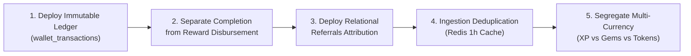

# VELOOP REWARDS — EXECUTIVE SUMMARY
## Product Analytics, Data Readiness & Data Management Blueprint
**Deliverable ID:** Deliverable 01  
**Project Task:** Data Analyst Internship — Task 01  
**Author:** Data Analyst Intern  
**Organization:** VELOOP Rewards  
**Date:** 2026-11-11  
**Target Audience:** Chief Executive Officer (CEO), Product Leadership, Head of Engineering  
**Integrity Label:** `SIMULATED DATA — CREATED FOR ANALYTICAL TESTING`  
**Classification:** Confirmed, Proposed, To Be Verified, Simulated  

---

## 1. Context & What Was Investigated

VELOOP Rewards is an early-stage digital rewards and user engagement ecosystem in active product development. Because the platform currently lacks live production telemetry volume, conventional product performance analysis is impossible without first establishing the structural foundations of data collection, schema normalization, and reporting reliability.

Over a structured 25-day internship cycle, an exhaustive, independent technical audit was conducted across the entire VELOOP ecosystem. The investigation encompassed:
1. **Product Area Mapping:** Comprehensive scoping across **18 functional product domains** and **32 granular features** (Registration, Login, Watch Ads, Daily Rewards, Tap & Earn, Mining, Spin the Wheel, Missions, Referrals, Wallet, Withdrawals, Help Center, Badges, Levels, XP, Gems, Tokens, and Streaks).
2. **Dataset Profiling:** Rigorous programmatic profiling of **67,868 records across 9 sheets** in the supplied simulated workbooks (`VELoop_Rewards_Data_01.xlsx` and `VELOOP_Simulated_User_Behavior_1000.xlsx`).
3. **Data Quality Audit:** In-depth anomaly detection across 12 issue categories in injected messy audit datasets (`Users_Messy_Audit` and `10_Event_Data_Quality_Audit`).
4. **Relational & Financial Architecture:** Design of an immutable double-entry wallet transaction model, a 5-stage withdrawal lifecycle, and a 4-stage referral attribution tree.
5. **Business Intelligence Delivery:** Development of a functional, interactive 7-section Streamlit analytics dashboard supporting real-time decision-making.

---

## 2. Key Discoveries & Empirical Findings

### 2.1 Behavioral Telemetry is Strong but Incomplete
The supplied behavioral dataset contains rich interaction telemetry covering 15 product features, logging **35,704 events** across **1,000 simulated users** and **7,913 contiguous sessions**. 
* The gaming and earning mechanics exhibit realistic distribution patterns: `Watch Ads` (3,126 events), `Missions` (2,780 events), `Streak Rewards` (2,734 events), `Tap & Earn` (2,654 events), and `Mining Rewards` (2,616 events) represent the highest volume user actions.
* Referential integrity across clean sheets is pristine: 100% of foreign keys in `02_Sessions`, `03_Feature_Events`, `04_Daily_Activity`, `05_Task_Activity`, and `06_Milestones` successfully resolve to valid parent `user_id` records in `Users_1000_Clean` with **zero orphan records**.

### 2.2 Critical Financial & Conversion Deficits Identified
Despite strong clickstream tracking, the platform currently exhibits major structural blind spots:
1. **Absence of Standalone Withdrawals Ledger:** Zero withdrawal transactions or fulfillment events exist in the streaming telemetry, making it impossible to audit payout processing latency, gateway rejection rates, or cash disbursement volume.
2. **Missing Double-Entry Wallet Model:** User balances are currently collapsed into a single static `xp_balance` column in the user profile. There is no immutable transaction ledger recording historical credits, debits, adjustments, or clawbacks.
3. **Missing Relational Referral Attribution:** Outbound referral shares are logged (`referral_shared: 834`), but the database lacks a relational table mapping referred users back to their referring user. As a result, viral growth coefficients ($K\text{-factor}$) and referral commission payouts cannot be calculated.
4. **Conflation of Task Completion and Reward Credit:** Task activity completion signals (client-side) are currently combined with financial reward credits, creating ambiguity when partner offerwall SDKs fail to deliver postbacks.

### 2.3 Data Quality Contamination in Unfiltered Streams
Auditing the messy audit sheets revealed that unvalidated data ingestion severely corrupts reporting:
* `Users_Messy_Audit` contained **8 duplicate primary keys**, **542 missing values**, malformed date strings, and negative ages.
* `10_Event_Data_Quality_Audit` contained **10 duplicate event IDs**, unstandardized lowercase casing across **4,210 records**, and null session sequence numbers.
* *Remediation Accomplished:* Automated reproducible cleaning scripts were deployed, successfully restoring clean baselines of exactly 1,000 unique users and 35,704 unique events into `02_processed_data/`.

---

## 3. What is Currently Unknown (To Be Verified)

To maintain absolute data authenticity and prevent converting assumptions into facts, the following technical unknowns are registered for executive and engineering sign-off:
* **Unknown 1 [Commercial Conversion Ratios]:** The exact exchange valuation between experience points (`XP`), premium currency (`Gems`), platform `Tokens`, and fiat currency (INR/USD) is unconfirmed.
* **Unknown 2 [Withdrawal Rules & Fees]:** The official minimum withdrawal threshold (e.g. 100 INR vs 250 INR) and transaction processing fee policies are unverified.
* **Unknown 3 [Third-Party Ad eCPM Yield]:** Commercial revenue share contracts with external ad partners (Google AdMob, Unity, AppLovin) are pending business confirmation.
* **Unknown 4 [Production DB Hosting]:** The final production database clustering and cloud hosting environment (standardized in this blueprint on PostgreSQL 15+).

---

## 4. Strategic Recommendations: What VELOOP Should Implement

VELOOP should immediately execute the following five architectural recommendations:

1. **Deploy Immutable Double-Entry Ledger (`wallet_transactions`):** Adopt the PostgreSQL schema provided in Deliverable 10 (`schema.sql`). Balances must never be directly updated via SQL `UPDATE`; balances must represent the materialized sum of immutable ledger entries.
2. **Decouple Task Execution from Financial Disbursement:** Enforce the 5-stage lifecycle (**Discovery $\rightarrow$ Start $\rightarrow$ Completion $\rightarrow$ Validation $\rightarrow$ Reward**). Third-party SDK signals must pass server-to-server (S2S) signature verification before wallet credits are committed.
3. **Implement Relational Referral Table (`referrals`):** Enforce the 4-stage referral progression (**Referral Created $\rightarrow$ User Registered $\rightarrow$ User Activated $\rightarrow$ Referral Converted**). Require referees to achieve an activation threshold (e.g. 50 XP) before paying referrer bonuses.
4. **Deploy Real-Time Ingestion Deduplication:** Implement an in-memory Redis cache with a 1-hour sliding TTL at the API Gateway to catch and drop duplicate events resulting from mobile client network retries.
5. **Segregate Platform Currencies:** Separate user balances into three discrete ledgers: `XP` (non-monetary experience), `Gems` (premium hard currency sink), and `Tokens` (cash-redeemable asset).

---

## 5. Major Product & Operational Risks

| Risk Category | Risk Description | Business & Financial Impact | Recommended Mitigation |
| :--- | :--- | :--- | :--- |
| **Financial Leakage** | Lack of transaction idempotency during cash withdrawal processing. | Duplicate payouts disbursed via payment gateway; permanent unrecoverable cash loss. | Enforce unique constraint on `(user_id, withdrawal_id)` and gateway idempotency keys. |
| **Referral Abuse** | Scripted bot farms registering self-referrals via emulators. | Depletion of customer acquisition budget without acquiring genuine active users. | Restrict referral bonus payouts until referee completes email verification and 3 tasks. |
| **Balance Drift** | Direct database updates without audit logging. | Untraceable currency inflation; inability to reconcile platform liabilities against bank float. | Enforce `ON DELETE RESTRICT` on wallet tables and daily automated balance assertions. |
| **Regulatory Breach** | Storing plaintext email, full names, and payment VPAs in reporting tables. | Non-compliance with DPDP and GDPR data privacy regulations; legal liability. | Implement SHA-256 one-way hashing and role-based access control (RBAC) tiers. |
| **Bot Autoclickers** | Mechanical scripts exploiting the Tap & Earn arena. | Point balance manipulation and player economy degradation. | Require `tap_count` and `taps_per_second` telemetry; flag cadences $> 12\text{ taps/sec}$. |

---

## 6. Implementation Priorities (The Critical Path)

The prioritized implementation backlog is structured into two distinct delivery horizons:

### Phase 1: Pre-Launch Production Blockers (Weeks 1–3)
1. **Critical:** Deploy PostgreSQL normalized relational schema (`schema.sql`) for `users`, `wallet_transactions`, `withdrawals`, and `referrals`.
2. **Critical:** Implement server-side UUIDv4/UUIDv7 generation for `event_id` and sequential transaction keys.
3. **High:** Instrument client mobile SDK to emit the 32 standardized production events defined in the Event Tracking Plan.
4. **High:** Deploy Ingestion Gateway Redis deduplication buffer (1-hour sliding window).
5. **High:** Implement PII masking (SHA-256 email hashing) in analytical reporting views.

### Phase 2: Post-Launch Growth & Optimization (Weeks 4–8)
1. **Medium:** Schedule automated hourly dbt Core transformation models to materialize star-schema fact tables and daily KPI rollups.
2. **Medium:** Connect the functional Streamlit analytics dashboard (`05_dashboard/app.py`) to the production analytical read-replica.
3. **Medium:** Instrument customer support interaction telemetry (`help_search_executed`, `ticket_submitted`).
4. **Low:** Develop machine-learning predictive churn models based on 30-day user activity patterns.

---

## 7. Conclusion

By shifting from ad-hoc metrics to a structured, reliable, and reusable analytical foundation, VELOOP Rewards establishes the data rigor necessary to safeguard capital, eliminate fraud, and optimize long-term user retention upon public launch.

