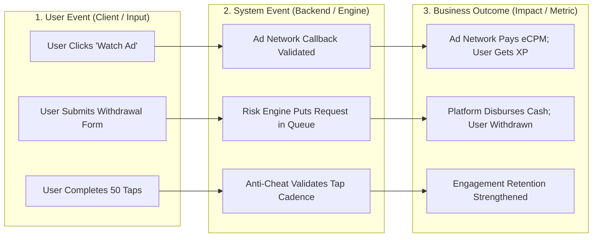

# VELOOP REWARDS — PRODUCT DATA READINESS AUDIT
**Deliverable ID:** Deliverable 02  
**Work Package:** Work Package A — Product Data Readiness Audit  
**Author:** Data Analyst Intern  
**Organization:** VELOOP Rewards  
**Date:** 2026-11-11  
**Integrity Policy:** `SIMULATED DATA — CREATED FOR ANALYTICAL TESTING`  
**Classification:** Confirmed, Proposed, To Be Verified, Simulated  

---

## 1. Executive Summary & Audit Context

VELOOP Rewards is an early-stage digital rewards ecosystem in active development. Prior to public launch, the data architecture, measurement specifications, event telemetry, and reporting pipelines must be thoroughly designed and audited.

This **Product Data Readiness Audit** establishes a comprehensive baseline of data instrumentation across the platform. It audits **18 core functional domains** and **32 granular features**, mapping user interactions to system events and business outcomes. 

### Key Audit Findings:
1. **Core Behavioral Telemetry is Solid:** The supplied simulated dataset contains rich event streaming for 15 product features (`Watch Ads`, `Missions`, `Streak Rewards`, `CAPTCHA`, `Tap & Earn`, `Mining Rewards`, `Referral`, `Daily Reward`, `Level System`, `Spin the Wheel`, `Wallet`, `Leaderboard`, `Badges`, `Exchange Center`, `Follow & Earn`) totaling 35,704 events across 1,000 simulated users and 7,913 sessions.
2. **Critical Financial & Conversion Gaps Exist:** While features like `Wallet` and `Referrals` have impression/view telemetry, there are **no transaction-level ledgers** for currency balances, withdrawals, or referee-to-referrer conversion attribution.
3. **Multi-Currency Mechanics Lack Segmentation:** The data model currently collapses user earnings into an aggregate `xp_balance`, lacking discrete transactional ledgers for experience points (`XP`), premium currency (`Gems`), and redeemable platform tokens (`Tokens`).
4. **15 Strategic Gaps Identified:** 4 Critical, 6 High, and 5 Medium severity analytics gaps have been identified and mapped with concrete engineering remediations.

---

## 2. Event Triad Framework: User Events, System Events & Business Outcomes

To prevent analytical ambiguity, all telemetry points in VELOOP Rewards are structured into three distinct layers:

1. **User Event (Client-Side Action):** An atomic action initiated directly by the end-user (e.g., tap, button click, navigation, form submission). Captures intent.
2. **System Event (Server-Side Execution):** An automated process, validation rule, 3rd-party callback, or database state mutation executed by backend services. Captures truth.
3. **Business Outcome (Economic / Strategic Impact):** The commercial, financial, or retention consequence of the interaction (e.g., ad revenue recognized, points liability accrued, payout completed, user retained). Captures value.

---

## 3. Product Mapping Table Across All 18 Product Domains

The table below provides the full audit mapping across all 18 mandated product areas and 32 granular features:

| # | Product Area | Feature / Component | User Action [User Event] | System Outcome [System Event] | Data Required (Payload) | Business Question Supported | Supplied Coverage | Evidentiary Tier | Readiness Status |
| :-: | :--- | :--- | :--- | :--- | :--- | :--- | :--- | :--- | :--- |
| **01** | **Registration** | Account Sign-Up | Submits email / social sign-in | Creates user record; sets verification pending | `user_id`, `email`, `auth_provider`, `timestamp`, `device_id` | What acquisition channel yields highest sign-up conversion? | Static profile in `Users` | [Simulated] | **Partial** |
| **01** | **Registration** | Email Verification | Clicks verification link / OTP | Updates `email_verification_status` to Verified | `user_id`, `verification_ts`, `latency_sec` | What % of users verify email within 24 hours? | Static flag in `Users` | [Simulated] | **Partial** |
| **02** | **Login** | User Authentication | Enters credentials or OAuth token | Validates session, issues JWT, logs session start | `user_id`, `session_id`, `login_ts`, `ip_hash`, `platform` | What is platform DAU, WAU, and MAU? | Logged in `02_Sessions` | [Simulated] | **Ready** |
| **02** | **Login** | Session Termination | Logs out or session times out | Closes session, calculates active duration | `session_id`, `session_end`, `duration_seconds` | What is average session duration and bounce rate? | Logged in `02_Sessions` | [Simulated] | **Ready** |
| **03** | **Watch Ads** | Ad Impression / Start | Clicks 'Watch Rewarded Ad' | Calls Ad SDK, initializes video buffer | `event_id`, `user_id`, `ad_network_id`, `ad_unit_id` | What is ad engagement frequency per DAU? | In `03_Feature_Events` | [Simulated] | **Ready** |
| **03** | **Watch Ads** | Ad Completion | Watches full rewarded video | Verifies SDK callback, credits reward balance | `event_id`, `user_id`, `completion_flag`, `xp_awarded` | What is video completion rate and revenue eCPM? | In `03_Feature_Events` | [Simulated] | **Ready** |
| **03** | **Watch Ads** | Ad Skipped / Closed | Exits video before completion mark | Discards reward, logs drop-off point | `event_id`, `user_id`, `elapsed_seconds`, `skip_reason` | At what second do users drop off from ads? | In `03_Feature_Events` | [Simulated] | **Ready** |
| **04** | **Daily Rewards**| Reward Calendar View | Opens daily check-in screen | Displays 7-day reward calendar & current day | `user_id`, `streak_day_number`, `reward_preview` | What % of active users inspect daily check-in? | In `03_Feature_Events` | [Simulated] | **Ready** |
| **04** | **Daily Rewards**| Daily Claim | Clicks 'Claim Reward' | Validates 24h eligibility, credits points, updates streak | `user_id`, `claim_datetime`, `streak_day`, `reward_amount` | Does daily check-in improve D7 retention? | In `03_Feature_Events` | [Simulated] | **Ready** |
| **05** | **Tap & Earn** | Tap Session Start | Opens tap arena, taps energy button | Initializes tap session, validates energy meter | `user_id`, `session_id`, `initial_energy` | What is daily adoption of tap mechanics? | In `03_Feature_Events` | [Simulated] | **Ready** |
| **05** | **Tap & Earn** | Tap Batch Submission | Submits accumulated taps upon exit | Server validates rate, guards against autoclicker, credits points | `user_id`, `tap_count`, `duration_sec`, `reward_points` | What proportion of tap activity indicates bot patterns? | Missing tap volume payload | [Simulated] | **Partial** |
| **06** | **Mining** | Rig Activation | Clicks 'Start Mining Rig' | Starts background timer (8-hour cycle) | `user_id`, `mining_start_ts`, `rig_tier`, `rate_per_hr` | How many users maintain active mining sessions? | In `03_Feature_Events` | [Simulated] | **Ready** |
| **06** | **Mining** | Yield Claim & Stop | Claims mined yield at cycle end | Credits tokens to wallet, resets mining rig | `user_id`, `stop_ts`, `yield_tokens`, `cycle_hours` | What is total token inflation via passive mining? | In `03_Feature_Events` | [Simulated] | **Ready** |
| **07** | **Spin** | Wheel Opened | Navigates to lucky wheel interface | Checks available tickets / free daily spin | `user_id`, `available_spins`, `last_spin_ts` | How frequently do users visit the lucky wheel? | In `03_Feature_Events` | [Simulated] | **Ready** |
| **07** | **Spin** | Wheel Execution | Clicks 'Spin Wheel' | Server generates RNG outcome, awards prize | `user_id`, `prize_type`, `prize_val`, `rng_seed_hash` | Is RNG prize distribution adhering to configured odds? | Missing prize payload | [Simulated] | **Partial** |
| **08** | **Missions** | Mission Browse | Browses active daily/weekly missions | Fetches user progress against mission goals | `user_id`, `active_missions`, `category` | Which mission categories attract most users? | In `03_Feature_Events` | [Simulated] | **Ready** |
| **08** | **Missions** | Mission Completion | Completes final mission objective | Verifies completion criteria, awards mission bonus | `user_id`, `mission_id`, `duration_min`, `reward_xp` | What is mission completion funnel drop-off? | In `03_Feature_Events` | [Simulated] | **Ready** |
| **09** | **Referrals** | Code Generation & Share | Clicks share referral code | Generates invite URL, tracks social channel intent | `user_id`, `referral_code`, `channel` (WhatsApp/Telegram) | Which social channel generates highest shares? | In `03_Feature_Events` | [Simulated] | **Ready** |
| **09** | **Referrals** | Conversion & Attribution | New user registers with referral code | Links referee to referrer, credits referral reward | `referral_id`, `referrer_id`, `referee_id`, `activation_ts` | What is viral coefficient (K-factor) and conversion rate? | Missing relational link | [To Be Verified] | **Critical Gap** |
| **10** | **Wallet** | Balance Inspection | Opens wallet tab | Queries current XP, Gem, and Cash balances | `user_id`, `xp_balance`, `cash_balance`, `timestamp` | How frequently do users check wallet balances? | In `03_Feature_Events` | [Simulated] | **Ready** |
| **10** | **Wallet** | Ledger Transaction | Credits/debits user balance | Generates double-entry financial ledger record | `transaction_id`, `user_id`, `amount`, `unit`, `ref_id` | What is daily net platform currency velocity? | Missing standalone ledger | [To Be Verified] | **Critical Gap** |
| **11** | **Withdrawals** | Request Submission | Selects method (UPI/PayPal) & amount | Validates balance threshold, freezes funds, enqueues payout | `withdrawal_id`, `user_id`, `amount`, `method`, `destination` | What is total requested withdrawal volume? | Missing standalone ledger | [To Be Verified] | **Critical Gap** |
| **11** | **Withdrawals** | Payout Processing | Finance dispatches payout via gateway | Updates status to Completed/Rejected, logs payment ID | `withdrawal_id`, `payout_tx_id`, `processing_latency_hr` | What is withdrawal fulfillment success rate & latency? | Missing standalone ledger | [To Be Verified] | **Critical Gap** |
| **12** | **Help Center** | FAQ & Ticket Browse | Searches help center or opens FAQ | Logs query term, article viewed, resolution flag | `user_id`, `article_id`, `search_query`, `ticket_id` | What are top user friction points causing churn? | Only session entry point | [Proposed] | **Gap** |
| **13** | **Badges** | Achievement Browse | Opens trophy / badge showcase | Displays unlocked vs locked badge milestones | `user_id`, `badges_unlocked_count`, `timestamp` | Do achievement badges increase user LTV? | In `03_Feature_Events` | [Simulated] | **Ready** |
| **13** | **Badges** | Badge Earned | Completes achievement criteria | Awards badge, adds bonus XP, displays in-app toast | `user_id`, `badge_id`, `badge_tier`, `bonus_xp` | What is the velocity of badge acquisition? | In `03_Feature_Events` & `06_Milestones` | [Simulated] | **Ready** |
| **14** | **Levels** | Progress Check | Views level badge & XP progress bar | Computes distance to next level threshold | `user_id`, `current_level`, `current_xp`, `target_xp` | What is user distribution across level tiers? | In `03_Feature_Events` | [Simulated] | **Ready** |
| **14** | **Levels** | Level-Up Milestone | Crosses level XP threshold | Increments level number, unlocks features, grants gift | `user_id`, `old_level`, `new_level`, `level_up_ts` | What is median time-to-level across user cohorts? | In `03_Feature_Events` | [Simulated] | **Ready** |
| **15** | **XP** | Experience Accrual | Earns points from tasks / games | Updates internal XP accumulator | `user_id`, `source_event_id`, `xp_amount`, `new_balance` | Which feature is primary contributor to XP economy? | Flagged in events; static total | [Simulated] | **Partial** |
| **16** | **Gems** | Premium Currency Spend | Spends gems on wheel tickets or perks | Decrements gem balance, unlocks premium benefit | `user_id`, `gem_amount`, `item_type`, `remaining_gems` | What is gem sink velocity and monetization burn rate? | Missing gem telemetry | [Proposed] | **Critical Gap** |
| **17** | **Tokens** | Token Minting & Payout | Earns platform tokens via high-tier tasks | Logs blockchain/internal token transaction | `user_id`, `token_amount`, `contract_hash`, `timestamp` | What is circulating platform token supply? | Missing token telemetry | [Proposed] | **Critical Gap** |
| **18** | **Streaks** | Streak Milestone View | Views streak status & consecutive days | Renders current streak counter & multiplier | `user_id`, `consecutive_days`, `streak_multiplier` | What streak length is the tipping point for retention? | In `03_Feature_Events` | [Simulated] | **Ready** |
| **18** | **Streaks** | Streak Broken / Reset | Fails to log in within 24–36 hour grace | Resets streak count to zero, logs break event | `user_id`, `broken_streak_length`, `reset_timestamp` | What % of users churn within 7 days of broken streak? | In `03_Feature_Events` | [Simulated] | **Ready** |

---

## 4. Analysis of Top 15 Analytics Gaps

A rigorous gap analysis was conducted comparing production requirements against the supplied data files:

### Gap 1 [Critical]: Absence of Standalone Withdrawals Transaction Ledger
* **Current State:** Zero withdrawal events exist in `03_Feature_Events`; no withdrawals table is provided in the workbooks.
* **Impact:** VELOOP cannot calculate withdrawal request volume, fulfillment latency, rejection rates, or payout method distribution (UPI vs PayPal).
* **Remediation:** Implement a dedicated `withdrawals` entity with states `Requested`, `Under_Review`, `Approved`, `Processing`, `Completed`, `Rejected`, `Reversed`.

### Gap 2 [Critical]: Absence of Double-Entry Wallet Transaction Model
* **Current State:** The Users sheet contains only a static `xp_balance`; no transaction ledger exists (~3,500 expected).
* **Impact:** Inability to audit financial liabilities, reconcile point balances, detect currency inflation, or trace fraudulent transactions.
* **Remediation:** Deploy immutable `wallet_transactions` ledger with credit/debit entries, reference IDs, and reversal tracking.

### Gap 3 [Critical]: Missing Relational Referrer-to-Referee Attribution Tree
* **Current State:** Referral sharing events exist, and Users table records static acquisition source text (e.g. `WhatsApp`), but no foreign key links referring users to referred users.
* **Impact:** Viral coefficient (K-factor), referral conversion velocity, and multi-tier commission payouts cannot be calculated.
* **Remediation:** Implement `referrals` entity with `referring_user_id`, `referred_user_id`, `registration_datetime`, and `activation_datetime`.

### Gap 4 [Critical]: Multi-Currency Ambiguity (XP vs Gems vs Tokens)
* **Current State:** The platform features mention XP, Gems, and Tokens, but all earnings are flattened into a single `xp_balance`.
* **Impact:** Disables economic modeling, premium currency burn rates, and tokenomics sustainability analysis.
* **Remediation:** Split balance ledger into three discrete currency units: `XP` (reputation), `GEMS` (hard currency), `TOKENS` (redeemable asset).

### Gap 5 [High]: Separation of Task Completion from Reward Disbursement
* **Current State:** `05_Task_Activity` combines task status and reward status in a single record, but lacks a dedicated disbursement ledger.
* **Impact:** Ambiguity between task validation by third-party ad/offerwall networks and internal financial reward credit.
* **Remediation:** Maintain separate lifecycles: Task Activity (Client/SDK) vs Reward Ledger (Backend Disbursement).

### Gap 6 [High]: Missing Granular Telemetry for Registration and Login
* **Current State:** Registration and last login are static columns in `Users_1000_Clean`; no events exist in the streaming event log.
* **Impact:** Inability to measure login failure rates, multi-device usage patterns, or onboarding funnel drop-offs.
* **Remediation:** Instrument `user_registered`, `user_logged_in`, `onboarding_started`, and `onboarding_step_completed`.

### Gap 7 [High]: Missing Prize and Outcome Payload in Spin-the-Wheel Events
* **Current State:** Spin events record start and completion, but lack properties for prize type, prize value, and RNG seed.
* **Impact:** Impossible to audit whether random number generation adheres to configured probability distributions.
* **Remediation:** Add `prize_type`, `prize_value`, and `rng_hash` attributes to the `spin_completed` event payload.

### Gap 8 [High]: Missing Anti-Cheat Payload in Tap & Earn Telemetry
* **Current State:** Tap events log start and complete, but omit tap count, duration, and tap frequency.
* **Impact:** Inability to detect autoclickers, bot farms, and mechanical abuse of the tap arena.
* **Remediation:** Require client payload: `tap_count`, `duration_seconds`, `taps_per_second`, and `client_hash`.

### Gap 9 [High]: Ad Network Partner and eCPM Attribution Blind Spot
* **Current State:** Ad events capture start, complete, and skip, but omit ad partner ID (AdMob, Unity, AppLovin) and eCPM.
* **Impact:** Inability to evaluate ad network yield, network fill rates, or partner-specific fraud.
* **Remediation:** Enrich ad telemetry with `ad_network_name`, `ad_unit_type`, `placement_id`, and `estimated_ecpm`.

### Gap 10 [High]: Plaintext PII in Analytical Storage Layer
* **Current State:** Full names and plaintext email addresses are present directly in analytical data tables.
* **Impact:** Security and privacy compliance violation (DPDP/GDPR); unneeded exposure to analytical staff.
* **Remediation:** Pseudo-anonymize email and full name via cryptographic hashing in analytical data marts.

### Gap 11 [Medium]: Customer Support & Help Center Telemetry Deficit
* **Current State:** Help Center appears solely as a session entry point; zero search or ticket events exist.
* **Impact:** Blind spot regarding user UX friction, bug prevalence, and withdrawal dispute volume.
* **Remediation:** Instrument `help_search_executed`, `faq_article_viewed`, and `ticket_submitted`.

### Gap 12 [Medium]: Lack of Step-Level Progression Telemetry in Missions
* **Current State:** Missions only capture start, complete, and abandon; no intermediate step telemetry.
* **Impact:** Analytics cannot pinpoint which specific step inside a multi-tier mission causes user drop-off.
* **Remediation:** Instrument `mission_step_completed` with `step_number` and `step_description`.

### Gap 13 [Medium]: Incomplete Mobile Session Interruption Modeling
* **Current State:** Sessions are modeled only with start and end times; background/foreground transitions are absent.
* **Impact:** Incoming phone calls or app switching artificially record session terminations.
* **Remediation:** Instrument mobile lifecycle events: `app_backgrounded` and `app_foregrounded`.

### Gap 14 [Medium]: Dirty Data Injections in Raw Event Stream
* **Current State:** `10_Event_Data_Quality_Audit` contains duplicate event IDs, lowercase feature names, and unverified devices.
* **Impact:** Queries executed directly on raw tables will yield inflated event counts and broken group-bys.
* **Remediation:** Deploy automated ELT data cleaning and validation gates before materializing analytical tables.

### Gap 15 [Medium]: Discrepancy Between Event Counts and Feature Usage Rollups
* **Current State:** Minor variances exist between raw event aggregates and pre-aggregated feature usage sheets.
* **Impact:** Cross-table KPI inconsistencies in executive reporting.
* **Remediation:** Establish single-source-of-truth automated dbt or SQL rollup transformations.

---

## 5. Audit Deliverable Artifact References

This audit is formally supported by the following project artifacts:
1. **Deliverable 03 (Excel):** `04_deliverables/deliverable_03_data_coverage_matrix/Data_Coverage_Matrix.xlsx` (Contains both the 32-Feature Coverage Matrix and the 15-Gap Register with professional formatting and conditional styling).
2. **Deliverable 19 (Excel):** `04_deliverables/deliverable_19_assumption_and_verification_register/Source_and_Verification_Register.xlsx` (Living register tracking all assumptions, risks, and missing inputs).
3. **Master Checklist:** `REQUIREMENTS_AND_DELIVERABLES_TRACKER.md` (Mapping all 19 Work Packages and 21 Deliverables).

