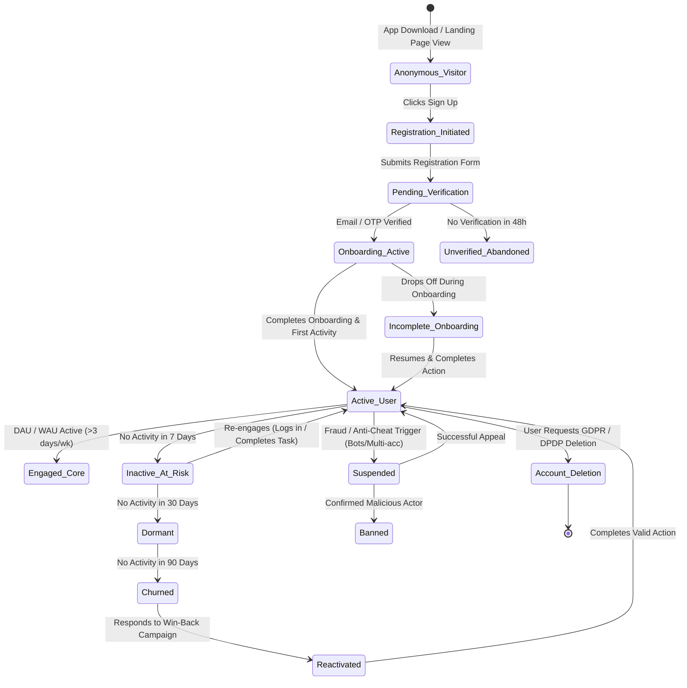

# VELOOP REWARDS — USER AND ACCOUNT ANALYTICS SPECIFICATION
**Deliverable ID:** Deliverable 04  
**Work Package:** Work Package B — User and Account Analytics  
**Author:** Data Analyst Intern  
**Organization:** VELOOP Rewards  
**Date:** 2026-11-11  
**Integrity Label:** `SIMULATED DATA — CREATED FOR ANALYTICAL TESTING`  
**Classification:** Confirmed, Proposed, To Be Verified, Simulated  

---

## 1. Executive Summary & Purpose

User and Account Analytics constitutes the core foundation of product intelligence at VELOOP Rewards. Because digital reward platforms encounter high registration fraud, multi-accounting, botting, and early churn, a rigorous user identity and lifecycle tracking architecture is essential.

This specification establishes:
1. An end-to-end user lifecycle state machine from initial impression to churn/reactivation.
2. Formal engineering definitions for primary system identifiers (`user_id`, `event_id`, `session_id`, `transaction_id`).
3. An enterprise User Analytics Data Specification table detailing validation, source, and analytical purposes.
4. Privacy, data minimization, and PII protection rules designed to prevent unnecessary data exposure in analytical warehouses.

---

## 2. End-to-End User Lifecycle Model

The user lifecycle at VELOOP Rewards is modeled as a deterministic state machine with explicit entry criteria, state transition triggers, and exit conditions.

### 2.1 Lifecycle State Definitions

| State Name | Definition | Qualifying Criteria | System Outcome | Evidentiary Tier |
| :--- | :--- | :--- | :--- | :--- |
| **Anonymous Visitor** | User has launched app/web but has not signed up. | Client device fingerprint logged; no `user_id` assigned. | Assigns temporary `device_id`. | [Proposed] |
| **Registration Initiated** | User begins sign-up form. | Form field interaction detected (`user_registration_started`). | Initial session tracked. | [Proposed] |
| **Pending Verification** | Credentials submitted; awaiting email/OTP confirmation. | User record created with status `Pending`; verification email sent. | Restricts reward payouts. | [Confirmed] |
| **Onboarding Active** | Email verified; user navigating initial app walkthrough. | Status `Onboarding`; step 1 of walkthrough loaded. | Unlocks new-user daily bonus. | [Confirmed] |
| **Active User (Standard)** | User is verified, has completed onboarding, and completed at least 1 action. | Completed task, spin, ad, or check-in within last 7 days. | Full platform feature access. | [Confirmed] |
| **Engaged Core User** | Highly committed user with strong recurring behavior. | Active $\ge 3$ distinct days in a 7-day rolling window. | Eligible for streak multipliers. | [Proposed] |
| **Inactive (At-Risk)** | Previously active user with zero activity in 7 to 29 days. | `days_since_last_activity` between 7 and 29. | Triggers re-engagement push. | [Confirmed] |
| **Dormant** | Inactive user for 30 to 89 consecutive days. | `days_since_last_activity` between 30 and 89. | Excluded from DAU/WAU; held in MAU. | [Confirmed] |
| **Churned** | Inactive user with no activity for $\ge 90$ consecutive days. | `days_since_last_activity` $\ge 90$. | Marked churned; counted in cumulative attrition. | [Proposed] |
| **Reactivated** | Dormant or churned user who logs in and completes an action. | Prior status `Dormant`/`Churned`; logs in and claims/earns points. | Re-enters active user pool. | [Proposed] |
| **Suspended** | Account frozen due to suspected terms-of-service violation. | Anti-cheat flag, autoclicker detection, or multiple accounts. | Balance locked; withdrawals disabled. | [Confirmed] |
| **Banned** | Permanently terminated account following fraud confirmation. | Manual review or verified bot farm fingerprint. | Account permanently disabled. | [Proposed] |
| **Account Deletion** | User requested erasure under privacy regulations. | Data deletion request submitted and verified. | PII purged; analytical record anonymized. | [Proposed] |

---

## 3. Core Enterprise Identifiers Specification

To guarantee relational integrity, cross-domain attribution, and prevent duplicate financial credits, VELOOP establishes four standard immutable identifier formats:

### 3.1 `user_id` (User Identifier)
* **Definition:** Globally unique, immutable alphanumeric identifier assigned to a user upon initial account creation.
* **Format Specification:** `VLUSR` prefix followed by 6 zero-padded numeric digits (e.g., `VLUSR000001` to `VLUSR999999`).
* **Generation Engine:** Server-side transactional sequence generator in authentication microservice. Never generated client-side.
* **Scope & Uniqueness:** Global across all platforms (Android, iOS, Web). Unique index enforced at PostgreSQL database level.
* **Immutability:** Completely immutable. Never re-issued or recycled upon account deletion.

### 3.2 `event_id` (Event Identifier)
* **Definition:** Globally unique identifier for every atomic telemetry event emitted by client applications or internal backend workers.
* **Format Specification:** `EVT` prefix followed by 8 zero-padded numeric digits (e.g., `EVT00000001` to `EVT99999999`) or UUIDv4 in distributed streaming pipelines.
* **Generation Engine:** Distributed UUID generator (UUIDv7 preferred in production for time-ordered B-tree indexing) or sequential streaming broker partition offset.
* **Scope & Deduplication:** Primary key for all analytical event logs. Enables event stream deduplication (idempotent ingestion).

### 3.3 `session_id` (Session Identifier)
* **Definition:** Contextual identifier binding a contiguous period of user interactions within the application.
* **Format Specification:** `SESS` prefix followed by 7 zero-padded numeric digits (e.g., `SESS0000001` to `SESS9999999`).
* **Inactivity & Rollover Rules:**
  1. A session expires automatically after **30 minutes of continuous user inactivity** (no client events emitted).
  2. A session terminates upon explicit user logout.
  3. A new session is generated when the user re-enters the app after backgrounding exceeding 30 minutes or from a new device/browser instance.
  4. Midnight UTC rollover: If a session spans across UTC 00:00:00, daily rollups allocate activity proportionally to each date.

### 3.4 `transaction_id` (Financial Transaction Identifier)
* **Definition:** Immutable double-entry ledger identifier recording any mutation to user reward balances (XP, Gems, Tokens, Cash).
* **Format Specification:** `TXN` prefix followed by 8 zero-padded numeric digits (e.g., `TXN00000001` to `TXN99999999`).
* **Financial Integrity Rules:**
  1. Primary key of the `wallet_transactions` ledger.
  2. Enforces strict ACID compliance. Every transaction must specify `user_id`, `currency_unit`, `amount` (signed integer/decimal), `transaction_type`, and `reference_id`.
  3. Transactions are immutable: errors are never overwritten; they are reversed via an offsetting transaction referencing the original `transaction_id`.

---

## 4. User Analytics Data Specification Table

The table below defines the enterprise user schema required for robust user and account analytics:

| Field Name | Data Type | Required | Primary Analytical Purpose | Data Source | Validation & Format Rules | Evidentiary Tier | Status |
| :--- | :--- | :---: | :--- | :--- | :--- | :--- | :--- |
| `user_id` | VARCHAR(16) | Yes | Primary user entity key; joins across all tables | Auth Service DB | `^VLUSR[0-9]{6}$`; Primary Key, Not Null, Unique | [Confirmed] | Available |
| `account_created_at` | TIMESTAMP | Yes | User cohort grouping; age-of-account calculations | Auth Service DB | ISO-8601 UTC; Cannot be future timestamp | [Confirmed] | Available |
| `account_status` | VARCHAR(20) | Yes | Account state filtering; active vs churned segmentation | Auth Service DB | Enum: `Active`, `Inactive`, `Pending`, `Suspended`, `Dormant`, `Banned`, `Deleted` | [Confirmed] | Available |
| `email_verification_status` | VARCHAR(15) | Yes | Trust & fraud filtering; onboarding friction analysis | Auth Service DB | Enum: `Verified`, `Pending`, `Failed` | [Confirmed] | Available |
| `email_verified_at` | TIMESTAMP | No | Verification latency calculation (time from sign-up) | Auth Service DB | Must be $\ge account\_created\_at$; Null if unverified | [Proposed] | Specification |
| `onboarding_status` | VARCHAR(20) | Yes | Measures initial product adoption & funnel completion | Client App / Auth | Enum: `Not_Started`, `In_Progress`, `Completed`, `Skipped` | [Confirmed] | Available |
| `onboarding_completed_at` | TIMESTAMP | No | Onboarding velocity and completion time analysis | Client App / Auth | Must be $\ge account\_created\_at$; Null if incomplete | [Proposed] | Specification |
| `account_created_via` | VARCHAR(30) | Yes | Evaluates registration UX channel performance | Client App / Web | Enum: `Web Registration`, `Android App`, `iOS App`, `Google OAuth` | [Confirmed] | Available |
| `acquisition_source` | VARCHAR(50) | Yes | Attribution modeling; marketing CAC evaluation | Attribution Engine | Enum: `Organic Search`, `Direct`, `WhatsApp`, `YouTube`, `Telegram`, `Instagram`, `Partner` | [Confirmed] | Available |
| `referral_code` | VARCHAR(16) | Yes | User's unique outbound sharing code | Auth Service DB | Alphanumeric; `^VL[0-9]{6}$`; Unique per user | [Confirmed] | Available |
| `referring_user_id` | VARCHAR(16) | No | Direct referral attribution; viral coefficient tracking | Referral Service | Must match valid `user_id` in users table; Null for organic | [Proposed] | Specification |
| `primary_device` | VARCHAR(20) | Yes | Hardware optimization; device-specific QA profiling | Client User-Agent | Enum: `Android`, `iOS`, `Desktop Web`, `Mobile Web` | [Confirmed] | Available |
| `platform` | VARCHAR(20) | Yes | Platform market share; multi-platform user analysis | Client User-Agent | Enum: `Web`, `Mobile App` | [Confirmed] | Available |
| `country` | VARCHAR(50) | Yes | Geographic segmentation and geo-targeting | IP Geo-Lookup | Standard ISO country name (e.g. `India`) | [Confirmed] | Available |
| `state` | VARCHAR(50) | No | Regional localization and state-level engagement | User Profile / IP | Standard state name (e.g. `Odisha`, `Maharashtra`) | [Confirmed] | Available |
| `city` | VARCHAR(50) | No | Urban vs rural adoption analysis | User Profile / IP | Standard city name; Nullable | [Confirmed] | Available |
| `age` | INTEGER | No | Demographic age-bracket profiling | User Self-Report | Integer $\ge 13$ and $\le 100$; Nullable | [Confirmed] | Available |
| `gender` | VARCHAR(25) | No | Demographic gender representation analysis | User Self-Report | Enum: `Male`, `Female`, `Non-binary`, `Prefer not to say` | [Confirmed] | Available |
| `last_login_datetime` | TIMESTAMP | Yes | Immediate recency calculation; DAU/WAU/MAU flagging | Auth Service DB | Must be $\ge account\_created\_at$; UTC timestamp | [Confirmed] | Available |
| `last_activity_datetime` | TIMESTAMP | Yes | True engagement recency (includes passive mining/claim) | Activity Rollup | Must be $\ge last\_login\_datetime$; Updated daily | [Proposed] | Specification |
| `lifetime_sessions` | INTEGER | Yes | Overall user engagement depth and tenure volume | Session Counter | Non-negative integer $\ge 0$; Default 0 | [Confirmed] | Available |
| `active_days` | INTEGER | Yes | Stickiness index ($\text{Active Days} / \text{Days Since Signup}$) | Daily Activity Agg | Non-negative integer $\ge 0$; Cannot exceed days since reg | [Confirmed] | Available |
| `xp_balance` | INTEGER | Yes | Current experience point accumulator | Wallet / Users DB | Non-negative integer $\ge 0$; Default 0 | [Confirmed] | Available |
| `is_active_7d` | VARCHAR(3) | Yes | Pre-computed flag for 7-day trailing active status | Daily ETL Rollup | Enum: `Yes`, `No` | [Confirmed] | Available |
| `is_active_30d` | VARCHAR(3) | Yes | Pre-computed flag for 30-day trailing active status | Daily ETL Rollup | Enum: `Yes`, `No` | [Confirmed] | Available |
| `consent_status` | VARCHAR(15) | Yes | Legal compliance with DPDP & GDPR data privacy laws | Consent Banner | Enum: `Accepted`, `Declined`, `Pending` | [Confirmed] | Available |
| `marketing_opt_in` | VARCHAR(3) | Yes | Segmentation for push notifications and email comms | User Settings | Enum: `Yes`, `No` | [Confirmed] | Available |

---

## 5. Privacy, Data Minimization & PII Protection Guidelines

In accordance with modern privacy frameworks (Digital Personal Data Protection Act - DPDP, GDPR, CCPA):

### 5.1 Prohibited Data Fields (Strictly Excluded)
Analytical data models must **NEVER** collect, ingest, or store the following sensitive attributes:
1. **User Passwords / Passphrases:** Must remain exclusively hashed using Argon2/bcrypt within dedicated authentication databases. Never exposed to analytics.
2. **Payment Card Numbers / CVV / Bank Credentials:** Direct payment credentials must never touch VELOOP servers; only tokenized gateway payment IDs (`payout_batch_id`) may be stored.
3. **National Identity Numbers:** PAN, Aadhaar, SSN, or Passport numbers must not be collected unless strictly mandated for tax compliance in payouts, in which case they reside in an encrypted vault accessible only to finance.
4. **Precise GPS Telemetry:** Continuous latitude/longitude tracking is prohibited. Only coarse IP-derived city/state metadata is permitted for geographic analysis.

### 5.2 Analytical Sanitization & Masking Policy
For analytical queries, dashboards, and intern workflows:
* **Email Anonymization:** Raw email strings (e.g., `sanjay.singh1@gmail.com`) must be transformed into one-way cryptographic SHA-256 hashes (`email_hash`) or masked (`s***h@gmail.com`) in analytical data marts.
* **Full Name Sanitization:** Direct person names are replaced with the unique non-identifiable key `user_id`.
* **RBAC Enforcement:** Analytics access is restricted to read-only sanitized replicas decoupled from production authentication clusters.

