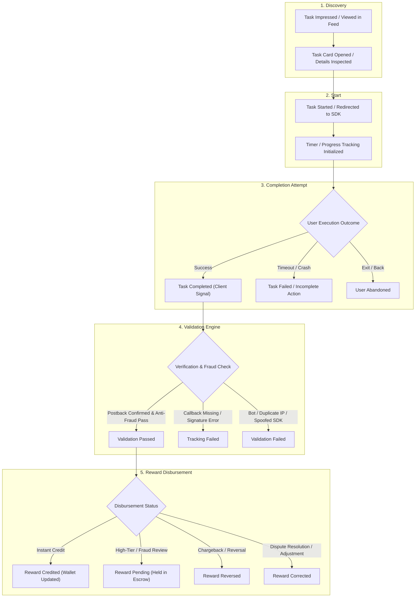
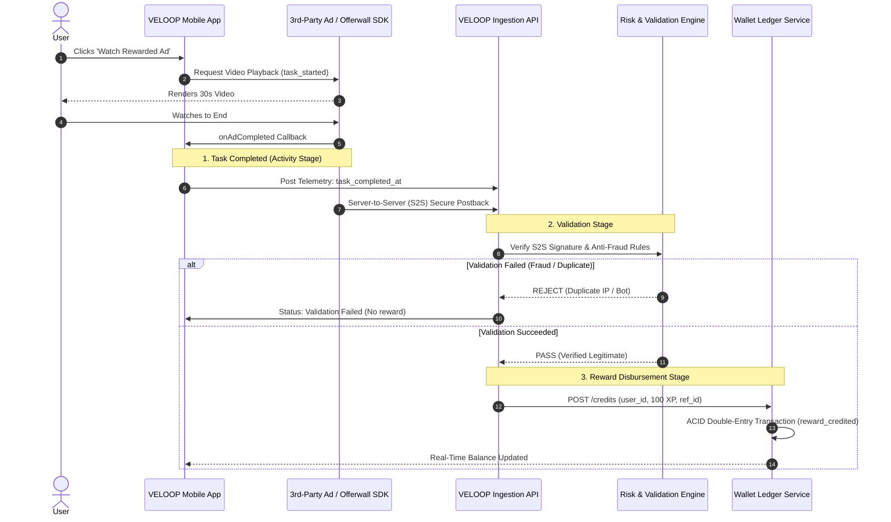
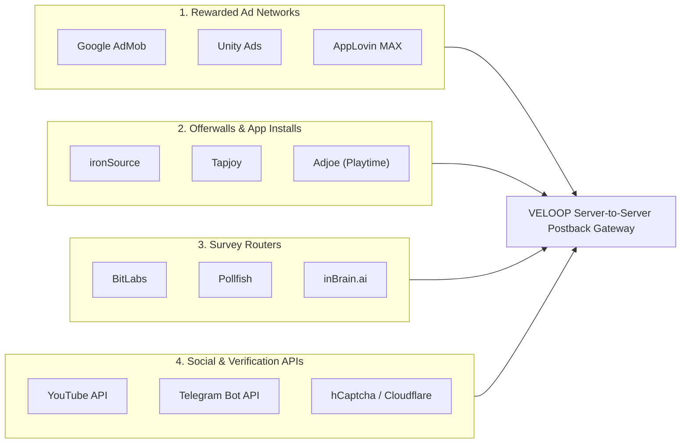

# VELOOP REWARDS — EARNING AND REWARD ANALYTICS SPECIFICATION
**Deliverable ID:** Deliverable 05  
**Work Package:** Work Package C — Earning and Reward Analytics  
**Author:** Data Analyst Intern  
**Organization:** VELOOP Rewards  
**Date:** 2026-11-11  
**Integrity Label:** `SIMULATED DATA — CREATED FOR ANALYTICAL TESTING`  
**Classification:** Confirmed, Proposed, To Be Verified, Simulated  

---

## 1. Executive Summary & Architecture Context

The earning and reward engine is the primary economic driver of VELOOP Rewards. Users engage with rewarded advertisements, sponsor app installs, partner surveys, micro-tasks, and in-game achievements to earn experience points (`XP`), premium currency (`Gems`), or platform tokens (`Tokens`).

In digital reward products, the greatest source of revenue loss, reporting discrepancies, and user churn stems from **conflating task activity completion with financial reward disbursement**. Third-party SDK callbacks frequently fail, offerwall networks report delayed postbacks, and malicious actors manipulate client-side completion signals.

This specification establishes:
1. The formal five-stage earning lifecycle: **Discovery $\rightarrow$ Start $\rightarrow$ Completion $\rightarrow$ Validation $\rightarrow$ Reward**.
2. Comprehensive specifications for all **12 critical task and reward states**, clearly distinguishing client execution from server financial disbursement.
3. Third-party partner dependencies (Ad networks, offerwalls, survey routers).
4. Relational data schemas for `task_catalog`, `task_activity`, and `rewards_disbursement_ledger`.

---

## 2. The 5-Stage Earning & Reward Lifecycle

---

## 3. Comprehensive Documentation of 12 Task & Reward States

Every transaction in the earning pipeline must map to one of the 12 deterministic states documented below:

| State Code | State Name | Phase | Primary Actor | Technical Definition & Trigger Condition | Data Payload Captured | Evidentiary Tier |
| :---: | :--- | :---: | :---: | :--- | :--- | :---: |
| **ST-01** | `Task Viewed` | Discovery | Client App | User scrolls feed; task card rendered within viewport for $\ge 1.0$s. | `task_id`, `user_id`, `position_index`, `feed_category` | [Confirmed] |
| **ST-02** | `Task Opened` | Discovery | Client App | User clicks task card; detailed instructions, requirements, and reward terms modal loaded. | `task_id`, `user_id`, `reward_amount`, `reward_unit` | [Confirmed] |
| **ST-03** | `Task Started` | Start | Client / 3rd Party | User clicks 'Start Task'; app initiates external deeplink, launches survey router, or opens video player. | `activity_id`, `task_id`, `user_id`, `task_started_at`, `device` | [Confirmed] |
| **ST-04** | `Task Completed` | Completion | Client / SDK | User finishes required activity criteria (e.g. ad video reaches 100%, survey final screen submitted). | `activity_id`, `task_completed_at`, `duration_seconds` | [Confirmed] |
| **ST-05** | `Task Failed` | Completion | Client / Partner | Task terminated abnormally due to technical fault, video buffer timeout, or partner app crash. | `activity_id`, `failure_reason` (`Timeout`, `Task unavailable`) | [Confirmed] |
| **ST-06** | `User Abandoned` | Completion | Client App | User intentionally closes task window, navigates back, or backgrounds app before meeting completion mark. | `activity_id`, `elapsed_seconds`, `failure_reason: User exited` | [Confirmed] |
| **ST-07** | `Tracking Failed` | Validation | Backend / Ingestion | Network drop, ad blocker interference, or missing server-to-server postback prevents receipt of verification. | `activity_id`, `error_code`, `partner_name`, `retry_count` | [Proposed] |
| **ST-08** | `Validation Failed` | Validation | Anti-Fraud Engine | Backend fraud heuristics or partner postback identifies duplicate IP, emulator, rooted device, or speedrun bot. | `activity_id`, `fraud_rule_id`, `failure_reason: Validation failed` | [Confirmed] |
| **ST-09** | `Reward Credited` | Disbursement | Wallet Service | Points/currency successfully committed to user's wallet ledger; balance increments immediately. | `reward_id`, `user_id`, `amount`, `unit`, `transaction_id`, `credited_at` | [Confirmed] |
| **ST-10** | `Reward Pending` | Disbursement | Escrow Service | Reward approved but placed in mandatory holding period (e.g., 24–72 hours for high-value partner offers or anti-fraud escrow). | `reward_id`, `escrow_release_scheduled_at`, `hold_reason` | [Confirmed] |
| **ST-11** | `Reward Reversed` | Disbursement | Audit / Finance | Credited reward revoked due to third-party advertiser chargeback, non-attribution clawback, or post-hoc fraud detection. | `reward_id`, `reversal_transaction_id`, `clawback_amount`, `reason` | [Proposed] |
| **ST-12** | `Reward Corrected` | Disbursement | Support / Admin | Manual or automated adjustment crediting missing points following an accepted user support ticket or reconciliation run. | `reward_id`, `ticket_id`, `adjustment_amount`, `authorized_by` | [Proposed] |

---

## 4. Disentangling Activity Completion vs. Reward Credit

A critical architectural principle enforced in this blueprint is that **Task Completion does NOT equal Reward Credit**:

### Key Analytical Distinctions:
* **Metric Independence:** `Task Completion Rate` measures user UX engagement ($\text{Completed Tasks} / \text{Started Tasks}$), whereas `Reward Fulfillment Rate` measures economic delivery ($\text{Rewards Credited} / \text{Tasks Completed}$).
* **Latency Tracking:** The system must record `validation_latency_seconds` (time from completion signal to server validation) and `disbursement_latency_seconds` (time from validation to wallet credit).
* **Escrow Segmentation:** Rewards pending in escrow must never be counted as immediate withdrawable user cash liabilities.

---

## 5. Third-Party Ecosystem & Partner Dependencies

VELOOP Rewards integrates with four distinct categories of external monetization partners:

### Partner Integration & Failure Handling Protocols:

| Partner Category | Integration Type | Verification Mechanism | Primary Failure Modes | Failure Handling Protocol |
| :--- | :--- | :--- | :--- | :--- |
| **Rewarded Ad Networks** (AdMob, Unity, AppLovin) | Client SDK + S2S Postbacks | Cryptographic HMAC-SHA256 signature on callback URL | Video caching timeout; ad fill failure (404); user forced app close | Fallback to secondary ad network watermark waterfall; log failure reason. |
| **Offerwall Networks** (ironSource, Tapjoy) | S2S Server Postback | Unique click ID parameter passing (`subId=user_id`) | Attributed click lost due to iOS ATT / privacy settings; app store download dropped | Provide user support ticket upload with app screenshot; manual review queue. |
| **Survey Routers** (BitLabs, Pollfish) | Webview / IFrame + S2S | Server postback with transaction token & status (complete vs screenout) | User demographic screenout (disqualified); survey abandoned midway | Screenout compensation bonus (credit partial 5 XP for effort); log `Screenout`. |
| **Social & Follow Tasks** (Telegram, YouTube) | OAuth / Webhook API | Channel membership lookup API or delayed verification timer | Rate limiting on Telegram bot API; private social profile settings | 60-second verification buffer; allow user to request manual re-check. |
| **CAPTCHA Systems** (hCaptcha) | Client Challenge + Token | Server verification endpoint (`/siteverify`) | Captcha failed; network connection dropped during challenge solve | Allow up to 3 retry attempts per 15-minute window; block IP on 5th consecutive failure. |

---

## 6. Relational Data Specifications for Earning Entities

To support analytics without data ambiguity, three relational entities are specified:

### 6.1 `task_catalog` (Task Definitions)
* `task_id` (PK, VARCHAR(16)): Unique identifier (e.g. `TASK0001`–`TASK0099`).
* `task_name` (VARCHAR(100)): Human-readable task title.
* `task_category` (VARCHAR(30)): Enum (`Advertisement`, `App Task`, `Survey`, `CAPTCHA`, `Social Activity`, `Game`, `Mission`, `Promotional Task`).
* `provider_name` (VARCHAR(50)): Third-party partner (e.g. `AdMob`, `ironSource`, `Internal`).
* `base_reward_amount` (DECIMAL(10,2)): Nominal reward offered to the user.
* `reward_unit` (VARCHAR(10)): Currency unit (`XP`, `GEMS`, `TOKENS`).
* `estimated_duration_seconds` (INTEGER): Expected time to finish.
* `is_active` (BOOLEAN): Soft-delete flag for retired tasks.

### 6.2 `task_activity` (Task Execution Sessions)
* `activity_id` (PK, VARCHAR(16)): Unique execution identifier (`ACT0000001`–`ACT9999999`).
* `user_id` (FK, VARCHAR(16)): References `users(user_id)`.
* `task_id` (FK, VARCHAR(16)): References `task_catalog(task_id)`.
* `session_id` (FK, VARCHAR(16)): References `sessions(session_id)`.
* `task_viewed_at` (TIMESTAMP): Time task card entered viewport.
* `task_started_at` (TIMESTAMP): Time user initiated task.
* `task_completed_at` (TIMESTAMP): Time client reported completion (Null if incomplete).
* `task_status` (VARCHAR(20)): Enum (`Completed`, `Abandoned`, `Failed`, `Pending`).
* `failure_reason` (VARCHAR(50)): Enum (`Validation failed`, `Task unavailable`, `Timeout`, `Incomplete action`, `User exited`, Null).
* `reward_status` (VARCHAR(20)): Enum (`Credited`, `Not Credited`, `Pending`).
* `device` (VARCHAR(20)): Enum (`Android`, `iOS`, `Desktop Web`, `Mobile Web`).

### 6.3 `rewards_ledger` (Financial Disbursement Records)
* `reward_id` (PK, VARCHAR(16)): Unique disbursement key (`RWD0000001`–`RWD9999999`).
* `activity_id` (FK, VARCHAR(16)): References `task_activity(activity_id)` (Null for daily rewards/referrals).
* `user_id` (FK, VARCHAR(16)): References `users(user_id)`.
* `reward_source` (VARCHAR(30)): Enum (`Task`, `Daily Check-In`, `Spin Wheel`, `Mining Yield`, `Referral Commission`, `Streak Bonus`).
* `reward_amount` (DECIMAL(12,2)): Exact amount credited.
* `reward_unit` (VARCHAR(10)): Enum (`XP`, `GEMS`, `TOKENS`).
* `disbursement_status` (VARCHAR(20)): Enum (`Credited`, `Pending_Escrow`, `Reversed`, `Corrected`).
* `transaction_id` (FK, VARCHAR(16)): References `wallet_transactions(transaction_id)`.
* `credited_at` (TIMESTAMP): Exact server timestamp of balance ledger update.
