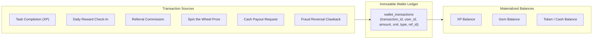
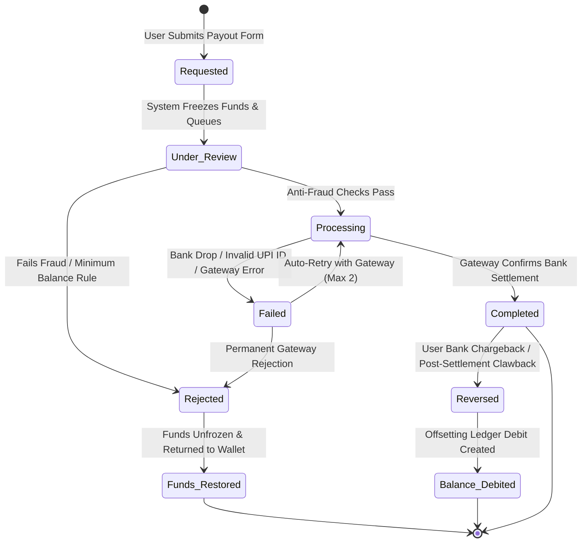

# VELOOP REWARDS — WALLET & WITHDRAWAL ANALYTICS SPECIFICATION
**Deliverable ID:** Deliverable 06  
**Work Package:** Work Package D — Wallet & Withdrawal Analytics  
**Author:** Data Analyst Intern  
**Organization:** VELOOP Rewards  
**Date:** 2026-11-11  
**Integrity Label:** `SIMULATED DATA — CREATED FOR ANALYTICAL TESTING`  
**Classification:** Confirmed, Proposed, To Be Verified, Simulated  

---

## 1. Executive Summary & Domain Scope

The Wallet and Withdrawal domain governs the economic foundation and financial credibility of VELOOP Rewards. Because user trust, regulatory compliance, and platform liquidity depend directly on accurate balance tracking and timely payouts, this domain requires strict financial accounting principles.

In digital rewards products, failure to maintain an immutable transaction ledger leads to catastrophic balance drift, untraceable currency duplication, and inability to reconcile financial liability against bank disbursement accounts.

This specification establishes:
1. An immutable **double-entry wallet transaction model** tracking every credit, debit, reversal, and balance adjustment across multiple currency units.
2. The end-to-end **withdrawal lifecycle** with deterministic state transitions, failure reasons, and anti-fraud gates.
3. Formal specifications for **10 core withdrawal KPIs** with exact mathematical formulas and data requirements.
4. Relational database schemas for `wallet_balances`, `wallet_transactions`, and `withdrawals`.

---

## 2. Wallet Transaction Model (D1)

The VELOOP wallet architecture enforces strict **ledger immutability**: account balances are never directly updated via destructive `UPDATE` SQL queries. Instead, user balances represent the materialized sum of all chronological transaction records in the ledger.

### 2.1 Transaction Model Field Definitions

| Field Name | Data Type | Required | Definition & Analytical Purpose | Validation & Integrity Rules | Evidentiary Tier | Status |
| :--- | :--- | :---: | :--- | :--- | :---: | :--- |
| `transaction_id` | VARCHAR(16) | Yes | Immutable unique identifier for every balance mutation | `^TXN[0-9]{8}$`; Primary Key, Not Null, Unique | [Proposed] | Specification |
| `user_id` | VARCHAR(16) | Yes | Foreign key referencing the account holder | Foreign Key to `users(user_id)`; Indexed | [Confirmed] | Specification |
| `timestamp` | TIMESTAMP | Yes | Exact UTC timestamp when transaction was committed | ISO-8601 UTC; Cannot be future dated | [Confirmed] | Specification |
| `transaction_type` | VARCHAR(25) | Yes | Functional nature of balance movement | Enum: `Reward Credit`, `Redemption`, `Reversal`, `Adjustment`, `Withdrawal Hold`, `Withdrawal Release` | [Proposed] | Specification |
| `amount` | DECIMAL(12,2) | Yes | Numeric magnitude of currency mutation | Non-zero decimal; Signed or paired with Debit/Credit flag | [Proposed] | Specification |
| `unit` | VARCHAR(10) | Yes | Specific currency unit being mutated | Enum: `XP`, `GEMS`, `TOKENS`, `INR`, `USD` | [Proposed] | Specification |
| `status` | VARCHAR(15) | Yes | Operational state of the transaction | Enum: `Committed`, `Pending`, `Failed`, `Reversed` | [Proposed] | Specification |
| `source` | VARCHAR(30) | Yes | Upstream product feature triggering transaction | Enum: `Task Engine`, `Daily Reward`, `Spin Wheel`, `Mining Rig`, `Referral Engine`, `Withdrawal Engine`, `Admin Tool` | [Proposed] | Specification |
| `reference_id` | VARCHAR(32) | Yes | Foreign identifier linking to external triggering entity | Points to `activity_id`, `milestone_id`, `withdrawal_id`, or `ticket_id` | [Proposed] | Specification |
| `reversal_transaction_id` | VARCHAR(16) | No | Self-referencing link connecting reversal to original transaction | Nullable; if populated, must reference valid historical `transaction_id` | [Proposed] | Specification |

### 2.2 Standard Transaction Types

* **`Reward Credit` [Confirmed / Implemented]:** Positive balance increment originating from completed tasks, daily check-ins, or game achievements.
* **`Redemption` [Proposed]:** Debit transaction exchanging points for gift cards, game vouchers, or platform perks.
* **`Withdrawal Hold` [Proposed]:** Temporary balance debit moving funds into an escrow hold while a cash payout is under review.
* **`Withdrawal Release` [Proposed]:** Re-crediting held funds back to the user balance if a withdrawal request is rejected or cancelled.
* **`Reversal` [Proposed]:** Corrective debit transaction reversing an illegitimate or fraudulent credit. Always references original `transaction_id`.
* **`Adjustment` [Proposed]:** Manual administrative credit or debit authorized by customer support to resolve user disputes.

---

## 3. Withdrawal Lifecycle Model (D2)

The withdrawal lifecycle governs the progression of a user's payout request from initial submission through automated anti-fraud screening, finance review, payment gateway dispatch, and final bank settlement.

### 3.1 Lifecycle States & Event Definitions

| State Name | Stage | Operational Definition | Balance Impact | Allowed Next States |
| :--- | :---: | :--- | :--- | :--- |
| **`Requested`** | Initiation | User selects payout method, enters payment address, and submits request. | Balance frozen; funds deducted from available balance | `Under_Review`, `Rejected` |
| **`Under_Review`** | Validation | Request evaluated by automated risk rules (bot detection, account age, KYC status). | Held in Escrow | `Processing`, `Rejected` |
| **`Processing`** | Gateway | Payout batch transmitted to payment gateway partner (e.g. Cashfree, Razorpay, PayPal). | In-Transit | `Completed`, `Failed`, `Rejected` |
| **`Completed`** | Final | Gateway returns successful webhook confirming funds deposited in user account. | Permanent Outflow | `Reversed` (rare) |
| **`Rejected`** | Terminal | Request declined due to invalid payment details, failed KYC, or fraudulent activity. | Funds restored to user balance | None |
| **`Reversed`** | Exception | Settled payout recalled due to banking return, account closure, or advertiser clawback. | Offsetting ledger debit | None |

### 3.2 Withdrawal Entity Schema Fields

* `withdrawal_id` (PK, VARCHAR(16)): Unique payout request identifier (`WDL0000001`–`WDL9999999`).
* `user_id` (FK, VARCHAR(16)): References `users(user_id)`.
* `requested_amount` (DECIMAL(10,2)): Nominal withdrawal amount requested in fiat currency (e.g., INR, USD).
* `points_redeemed` (INTEGER): Exact amount of platform points/tokens deducted from user wallet.
* `payout_method` (VARCHAR(20)): Payment channel: `UPI`, `Paytm`, `Bank Transfer`, `PayPal`, `Crypto Voucher`.
* `destination_hash` (VARCHAR(64)): SHA-256 cryptographic hash of recipient account (UPI VPA, bank account, email) for privacy and multi-account fraud detection.
* `requested_timestamp` (TIMESTAMP): Exact time request was submitted.
* `processing_timestamp` (TIMESTAMP): Time batch was dispatched to gateway (Null if rejected before dispatch).
* `final_timestamp` (TIMESTAMP): Time final webhook was received (`Completed`, `Rejected`, `Reversed`).
* `status` (VARCHAR(20)): Enum (`Requested`, `Under_Review`, `Processing`, `Completed`, `Rejected`, `Reversed`).
* `rejection_reason` (VARCHAR(50)): Categorized failure reason (`Invalid Payment Address`, `Failed Minimum Balance`, `Suspected Bot Activity`, `Multiple Accounts on Payment Address`, `Gateway Timeout`).

---

## 4. Withdrawal KPI Catalogue (D3)

The 10 mandatory withdrawal KPIs are formally defined below:

### KPI 1: Withdrawal Requests Volume
* **Definition:** Total count of unique withdrawal requests submitted by users within a specified timeframe.
* **Mathematical Formula:** $\text{Withdrawal Requests} = \sum \mathbf{1}_{\{\text{event} = \text{'withdrawal\_requested'}\}}$
* **Data Required:** `withdrawal_id`, `requested_timestamp`
* **Data Source:** `withdrawals` table / `withdrawal_requested` event stream
* **Reporting Frequency:** Daily / Weekly
* **Primary Stakeholder:** Product Management, Finance Operations
* **Business Purpose:** Measures user monetization demand and operational workload for payout processing.
* **Limitation:** Does not reflect financial capital disbursed; counts raw submissions regardless of validity.

### KPI 2: Completed Withdrawals
* **Definition:** Total count of withdrawal requests successfully settled in user bank accounts.
* **Mathematical Formula:** $\text{Completed Withdrawals} = \sum \mathbf{1}_{\{\text{status} = \text{'Completed'}\}}$
* **Data Required:** `withdrawal_id`, `status`, `final_timestamp`
* **Data Source:** `withdrawals` table / gateway settlement webhook
* **Reporting Frequency:** Daily / Weekly / Monthly
* **Primary Stakeholder:** Finance Operations, Executive Leadership
* **Business Purpose:** Measures fulfilled liquidity delivered to users; primary driver of word-of-mouth trust.
* **Limitation:** Does not account for latency between request and bank credit.

### KPI 3: Pending Withdrawals (Processing Queue)
* **Definition:** Total count of active withdrawal requests currently in `Requested`, `Under_Review`, or `Processing` status.
* **Mathematical Formula:** $\text{Pending Queue} = \sum \mathbf{1}_{\{\text{status} \in (\text{'Requested'}, \text{'Under\_Review'}, \text{'Processing'})\}}$
* **Data Required:** `withdrawal_id`, `status`
* **Data Source:** Real-time query on `withdrawals` table
* **Reporting Frequency:** Hourly / Daily real-time monitoring
* **Primary Stakeholder:** Operations Team, Risk & Fraud Lead
* **Business Purpose:** Operational bottleneck indicator; identifies backlog spikes requiring manual intervention.
* **Limitation:** High count can indicate either high platform volume or severe operational backlogs.

### KPI 4: Rejected Withdrawals
* **Definition:** Total count of withdrawal requests declined due to invalid payment information or fraud detection.
* **Mathematical Formula:** $\text{Rejected Withdrawals} = \sum \mathbf{1}_{\{\text{status} = \text{'Rejected'}\}}$
* **Data Required:** `withdrawal_id`, `status`, `rejection_reason`
* **Data Source:** `withdrawals` table
* **Reporting Frequency:** Daily / Weekly
* **Primary Stakeholder:** Risk & Fraud Operations, Customer Support
* **Business Purpose:** Monitors anti-fraud effectiveness and highlights UX friction in payment address collection.
* **Limitation:** Rejections caused by user typographical errors must be separated from confirmed malicious fraud.

### KPI 5: Reversed Withdrawals
* **Definition:** Total count of previously completed withdrawals that were clawed back or returned due to bank failures.
* **Mathematical Formula:** $\text{Reversed Withdrawals} = \sum \mathbf{1}_{\{\text{status} = \text{'Reversed'}\}}$
* **Data Required:** `withdrawal_id`, `status`, `final_timestamp`
* **Data Source:** Banking reconciliation feed / `wallet_transactions`
* **Reporting Frequency:** Weekly / Monthly
* **Primary Stakeholder:** Finance Operations
* **Business Purpose:** Tracks bank-level return rates and financial accounting leakage.
* **Limitation:** Reversals often exhibit a 3–7 day reporting delay from external clearing banks.

### KPI 6: Average Processing Time (Fulfillment Latency)
* **Definition:** Median and mean elapsed duration (in hours) from withdrawal request submission to completed settlement.
* **Mathematical Formula:** $\text{Mean Processing Time} = \frac{1}{N_{\text{completed}}} \sum_{i=1}^{N_{\text{completed}}} \left( \text{final\_timestamp}_i - \text{requested\_timestamp}_i \right)$
* **Data Required:** `requested_timestamp`, `final_timestamp`, `status = 'Completed'`
* **Data Source:** `withdrawals` table
* **Reporting Frequency:** Daily / Weekly
* **Primary Stakeholder:** Product Operations, User Experience Lead
* **Business Purpose:** Core SLA performance metric directly correlated with user NPS and platform trust.
* **Limitation:** Skewed by manual fraud holds; median hours should always be reported alongside arithmetic mean.

### KPI 7: Withdrawal Completion Rate
* **Definition:** Percentage of submitted withdrawal requests that successfully reach completed status.
* **Mathematical Formula:** $\text{Completion Rate} = \left( \frac{\text{Completed Withdrawals}}{\text{Completed} + \text{Rejected} + \text{Reversed}} \right) \times 100\%$
* **Data Required:** `withdrawal_id`, `status`
* **Data Source:** `withdrawals` table
* **Reporting Frequency:** Weekly / Monthly
* **Primary Stakeholder:** Product Management, Finance Operations
* **Business Purpose:** Evaluates end-to-end payment funnel efficiency and gateway reliability.
* **Limitation:** Excludes currently pending requests to prevent artificially depressing rates during volume surges.

### KPI 8: Total Withdrawal Volume (Fiat Currency Disbursed)
* **Definition:** Total aggregate monetary value of all completed withdrawals in platform currency (INR/USD).
* **Mathematical Formula:** $\text{Withdrawal Volume} = \sum_{i \in \text{Completed}} \text{requested\_amount}_i$
* **Data Required:** `requested_amount`, `status = 'Completed'`
* **Data Source:** `withdrawals` table / Bank disbursement logs
* **Reporting Frequency:** Daily / Weekly / Monthly
* **Primary Stakeholder:** Chief Financial Officer (CFO), Executive Leadership
* **Business Purpose:** Core financial liability measure; evaluates platform burn rate against advertising cash collections.
* **Limitation:** Does not reflect transaction processing gateway fees incurred by VELOOP.

### KPI 9: Pending Withdrawal Liability
* **Definition:** Total fiat value of all withdrawal requests currently queued in pending status.
* **Mathematical Formula:** $\text{Pending Liability} = \sum_{i \in \text{Pending}} \text{requested\_amount}_i$
* **Data Required:** `requested_amount`, `status \in ('Requested', 'Under_Review', 'Processing')`
* **Data Source:** `withdrawals` table
* **Reporting Frequency:** Daily
* **Primary Stakeholder:** Finance Operations, Treasury
* **Business Purpose:** Cash reserve planning; ensures payment gateway float accounts maintain sufficient liquidity.
* **Limitation:** Overestimates liability if a notable portion of the queue is subsequently rejected for fraud.

### KPI 10: Withdrawal Method Distribution
* **Definition:** Percentage breakdown of completed withdrawals across payment channels (UPI, Paytm, Bank, PayPal).
* **Mathematical Formula:** $\text{Method Share}_m = \left( \frac{\text{Withdrawals via Method } m}{\text{Total Completed Withdrawals}} \right) \times 100\%$
* **Data Required:** `payout_method`, `withdrawal_id`, `status = 'Completed'`
* **Data Source:** `withdrawals` table
* **Reporting Frequency:** Monthly
* **Primary Stakeholder:** Partnerships Lead, Finance Operations
* **Business Purpose:** Guides payment gateway commercial negotiations and identifies user channel preferences.
* **Limitation:** Influenced by platform UI placement and minimum threshold differences across payment channels.

