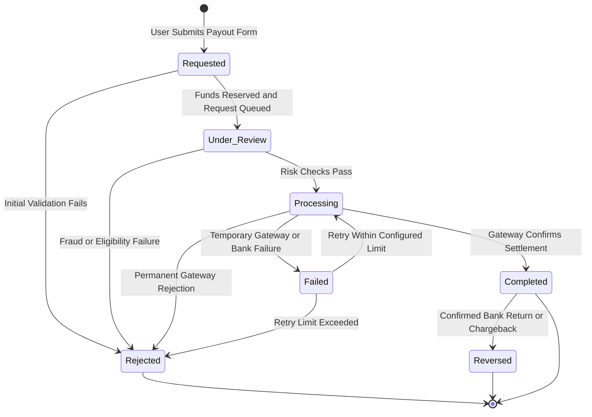

# VELOOP REWARDS — WALLET & WITHDRAWAL ANALYTICS SPECIFICATION

**Deliverable ID:** Deliverable 06  
**Work Package:** Work Package D — Wallet & Withdrawal Analytics  
**Author:** Data Analysis Intern  
**Organization:** VELOOP Rewards  
**Integrity Label:** `SIMULATED DATA — CREATED FOR ANALYTICAL TESTING`  
**Classification:** Confirmed, Proposed, To Be Verified, Simulated

---

## 1. Executive Summary & Domain Scope

The Wallet and Withdrawal domain governs the economic foundation and financial credibility of VELOOP Rewards. Because user trust, financial accountability, and platform liquidity depend on accurate balance tracking and reliable payouts, this domain requires strict financial accounting principles.

In digital rewards products, failure to maintain an immutable transaction ledger can lead to balance inconsistencies, untraceable currency duplication, and an inability to reconcile financial liabilities against payment settlement records.

This specification establishes:

1. An immutable **double-entry wallet ledger** tracking credits, debits, reversals, and balance adjustments across multiple currency units.
2. An end-to-end **withdrawal lifecycle** with defined state transitions, failure reasons, and anti-fraud controls.
3. Formal specifications for **10 core withdrawal KPIs** with mathematical formulas and data requirements.
4. Relational database structures for `wallet_accounts`, `wallet_ledger`, and `withdrawals`.
5. Data provenance rules that distinguish observed engagement telemetry from proposed financial workflows and simulated test records.

**Implementation distinction:** This document defines the proposed analytical and engineering architecture. A proposed schema, accounting rule, or KPI definition does not establish that the corresponding production workflow has been deployed.

---

## 2. Wallet Transaction Model (D1)

The VELOOP wallet architecture follows the principle of ledger immutability. Account balances should not be modified through destructive balance updates. Instead, committed ledger entries provide the accounting history from which balances can be calculated or materialized.

```mermaid
flowchart LR
    subgraph Sources["Transaction Sources"]
        S1["Task Completion (XP)"]
        S2["Daily Reward Check-In"]
        S3["Referral Commission"]
        S4["Spin the Wheel Prize"]
        S5["Cash Payout Request"]
        S6["Fraud Reversal Clawback"]
        S7["Administrative Adjustment"]
    end

    subgraph Ledger["Immutable Wallet Ledger"]
        TX["wallet_ledger<br/>ledger_entry_id, transaction_id, account_id, amount, entry_type, unit"]
    end

    subgraph Accounts["Wallet Accounts"]
        A1["User Available Account"]
        A2["User Locked Account"]
        A3["System Liability Account"]
        A4["Settlement / Clearing Account"]
    end

    Sources --> TX
    TX --> Accounts
```

### 2.1 Wallet Database Components

| Table | Purpose | Implementation Status |
|---|---|---|
| `wallet_accounts` | Stores wallet account identities, ownership, and currency units | PostgreSQL test schema previously observed |
| `wallet_ledger` | Stores accounting entries for wallet credits, debits, holds, and reversals | PostgreSQL test schema previously observed |
| `withdrawals` | Stores withdrawal requests and their processing lifecycle | PostgreSQL test schema previously observed |
| `wallet_transactions` | Optional transaction-header table grouping related ledger entries | Proposed architecture |

**Note:** The existing PostgreSQL project includes `wallet_accounts`, `wallet_ledger`, and `withdrawals`. The optional transaction-header design must be verified against the actual database schema before being described as implemented.

### 2.2 Transaction Model Field Definitions

| Field Name | Data Type | Required | Definition & Analytical Purpose | Validation & Integrity Rules | Status |
|---|---|---|---|---|---|
| `transaction_id` | VARCHAR(16) | Yes | Groups related ledger entries into one logical transaction | Primary Key in transaction header; unique and immutable | Proposed |
| `ledger_entry_id` | BIGINT | Yes | Unique identifier for each individual accounting entry | Primary Key; generated identifier | Proposed |
| `account_id` | BIGINT | Yes | Identifies the wallet account affected by an entry | Foreign Key to `wallet_accounts(account_id)` | Proposed |
| `user_id` | VARCHAR(16) | Yes | Identifies the account owner where applicable | Foreign Key to `users(user_id)` | Proposed |
| `timestamp` | TIMESTAMP | Yes | Time when the ledger entry is committed | UTC timestamp; cannot be future dated | Proposed |
| `entry_type` | VARCHAR(10) | Yes | Identifies the accounting direction | Enum: `DEBIT`, `CREDIT` | Proposed |
| `amount` | DECIMAL(12,2) | Yes | Positive magnitude of the ledger entry | Must be greater than zero | Proposed |
| `unit` | VARCHAR(10) | Yes | Currency or rewards unit | Controlled values: `XP`, `GEMS`, `TOKENS`, `INR`, `USD` | Proposed |
| `transaction_type` | VARCHAR(25) | Yes | Functional purpose of the transaction | Controlled transaction categories | Proposed |
| `status` | VARCHAR(15) | Yes | Operational state of the transaction | `Pending`, `Committed`, `Failed`, `Reversed` | Proposed |
| `source` | VARCHAR(30) | Yes | Product feature or system that generated the transaction | Controlled source categories | Proposed |
| `reference_id` | VARCHAR(32) | No | Identifier of the triggering business entity | References activity, milestone, withdrawal, or support ticket where applicable | Proposed |
| `reversal_transaction_id` | VARCHAR(16) | No | Links a reversal to the original transaction | Nullable self-reference to the transaction header | Proposed |

### 2.3 Double-Entry Accounting Rules

The ledger must maintain the following accounting invariants:

1. Every committed transaction must contain the required debit and credit entries.
2. Each entry must have a positive amount and an explicit `DEBIT` or `CREDIT` direction.
3. Entries belonging to the same transaction and currency must balance.
4. Committed ledger entries must not be destructively updated or deleted.
5. Corrections must be performed through compensating entries referencing the original transaction.
6. All ledger entries must reference valid wallet accounts.
7. Transactions involving different currency units must be balanced independently.

The fundamental reconciliation rule is:

\[
\sum \text{Debits}_{t,c}
=
\sum \text{Credits}_{t,c}
\]

Where:

- \(t\) represents a transaction.
- \(c\) represents a currency or rewards unit.

### 2.4 Standard Transaction Types

| Transaction Type | Description | Proposed Accounting Treatment |
|---|---|---|
| `Reward Credit` | Reward generated by completed tasks or achievements | Credit user reward account; corresponding debit to the appropriate system account |
| `Redemption` | Points exchanged for gift cards, vouchers, or platform benefits | Debit user account; corresponding credit to redemption clearing account |
| `Withdrawal Hold` | Funds reserved during payout verification | Debit available account; credit locked account |
| `Withdrawal Release` | Funds returned after rejection or cancellation | Debit locked account; credit available account |
| `Withdrawal Settlement` | Approved withdrawal paid through an external gateway | Debit locked account; credit settlement account |
| `Reversal` | Correction of an earlier transaction | Compensating entries referencing the original transaction |
| `Adjustment` | Authorized administrative correction | Balanced debit and credit entries with an audit reference |

**Implementation status:** These are proposed accounting classifications. Actual transaction-type availability must be verified against the PostgreSQL records and schema.

---

## 3. Withdrawal Lifecycle Model (D2)

The withdrawal lifecycle governs the progression of a payout request from initial submission through validation, anti-fraud screening, payment gateway processing, and final settlement.

### 3.1 Lifecycle States & Event Definitions

| State Name | Stage | Operational Definition | Balance Impact | Allowed Next States |
|---|---|---|---|---|
| `Requested` | Initiation | User submits withdrawal request and payment details | Funds reserved from available balance, subject to successful validation | `Under_Review`, `Rejected` |
| `Under_Review` | Validation | Request evaluated by fraud detection, account eligibility, and compliance rules | Funds remain in locked account | `Processing`, `Rejected` |
| `Processing` | Gateway | Payout instruction transmitted to the payment provider | Funds remain reserved during settlement | `Completed`, `Failed`, `Rejected` |
| `Failed` | Exception | Temporary payment gateway, bank, or processing failure | Funds remain reserved until retry or release decision | `Processing`, `Rejected` |
| `Completed` | Final | Gateway confirms successful settlement | Permanent outflow from wallet liability | `Reversed` |
| `Rejected` | Terminal | Request rejected because of failed validation, eligibility, or risk controls | Funds released to available balance | None |
| `Reversed` | Exception | Previously settled payout is returned or reversed | Compensating ledger entries record the financial adjustment | None |

### 3.2 Withdrawal Accounting Actions

The following are accounting actions, not withdrawal lifecycle statuses.

| Accounting Action | Description |
|---|---|
| `Funds Reserved` | Moves the requested amount from available balance to locked balance |
| `Funds Released` | Returns reserved funds to the available account after rejection or cancellation |
| `Funds Settled` | Records the confirmed payout against the settlement or clearing account |
| `Balance Debited` | Records an appropriate compensating debit when a completed payout is reversed |

A withdrawal must not be marked `Completed` solely because a payout instruction was sent. Completion requires a verified settlement response from the payment provider or bank.

### 3.3 Withdrawal Entity Schema Fields

| Field | Data Type | Required | Purpose and Validation |
|---|---|---|---|
| `withdrawal_id` | VARCHAR(16) | Yes | Primary Key; unique withdrawal request identifier |
| `user_id` | VARCHAR(16) | Yes | Foreign Key to `users(user_id)` |
| `requested_amount` | DECIMAL(12,2) | Yes | Requested payout amount; greater than zero |
| `settled_amount` | DECIMAL(12,2) | No | Actual confirmed payout amount; populated after settlement |
| `currency` | VARCHAR(3) | Yes | ISO currency code such as `INR` or `USD` |
| `points_redeemed` | INTEGER | No | Points or tokens converted for the withdrawal |
| `payout_method` | VARCHAR(20) | Yes | Payment channel such as UPI, Paytm, Bank Transfer, or PayPal |
| `destination_hash` | VARCHAR(64) | Yes | Protected identifier for the recipient payment destination |
| `gateway_reference_id` | VARCHAR(64) | No | Payment gateway transaction reference |
| `requested_timestamp` | TIMESTAMP | Yes | Time the withdrawal was submitted |
| `processing_timestamp` | TIMESTAMP | No | Time the request was dispatched to the gateway |
| `final_timestamp` | TIMESTAMP | No | Time a terminal status or settlement event was recorded |
| `updated_timestamp` | TIMESTAMP | Yes | Time of the latest request update |
| `status` | VARCHAR(20) | Yes | `Requested`, `Under_Review`, `Processing`, `Failed`, `Completed`, `Rejected`, `Reversed` |
| `rejection_reason` | VARCHAR(100) | No | Reason for rejection |
| `failure_reason` | VARCHAR(100) | No | Reason for temporary or permanent processing failure |

**Security note:** Payment destination identifiers should be protected using an appropriate keyed HMAC or equivalent privacy-preserving mechanism. A plain SHA-256 hash alone may be vulnerable to guessing attacks when the original destination has a small or predictable input space.

### 3.4 Withdrawal Integrity Rules

1. Every withdrawal must reference a valid user.
2. `requested_amount` must be positive.
3. `settled_amount` must be non-negative and must not exceed the authorized amount unless a documented adjustment exists.
4. `currency` must be explicitly recorded.
5. A completed withdrawal must have a confirmed settlement reference and settlement timestamp.
6. A rejected withdrawal must have an appropriate rejection reason.
7. A failed withdrawal must retain its failure reason and retry history.
8. Reversed withdrawals must reference their original settlement and corresponding compensating ledger entries.
9. Withdrawal status changes must be recorded in an auditable status history.
10. Funds must not be released or settled twice.

---

## 4. Withdrawal KPI Catalogue (D3)

The following 10 mandatory withdrawal KPIs define the operational, financial, and product measurements required for a production-ready VELOOP Rewards withdrawal system.

**Measurement convention:** All count-based KPIs use unique `withdrawal_id` values. Monetary KPIs must be grouped by currency and must not combine INR and USD without an explicit conversion policy.

### KPI 1: Withdrawal Requests Volume

- **Definition:** Total number of unique withdrawal requests submitted by users within a specified reporting period.
- **Mathematical Formula:**

  \[
  \text{Withdrawal Requests} =
  \operatorname{COUNT}(\text{DISTINCT withdrawal\_id})
  \]

- **Data Required:** `withdrawal_id`, `requested_timestamp`
- **Data Source:** `withdrawals` table / `withdrawal_requested` event stream
- **Reporting Frequency:** Daily / Weekly
- **Primary Stakeholder:** Product Management, Finance Operations
- **Business Purpose:** Measures user withdrawal demand and operational workload.
- **Limitation:** Measures submissions, not successful payouts. Invalid and subsequently rejected requests are included.

### KPI 2: Completed Withdrawals

- **Definition:** Total number of withdrawal requests confirmed as successfully settled.
- **Mathematical Formula:**

  \[
  \text{Completed Withdrawals} =
  \operatorname{COUNT}(\text{withdrawal\_id WHERE status = 'Completed'})
  \]

- **Data Required:** `withdrawal_id`, `status`, `final_timestamp`
- **Data Source:** `withdrawals` table / payment gateway settlement webhook
- **Reporting Frequency:** Daily / Weekly / Monthly
- **Primary Stakeholder:** Finance Operations, Executive Leadership
- **Business Purpose:** Measures fulfilled withdrawal requests and successful payout delivery.
- **Limitation:** A completed application status must be reconciled against actual bank or payment gateway settlement confirmation.

### KPI 3: Pending Withdrawals (Processing Queue)

- **Definition:** Number of withdrawal requests currently awaiting review or settlement.
- **Mathematical Formula:**

  \[
  \text{Pending Queue} =
  \sum \mathbf{1}_{\text{status} \in
  \{\text{'Requested'},\text{'Under\_Review'},\text{'Processing'}\}}
  \]

- **Data Required:** `withdrawal_id`, `status`
- **Data Source:** Real-time query on `withdrawals` table
- **Reporting Frequency:** Hourly / Daily
- **Primary Stakeholder:** Operations Team, Risk & Fraud Lead
- **Business Purpose:** Identifies processing backlogs and operational bottlenecks.
- **Limitation:** A high count may reflect increased demand or delayed processing. `Failed` requests should be monitored separately until retry or terminal resolution.

### KPI 4: Rejected Withdrawals

- **Definition:** Number of withdrawal requests rejected because of invalid payment details, policy violations, or risk controls.
- **Mathematical Formula:**

  \[
  \text{Rejected Withdrawals} =
  \operatorname{COUNT}(\text{withdrawal\_id WHERE status = 'Rejected'})
  \]

- **Data Required:** `withdrawal_id`, `status`, `rejection_reason`
- **Data Source:** `withdrawals` table
- **Reporting Frequency:** Daily / Weekly
- **Primary Stakeholder:** Risk & Fraud Operations, Customer Support
- **Business Purpose:** Monitors rejection patterns and identifies payment-information or verification issues.
- **Limitation:** User input errors must be distinguished from confirmed fraudulent activity.

### KPI 5: Reversed Withdrawals

- **Definition:** Number of previously completed withdrawals subsequently returned or reversed by a payment provider or bank.
- **Mathematical Formula:**

  \[
  \text{Reversed Withdrawals} =
  \operatorname{COUNT}(\text{withdrawal\_id WHERE status = 'Reversed'})
  \]

- **Data Required:** `withdrawal_id`, `status`, `final_timestamp`
- **Data Source:** Banking reconciliation feed / `wallet_ledger`
- **Reporting Frequency:** Weekly / Monthly
- **Primary Stakeholder:** Finance Operations
- **Business Purpose:** Monitors payout reversals and payment settlement reliability.
- **Limitation:** External bank reporting delays may cause reversals to appear several days after the original settlement.

### KPI 6: Average Processing Time (Fulfillment Latency)

- **Definition:** Mean and median elapsed time, in hours, between withdrawal submission and confirmed successful settlement.
- **Mathematical Formula:**

  \[
  \text{Mean Processing Time} =
  \frac{1}{N_{\text{completed}}}
  \sum_{i=1}^{N_{\text{completed}}}
  \frac{\text{final\_timestamp}_i-\text{requested\_timestamp}_i}
  {3600\text{ seconds}}
  \]

  \[
  \text{Median Processing Time} =
  \operatorname{MEDIAN}(\text{Processing Duration in Hours})
  \]

- **Data Required:** `requested_timestamp`, confirmed settlement timestamp, `status = 'Completed'`
- **Data Source:** `withdrawals` table and gateway settlement records
- **Reporting Frequency:** Daily / Weekly
- **Primary Stakeholder:** Product Operations, User Experience Lead
- **Business Purpose:** Measures payout fulfillment speed and supports service-level agreement monitoring.
- **Limitation:** Manual reviews and exceptional payment delays can skew the mean. Report the median alongside it.

### KPI 7: Withdrawal Completion Rate

- **Definition:** Percentage of terminally resolved withdrawal requests that successfully reach completed status.
- **Mathematical Formula:**

  \[
  \text{Completion Rate} =
  \frac{\text{Completed Withdrawals}}
  {\text{Completed}+\text{Rejected}+\text{Reversed}}
  \times 100
  \]

- **Data Required:** `withdrawal_id`, `status`
- **Data Source:** `withdrawals` table and withdrawal status history
- **Reporting Frequency:** Weekly / Monthly
- **Primary Stakeholder:** Product Management, Finance Operations
- **Business Purpose:** Evaluates the effectiveness of the withdrawal fulfillment process.
- **Limitation:** Pending requests are excluded. This formula treats reversed withdrawals as unsuccessful terminal outcomes. Status categories must be mutually exclusive at the reporting snapshot. If the objective is to measure first-time settlement success, use historical settlement events rather than only the current status.

### KPI 8: Total Withdrawal Volume (Fiat Currency Disbursed)

- **Definition:** Total confirmed monetary value successfully disbursed through completed withdrawals.
- **Mathematical Formula:**

  \[
  \text{Withdrawal Volume}_{c} =
  \sum_{i \in \text{Completed},\ currency_i=c}
  \text{Settled Amount}_i
  \]

- **Data Required:** `withdrawal_id`, `settled_amount`, `currency`, `status`
- **Data Source:** `withdrawals` table / bank disbursement logs
- **Reporting Frequency:** Daily / Weekly / Monthly
- **Primary Stakeholder:** Chief Financial Officer (CFO), Executive Leadership
- **Business Purpose:** Measures confirmed payout value and supports financial reconciliation.
- **Limitation:** Requested amounts may differ from actual settled amounts because of fees, partial settlements, or adjustments. Use confirmed settled amounts where available.

### KPI 9: Pending Withdrawal Liability

- **Definition:** Total requested monetary value of withdrawal requests currently awaiting processing or settlement.
- **Mathematical Formula:**

  \[
  \text{Pending Liability}_{c} =
  \sum_{i \in \text{Pending},\ currency_i=c}
  \text{requested\_amount}_i
  \]

  Pending statuses: `Requested`, `Under_Review`, and `Processing`.

- **Data Required:** `requested_amount`, `status`, `currency`
- **Data Source:** `withdrawals` table
- **Reporting Frequency:** Daily
- **Primary Stakeholder:** Finance Operations, Treasury
- **Business Purpose:** Supports liquidity planning and estimates outstanding withdrawal obligations.
- **Limitation:** This is an operational estimate, not necessarily a confirmed accounting liability. Requests subsequently rejected or cancelled must be excluded. Failed requests awaiting resolution should be reported separately.

### KPI 10: Withdrawal Method Distribution

- **Definition:** Percentage distribution of completed withdrawals across supported payout methods.
- **Mathematical Formula:**

  \[
  \text{Method Share}_{m} =
  \frac{\text{Completed Withdrawals via Method }m}
  {\text{Total Completed Withdrawals}}
  \times 100
  \]

- **Data Required:** `payout_method`, `withdrawal_id`, `status = 'Completed'`
- **Data Source:** `withdrawals` table
- **Reporting Frequency:** Monthly
- **Primary Stakeholder:** Partnerships Lead, Finance Operations
- **Business Purpose:** Identifies payment-channel preferences and supports payment-provider decisions.
- **Limitation:** Distribution can be influenced by interface placement, payment eligibility, and minimum withdrawal thresholds.

---

## 5. Source Data Provenance & Production Implementation Notice

> [!WARNING]
> **DATA AUTHENTICITY NOTICE — SIMULATED DATA — CREATED FOR ANALYTICAL TESTING**
>
> The supplied raw workbooks (`VELoop_Rewards_Data_01.xlsx` and `VELOOP_Simulated_User_Behavior_1000.xlsx`) do not contain actual financial transaction records, confirmed withdrawal payouts, or payment gateway settlement tables.

### 5.1 Available Observed Telemetry

The following wallet-related observations are available in the supplied datasets:

1. **User-level soft balance:** `xp_balance` in `Users_1000_Clean`, with an observed mean of approximately 1,566 XP. XP is an engagement measure and must not be interpreted as fiat currency.
2. **Daily wallet engagement:** `wallet_activity = 'Yes'` on 1,686 user-days out of 6,667 records in `04_Daily_Activity` (approximately 25.3%).
3. **Wallet feature engagement:** 2,172 `wallet_viewed` events across 810 distinct users in `03_Feature_Events`.

These observations demonstrate wallet-related engagement but do not establish actual cash balances, withdrawal demand, or payout completion.

### 5.2 Zero Fabricated Financials Policy

No fictional fiat balances, payment transactions, withdrawal requests, bank settlements, or financial performance metrics have been introduced into the analysis.

Consequently, the 10 withdrawal KPIs above are formally defined analytical specifications. They are **not calculated or reported as observed business results**.

### 5.3 Production Implementation Blueprint

The following components provide the proposed engineering foundation for production implementation:

- PostgreSQL relational structures: `wallet_accounts`, `wallet_ledger`, and `withdrawals`.
- Immutable double-entry accounting and reconciliation logic.
- Withdrawal status lifecycle and payment settlement integration.
- SQL analytics specifications in `03_analysis_and_models/sql/04_wallet_and_withdrawal_analytics.sql`.
- Gateway settlement references and transaction status history.
- Reversal and compensating ledger entry controls.

Actual KPI computation requires populated and validated withdrawal records, confirmed settlement information, currency metadata, and payment gateway reconciliation data.

### 5.4 Implementation Status

| Component | Status | Evidence / Limitation |
|---|---|---|
| Withdrawal KPI definitions | Defined | Analytical specification completed |
| Wallet engagement telemetry | Observed | Available in supplied simulated workbooks |
| Wallet account records | Simulated / Test | PostgreSQL test records previously observed |
| Wallet ledger records | Simulated / Test | PostgreSQL test records previously observed |
| Withdrawal records | Simulated / Test | PostgreSQL test records previously observed |
| Actual bank payout records | Not available | No verified settlement evidence |
| Production withdrawal KPI values | Not calculable | Genuine financial transaction data unavailable |
| Double-entry accounting production deployment | Not verified | Schema and reconciliation must be verified |
| Payment gateway integration | Not verified | No production gateway evidence |
| Production financial reconciliation | Not verified | Requires genuine settlement feeds |

**Conclusion:** D1, D2, and D3 establish the wallet accounting architecture, withdrawal lifecycle, and 10 formal withdrawal KPI definitions. The specification preserves data authenticity by distinguishing observed simulated engagement telemetry from proposed financial workflows. Production reporting should begin only after genuine withdrawal and settlement records become available.

---

## 6. Current Implementation Status & Verification Boundary

This deliverable is an analytical specification and must be interpreted separately from runtime verification.

The current Streamlit source contains seven navigation sections:

1. Overview
2. User Analytics
3. Earning & Rewards
4. Wallet & Withdrawal
5. Referral & Virality
6. Feature & Engagement
7. Data Quality & Audit

Workbook-level simulated records are not interchangeable with PostgreSQL-loaded records.

The supplied PostgreSQL execution evidence is marked `AUTH_REQUIRED_NOT_VERIFIED`; successful live database execution is therefore not established by that evidence.

The automated project test suite was rerun for this archive and passed **40/40 tests**. This confirms the reported automated test result only. It does not verify live PostgreSQL connectivity, production payment settlement, or public dashboard deployment.

Wallet, withdrawal, user, session, event, task, and milestone examples must be classified as simulated or test data unless independent evidence establishes otherwise.

Referral event activity must not be described as verified referral conversion without validated referrer/referee relationship records.

A proposed schema, accounting control, or KPI definition is not evidence that the corresponding production workflow is deployed.

---

## 7. Final Deliverable Summary

| Workstream | Deliverable | Status |
|---|---|---|
| D1 | Wallet Transaction and Ledger Model | Specification defined |
| D2 | Withdrawal Lifecycle Model | Specification defined |
| D3 | Ten Withdrawal KPI Definitions | Completed |
| Data Provenance | Source authenticity and limitations | Documented |
| Database Design | Wallet and withdrawal relational architecture | Proposed / Test schema evidence |
| Accounting Integrity | Double-entry and reconciliation requirements | Defined; production verification pending |
| Production Readiness | Gateway and settlement integration | Not verified |

**Final Integrity Statement:**

`SIMULATED DATA — CREATED FOR ANALYTICAL TESTING`

This deliverable provides a structured and technically grounded wallet and withdrawal analytics blueprint without presenting simulated data as real financial activity or claiming unverified production capabilities.
