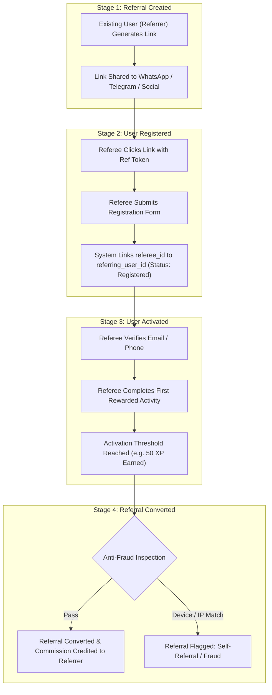
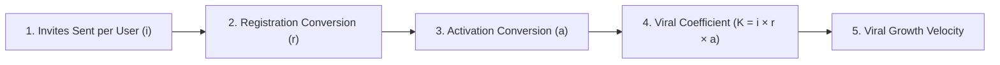

# VELOOP REWARDS — REFERRAL & ENGAGEMENT ANALYTICS SPECIFICATION
**Deliverable ID:** Deliverable 07  
**Work Package:** Work Package E — Referral & Engagement Analytics  
**Author:** Data Analyst Intern  
**Organization:** VELOOP Rewards  
**Date:** 2026-11-11  
**Integrity Label:** `SIMULATED DATA — CREATED FOR ANALYTICAL TESTING`  
**Classification:** Confirmed, Proposed, To Be Verified, Simulated  

---

## 1. Executive Summary & Growth Architecture

Referral programs and recurring engagement mechanics represent the primary low-cost viral growth engine for VELOOP Rewards. However, in consumer rewards applications, referral programs are exceptionally vulnerable to **referral fraud** (self-referrals, device spoofing, disposable email rings, and click-farm bot registrations).

A fundamental tenet established in this specification:
> **Registration does NOT equal Referral Conversion.**

A newly registered referee represents only an unverified account. A referral converts **only** when the referred user achieves a validated product activation milestone (e.g. completes 3 tasks, earns 100 XP, or verifies identity).

This document establishes:
1. The 4-stage referral lifecycle: **Referral Created $\rightarrow$ User Registered $\rightarrow$ User Activated $\rightarrow$ Referral Converted**.
2. Relational schema definitions for referral attribution and commission distribution.
3. Standardized metrics for viral coefficient ($K\text{-factor}$), viral cycle time, and referral retention uplift.
4. Comprehensive engagement frameworks measuring feature adoption, repeat usage, task velocity, active users, and returning user cohorts.

---

## 2. The 4-Stage Referral Lifecycle (E1)

### 2.1 Referral Lifecycle State Definitions

| State Name | Stage | Operational Definition | System Outcome | Commission Impact | Evidentiary Tier |
| :--- | :---: | :--- | :--- | :--- | :---: |
| **`Referral Created`** | Intent | Referrer generates unique invite code or clicks share button to social media. | Logs `referral_created` & `referral_shared` telemetry. | None | [Confirmed] |
| **`User Registered`** | Acquisition | Referee installs app or lands on web sign-up page with valid code; creates account. | Creates `referrals` record linking `referring_user_id` and `referred_user_id`. | None (Held in escrow) | [Proposed] |
| **`User Activated`** | Engagement | Referee meets minimum product engagement threshold (e.g., 3 tasks completed or 100 XP accumulated). | Emits `referral_activated` event; schedules reward disbursement. | Pending approval | [Proposed] |
| **`Referral Converted`** | Monetization | Anti-fraud engine confirms referee is not a duplicate device or emulator; commission paid. | Status updated to `Converted`; commission credited to referrer wallet. | Commission credited | [Proposed] |
| **`Referral Rejected`** | Terminal / Fraud | Referee detected sharing same IP/device fingerprint as referrer; or referee churns before activation. | Referral marked `Rejected`; invite bonus permanently withheld. | None (Clawed back) | [Proposed] |

---

## 3. Referral Relational Data Specifications

To overcome **GAP-003** identified in the Product Data Readiness Audit, the platform specifies a dedicated relational entity:

### 3.1 Entity Schema: `referrals`

| Field Name | Data Type | Required | Primary Analytical Purpose | Validation & Integrity Rules | Evidentiary Tier |
| :--- | :--- | :---: | :--- | :--- | :---: |
| `referral_id` | VARCHAR(16) | Yes | Primary key uniquely identifying the referral pair | `^REF[0-9]{8}$`; Primary Key, Not Null, Unique | [Proposed] |
| `referring_user_id` | VARCHAR(16) | Yes | Foreign key of existing user who shared code | References `users(user_id)`; Not Null, Indexed | [Proposed] |
| `referred_user_id` | VARCHAR(16) | Yes | Foreign key of newly registered referee | References `users(user_id)`; Unique Constraint (cannot be referred twice) | [Proposed] |
| `creation_timestamp` | TIMESTAMP | Yes | Time referral code was generated/shared | Must be $\le registration\_timestamp$ | [Proposed] |
| `registration_timestamp` | TIMESTAMP | Yes | Time referee successfully created account | Matches `users.account_created_at` for referee | [Proposed] |
| `activation_timestamp` | TIMESTAMP | No | Time referee met activation threshold criteria | Null if referee never activates; $\ge registration\_timestamp$ | [Proposed] |
| `conversion_timestamp` | TIMESTAMP | No | Time referral commission was credited to referrer | Null if rejected or pending; $\ge activation\_timestamp$ | [Proposed] |
| `referral_status` | VARCHAR(20) | Yes | Current state of referral relationship | Enum: `Created`, `Registered`, `Activated`, `Converted`, `Rejected` | [Proposed] |
| `referral_source` | VARCHAR(30) | Yes | Channel where invite was clicked | Enum: `WhatsApp`, `Telegram`, `Direct Link`, `Instagram`, `YouTube` | [Confirmed] |
| `commission_amount` | DECIMAL(10,2) | No | Exact reward amount credited to referrer | Null until converted; Non-negative decimal | [Proposed] |
| `commission_unit` | VARCHAR(10) | No | Currency unit of commission payout | Enum: `XP`, `GEMS`, `TOKENS`, `INR` | [Proposed] |
| `rejection_reason` | VARCHAR(50) | No | Fraud classification if referral is disqualified | Enum: `Same Device Fingerprint`, `Same IP Hash`, `Inactivity Churn`, Null | [Proposed] |

---

## 4. Viral Growth & Network Metrics

### 4.1 Core Virality Formulas
1. **Viral Coefficient ($K\text{-factor}$):**
   $$K = i \times c_r \times c_a$$
   * Where $i = \text{Average Invites Sent per User} = \frac{\text{Total Referrals Shared}}{\text{Total Active Users}}$
   * $c_r = \text{Registration Conversion Rate} = \frac{\text{Referred Registrations}}{\text{Total Referrals Shared}}$
   * $c_a = \text{Activation Conversion Rate} = \frac{\text{Converted Referrals}}{\text{Referred Registrations}}$
   * *Interpretation:* If $K > 1.0$, the platform achieves exponential viral loop growth without paid marketing spend. If $K < 1.0$, viral growth decays and requires continuous organic/paid acquisition.
2. **Viral Cycle Time ($V_t$):**
   $$V_t = \text{Median}(\text{activation\_timestamp} - \text{creation\_timestamp})$$
   * Measures the velocity of the viral loop. A shorter cycle time accelerates compound user acquisition.
3. **Referral Retention Uplift:**
   $$\text{Retention Uplift}_{\text{D30}} = \text{Retention Rate}_{\text{Referred Users}} - \text{Retention Rate}_{\text{Organic Users}}$$
   * Measures cohort quality: referred users typically exhibit $15\%\text{--}30\%$ higher 30-day retention due to pre-existing social trust.

---

## 5. Comprehensive User Engagement Framework (E2)

Engagement analytics at VELOOP evaluate how actively, deeply, and frequently users interact with the 18 product features over time.

### 5.1 Engagement Measurement Dimensions

| Engagement Dimension | Technical Definition | Required Data Fields | Primary Analytical Metric | Evidentiary Tier |
| :--- | :--- | :--- | :--- | :---: |
| **1. Feature Adoption** | Proportion of active user base that interacts with a specific feature at least once. | `user_id`, `feature_name`, `event_datetime` | $\text{Feature Adoption Rate} = \frac{\text{Unique Users Using Feature}}{\text{Total Active Users}} \times 100\%$ | [Confirmed] |
| **2. Repeat Usage (Depth)** | Frequency with which an adopted user returns to that feature within a 7-day period. | `user_id`, `feature_name`, `session_id`, `event_datetime` | $\text{Repeat Usage Ratio} = \frac{\text{Sessions with Feature}}{\text{Unique Feature Users}}$ | [Confirmed] |
| **3. Task Activity Velocity** | Volume and pace of earning tasks completed per active user day. | `user_id`, `task_id`, `task_status = 'Completed'`, `activity_date` | $\text{Tasks Per Active User} = \frac{\text{Total Completed Tasks}}{\text{DAU}}$ | [Confirmed] |
| **4. Daily Activity Index** | Composite index evaluating user breadth across daily product features (ad, tap, spin, check-in). | `daily_reward_claimed`, `streak_activity`, `task_count`, `spin_activity` | $\text{Breadth Score} = \sum \mathbf{1}_{\{\text{Feature Active on Date } d\}}$ (Range 0–7) | [Confirmed] |
| **5. Feature Event Frequency** | Granular interaction volume emitted per user session for a specific feature. | `event_id`, `session_id`, `feature_name` | $\text{Events per Session} = \frac{\text{Total Feature Events}}{\text{Sessions with Feature}}$ | [Confirmed] |
| **6. Active Users (DAU / WAU / MAU)** | Unique users generating at least one qualifying value-producing event within a 1, 7, or 30-day window. | `user_id`, `event_datetime`, `qualifying_event_flag = TRUE` | $\text{Stickiness Ratio} = \frac{\text{DAU}}{\text{MAU}} \times 100\%$ | [Confirmed] |
| **7. Returning Users (Retention)** | Users active in a baseline cohort who return and emit an activity event in a subsequent time window. | `user_id`, `cohort_registration_date`, `activity_date` | $\text{Day-}N\text{ Retention} = \frac{\text{Active Cohort Users on Day } N}{\text{Initial Cohort Size}} \times 100\%$ | [Confirmed] |

### 5.2 Qualifying Event Criteria for "Active User" Definition
In accordance with **Section 20 of `Data_Analyst_01.pdf`**, an "Active User" must never be calculated merely by app launch or passive push notification delivery. An active user requires **verifiable interaction with core platform mechanics**:
* **Qualifying Active Events:**
  1. `daily_reward_claimed`
  2. `task_completed` or `task_started`
  3. `tap_completed`
  4. `mining_started` or `mining_stopped`
  5. `spin_completed`
  6. `badge_earned`
  7. `streak_claimed`
  8. `withdrawal_requested`
* **Non-Qualifying Events:** `app_backgrounded`, `push_notification_delivered`, `error_logged`.

