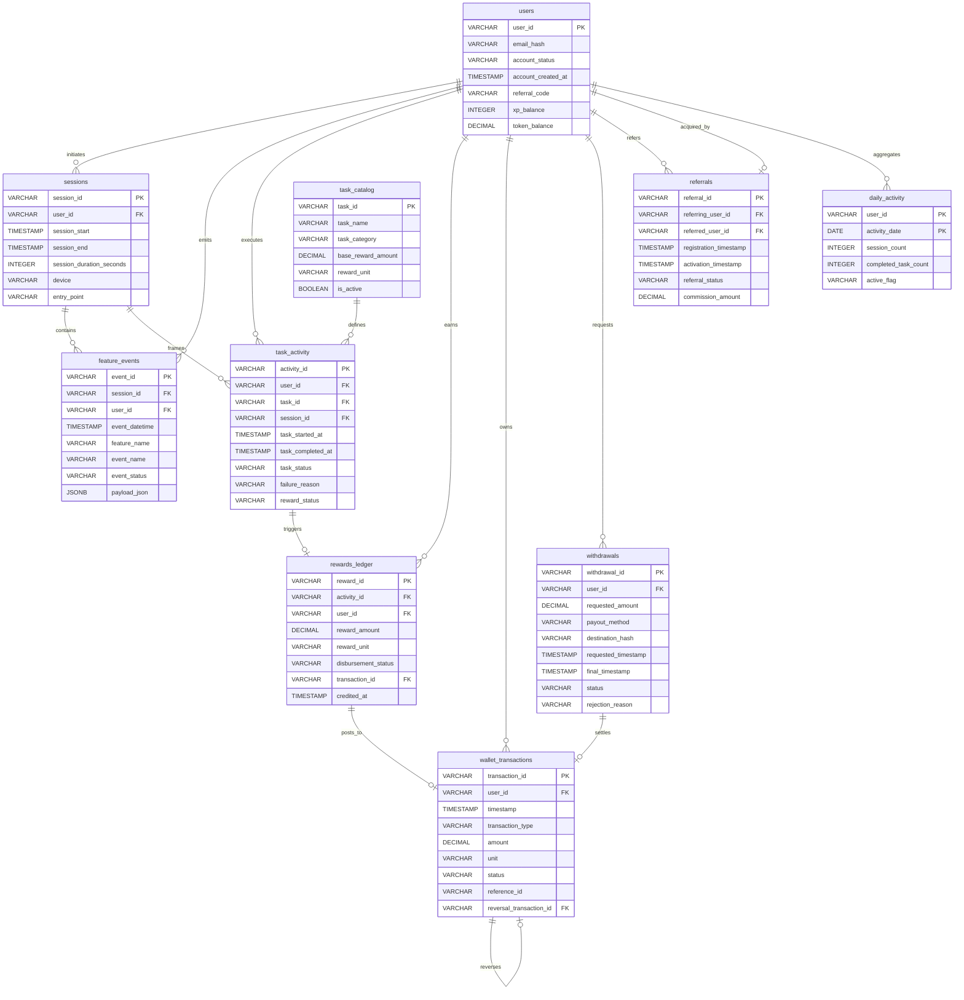

# VELOOP REWARDS — LOGICAL DATA MODEL & ER DIAGRAM SPECIFICATION
**Deliverable ID:** Deliverable 10  
**Work Package:** Work Package H — Logical Data Model & ER Diagram  
**Author:** Data Analysis Intern  
**Organization:** VELOOP Rewards    
**Integrity Label:** `SIMULATED DATA — CREATED FOR ANALYTICAL TESTING`  
**Classification:** Confirmed, Proposed, To Be Verified, Simulated  

---

## 1. Executive Summary & Architectural Overview

The VELOOP Rewards platform requires a high-performance, normalized relational data model capable of supporting both high-throughput write operations (telemetry event ingestion, reward crediting) and analytical reporting (cohort retention, financial reconciliation, multi-touch attribution).

To prevent data silos and inconsistencies, the model is architected across four functional clusters:
1. **User Identity & Lifecycle Cluster:** `users`, `sessions`, `daily_activity`.
2. **Behavioral Telemetry Cluster:** `feature_events`, `task_catalog`, `task_activity`.
3. **Financial Accounting Cluster:** `wallet_transactions`, `rewards_ledger`, `withdrawals`.
4. **Growth & Virality Cluster:** `referrals`.

The complete schema is written in PostgreSQL 15+ compatible DDL and saved at [`04_deliverables/deliverable_10_logical_data_model/schema.sql`](04_deliverables/deliverable_10_logical_data_model/schema.sql).

---

## 2. Professional Entity-Relationship (ER) Diagram

## 3. Primary Key & Relational Integrity Specifications (H1 & H2)

### 3.1 Primary Keys Summary
* `users.user_id`: Immutable alphanumeric identifier format `^VLUSR[0-9]{6}$`.
* `sessions.session_id`: Alphanumeric format `^SESS[0-9]{7}$`.
* `feature_events.event_id`: High-volume format `^EVT[0-9]{8}$`.
* `task_catalog.task_id`: Catalog identifier format `^TASK[0-9]{4}$`.
* `task_activity.activity_id`: Execution instance format `^ACT[0-9]{7}$`.
* `rewards_ledger.reward_id`: Disbursement key format `^RWD[0-9]{7}$`.
* `wallet_transactions.transaction_id`: Ledger key format `^TXN[0-9]{8}$`.
* `withdrawals.withdrawal_id`: Payout key format `^WDL[0-9]{7}$`.
* `referrals.referral_id`: Attribution key format `^REF[0-9]{8}$`.
* `daily_activity.(user_id, activity_date)`: Composite primary key.

### 3.2 Foreign Key Cascading & Deletion Policies
1. **User Cascades:** Deleting a user (`ON DELETE CASCADE`) cascades to `sessions`, `feature_events`, `task_activity`, and `daily_activity`.
2. **Financial Protection (`ON DELETE RESTRICT`):** The entities `wallet_transactions`, `withdrawals`, and `task_catalog` strictly enforce `ON DELETE RESTRICT`. A user record cannot be hard-deleted if financial transactions or payout records exist in the ledger. This guarantees audit compliance with financial accounting standards.
3. **Nullable Activity Links (`ON DELETE SET NULL`):** If a `task_activity` record is pruned in operational maintenance, the `rewards_ledger.activity_id` is set to NULL, preserving the immutable financial ledger entry intact.

---

## 4. Cardinality & Relationship Documentation (H3)

### 4.1 One-to-Many Relationships (1:N)
* **`users` $\rightarrow$ `sessions` (1:N):** One registered user initiates multiple contiguous application visits across different devices and dates.
* **`users` $\rightarrow$ `task_activity` (1:N):** A user executes multiple earning tasks over their tenure.
* **`users` $\rightarrow$ `wallet_transactions` (1:N):** A user balance is mutated across numerous distinct earning credits, redemptions, and fee adjustments.
* **`users` $\rightarrow$ `withdrawals` (1:N):** A user submits multiple payout requests as they accumulate redeemable balances.
* **`sessions` $\rightarrow$ `feature_events` (1:N):** A single 5-minute user session emits dozens of discrete interaction events (views, clicks, taps, claims).

### 4.2 One-to-One Relationships (1:1)
* **`users` $\rightarrow$ `referrals` (as referee) (1:1):** A user can only be referred into the platform **once**. Enforced by a unique constraint on `referrals.referred_user_id`.
* **`task_activity` $\rightarrow$ `rewards_ledger` (1:1):** Each completed task activity record can generate at most one disbursement credit record in `rewards_ledger`.
* **`rewards_ledger` $\rightarrow$ `wallet_transactions` (1:1):** Every individual reward disbursement record corresponds to exactly one committed double-entry credit record in the financial transaction ledger.

### 4.3 Many-to-Many Relationships (N:M)
* **`users` $\longleftrightarrow$ `task_catalog` (N:M):** Users engage with many tasks, and tasks are executed by thousands of users. This relationship is fully resolved by the associative junction table `task_activity`.

### 4.4 Self-Referencing Recursive Relationships
* **`wallet_transactions.reversal_transaction_id` $\rightarrow$ `wallet_transactions.transaction_id`:** When a prior credit is clawed back for fraud, a new offsetting transaction record is created that directly points to the historical transaction being reversed. This provides a clean, tamper-evident audit trail without overwriting historical database records.
* **`users.referring_user_id` $\rightarrow$ `users.user_id`:** Self-referencing foreign key on the `users` table allowing direct recursive traversal of multi-tier referral trees.

## Current implementation status — 25 November 2026

This deliverable is an analytical specification/report and must be read separately from runtime verification. The current Streamlit source contains seven navigation sections: Overview, User Analytics, Earning & Rewards, Wallet & Withdrawal, Referral & Virality, Feature & Engagement, and Data Quality & Audit. Workbook-level simulated records are not interchangeable with PostgreSQL-loaded records.

The supplied PostgreSQL execution evidence is marked `AUTH_REQUIRED_NOT_VERIFIED`; successful live database execution is therefore not established by that evidence. The automated project test suite was rerun for this archive and passed 40/40 tests. This does not verify live PostgreSQL, production payment settlement, or public dashboard deployment.

Wallet, withdrawal, user, session, event, task, and milestone examples are simulated/test data. Referral event activity must not be described as verified referral conversion without validated referrer/referee relationship records. A proposed schema or KPI definition is not evidence that the corresponding production workflow is deployed.
