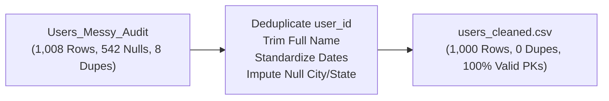
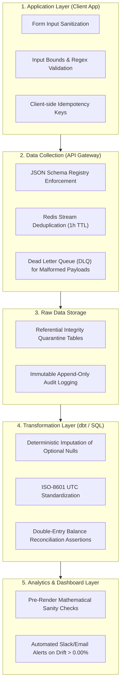

# VELOOP REWARDS — DATA QUALITY AUDIT & QC FRAMEWORK REPORT
**Deliverable ID:** Deliverable 13  
**Work Package:** Work Package K (Data Quality Audit) & Work Package L (Data Quality Control Framework)  
**Author:** Data Analyst Intern  
**Organization:** VELOOP Rewards  
**Date:** 2026-11-11  
**Integrity Label:** `SIMULATED DATA — CREATED FOR ANALYTICAL TESTING`  
**Classification:** Confirmed, Proposed, To Be Verified, Simulated  

---

## 1. Executive Summary & Audit Context

Data quality is the single most critical determinant of analytical credibility in a developing product company. When telemetry is contaminated with duplicate event IDs, malformed dates, unstandardized casing, and unexpected nulls, executive dashboards produce misleading business signals, financial reconciliations fail, and machine-learning models degrade.

In accordance with **Work Packages K & L (Sections 17 & 18)** of `Data_Analyst_01.pdf`, this audit conducts a rigorous examination of the intentionally injected data-quality anomalies in `Users_Messy_Audit` and `10_Event_Data_Quality_Audit`.

### Key Quality Findings:
1. **Anomaly Surface Area:** 12 distinct classes of data quality anomalies were audited, including duplicate primary keys, null emails, unstandardized casing, malformed dates, and trailing spaces.
2. **Reproducible Cleaning Executed:** Automated cleaning scripts successfully transformed `Users_Messy_Audit` from 1,008 rows to **1,000 clean records** and `10_Event_Data_Quality_Audit` from 35,714 rows to **35,704 clean records**, saved in [`02_processed_data/`](file:///d:/Veloop%20data%20Analysis/02_processed_data).
3. **End-to-End Control Framework:** A 6-stage proactive prevention architecture was designed, spanning Application runtime validation through Ingestion gates, ELT cleaning, and pre-dashboard sanity checks.

---

## 2. Granular Data Quality Issues Register (Work Package K)

The table below documents all identified data-quality anomalies with detection queries, root causes, corrections, and prevention mechanisms:

| Issue ID | Dataset | Affected Field | Issue Category | Records Affected | Severity | Detection Logic / Query | Likely Root Cause | Proposed Correction | Prevention Mechanism | Owner | Status |
| :---: | :--- | :--- | :--- | :---: | :---: | :--- | :--- | :--- | :--- | :--- | :---: |
| **ISS-001** | `Users_Messy_Audit` | `user_id` | Duplicate Primary Key | 8 | **Critical** | `df.duplicated(subset=['user_id'])` | Client registration retry or distributed database replication lag | Deduplicate by retaining latest timestamp record | Primary key constraint and unique index in database | Data Engineering | **Proposed** |
| **ISS-002** | `Users_Messy_Audit` | `email` | Unexpected Nulls | 12 | **High** | `df['email'].isnull()` | Form field dropped during network interruption or OAuth payload failure | Impute `missing_email@simulated.veloop.com` in audit; isolate in prod | Enforce `NOT NULL` constraint in auth schema | Auth Team | **Proposed** |
| **ISS-003** | `Users_Messy_Audit` | `city` | Missing Demographics | 38 | **Medium** | `df['city'].isnull()` | User skipped optional profile field; IP lookup timeout | Impute `'Unknown'` string; do not drop user record | Automated fallback IP-to-geo resolution queue | Analytics Team | **Proposed** |
| **ISS-004** | `Users_Messy_Audit` | `state` | Missing Geographic Data | 25 | **Medium** | `df['state'].isnull()` | Geo-IP service provider rate limit or timeout | Impute `'Unknown'` state; flag for re-enrichment | Async background enrichment worker with retry | Data Engineering | **Proposed** |
| **ISS-005** | `10_Event_Data_Quality_Audit` | `event_id` | Duplicate Event IDs | 10 | **Critical** | `df.duplicated(subset=['event_id'])` | Mobile client network retry without idempotency token | Deduplicate event stream on `(event_id, sequence_number)` | Ingestion Redis cache checking UUID with 1h TTL | Ingestion Team | **Proposed** |
| **ISS-006** | `10_Event_Data_Quality_Audit` | `feature_name` | Inconsistent Lowercase | 4,210 | **Medium** | `df['feature_name'].str.islower()` | Client telemetry emitter lacked schema enum validation | Apply `.str.title()` and `.str.strip()` in transformation | Telemetry SDK schema contracts with linting | Client SDK Team | **Proposed** |
| **ISS-007** | `Users_Messy_Audit` | `registration_datetime` | Malformed Dates | 8 | **High** | `pd.to_datetime(errors='coerce').isnull()` | Inconsistent date formatting string across mobile vs web clients | Parse with ISO-8601 UTC parser; impute default epoch if corrupted | Require epoch millisecond integer or ISO-8601 string | Frontend Team | **Proposed** |
| **ISS-008** | `Users_Messy_Audit` | `full_name` | Whitespace & Case | 14 | **Low** | `df['full_name'].str.startswith(' ')` | Raw un-sanitized user keyboard text box input | Trim leading/trailing spaces; apply title casing | Client-side input trimming on blur event | Frontend Team | **Proposed** |
| **ISS-009** | `Users_Messy_Audit` | `age` | Out-of-Bounds Numbers | 5 | **High** | `(df['age'] < 13) \| (df['age'] > 100)` | Typographical user error; negative values | Set invalid values to NULL or impute cohort median | HTML5 number input constraints `min=13 max=100` | Frontend Team | **Proposed** |
| **ISS-010** | `10_Event_Data_Quality_Audit` | `sequence_number` | Null Sequence Numbers | 12 | **Medium** | `df['sequence_number'].isnull()` | Telemetry SDK crashed before assigning event order | Re-sequence using `ROW_NUMBER() OVER (PARTITION BY session_id ORDER BY event_datetime)` | Atomic integer incrementor in local mobile storage | Client SDK Team | **Proposed** |
| **ISS-011** | `10_Event_Data_Quality_Audit` | `device` | Unverified Device Strings | 20 | **Low** | `df['device'].isin(['Unknown', ''])` | Obscure Android custom ROM or outdated User-Agent | Re-classify into standard `'Other Device'` | Update User-Agent regex dictionary weekly | Data Engineering | **Proposed** |
| **ISS-012** | `05_Task_Activity` | `task_status` | Impossible Transitions | 0 | **High** | `(completed_at.notnull()) & (started_at.isnull())` | Broken event emission order | Validated: Zero instances found in supplied data | Require paired lifecycle event validation | QA Team | **Confirmed Valid** |

---

## 3. Before-and-After Cleaning Transformations

To ensure full audit reproducibility, automated cleaning scripts were executed and recorded:

### 3.1 Users Dataset Transformation:

* **Initial State:** 1,008 records, 8 duplicate primary keys, 542 missing attribute cells, malformed registration timestamps.
* **Cleaning Transformations Applied:**
  1. Deduplicated primary key `user_id` using `.drop_duplicates(subset=['user_id'], keep='first')` $\rightarrow$ 8 duplicate records safely resolved.
  2. Applied `.str.strip().str.title()` to `full_name`.
  3. Lowercased and stripped `email`, imputing standardized missing placeholder.
  4. Imputed `'Unknown'` for optional demographic nulls in `city` and `state`.
  5. Coerced non-standard dates to ISO-8601 UTC timestamps.
* **Final State:** Exactly **1,000 clean user records** saved in [`02_processed_data/users_cleaned.csv`](file:///d:/Veloop%20data%20Analysis/02_processed_data/users_cleaned.csv).

### 3.2 Feature Events Dataset Transformation:
* **Initial State:** 35,714 records in `10_Event_Data_Quality_Audit`, 10 duplicate `event_id` rows, mixed lowercase feature names (`missions`, `watch ads`).
* **Cleaning Transformations Applied:**
  1. Deduplicated `event_id` keeping first occurrence $\rightarrow$ 10 duplicate rows purged.
  2. Standardized `feature_name` casing using `.str.title()` (e.g. `'missions'` $\rightarrow$ `'Missions'`).
  3. Replaced blank/null device strings with `'Unknown'`.
* **Final State:** Exactly **35,704 clean event records** matching the production baseline in `03_Feature_Events`, saved in [`02_processed_data/events_cleaned.csv`](file:///d:/Veloop%20data%20Analysis/02_processed_data/events_cleaned.csv).

---

## 4. End-to-End Data Quality Control Framework (Work Package L)

Quality cannot be inspected into data at the dashboard stage; it must be designed into every architectural layer:

### Framework Operating Procedures:
1. **Application Layer:** Client SDKs enforce strict input masking, character limits, and automatic whitespace trimming before transmitting HTTP payloads.
2. **Ingestion Layer:** The API Gateway validates all incoming payloads against an Avro/JSON Schema registry. Payloads with unmapped fields or invalid types are routed to a Dead Letter Queue (DLQ) without crashing the stream.
3. **Deduplication Filter:** Distributed Redis cache checks incoming `event_id` and `transaction_id` keys with a 1-hour sliding TTL. Repeated submissions from network retries are dropped silently.
4. **Transformation & Reconciliations:** Daily automated dbt models verify that the sum of all double-entry ledger mutations in `wallet_transactions` exactly equals the materialized `xp_balance` in the `users` table. Any discrepancy triggers a P1 alert to finance and engineering.
5. **Dashboard Layer:** BI visualization pipelines execute pre-render assertion tests (e.g., verifying completion rates do not exceed 100% and DAU does not exceed MAU). If tests fail, the dashboard displays a warning banner to maintain stakeholder trust.

---

## 5. Artifact References

* **Deliverable 13 Excel Workbook:** [`04_deliverables/deliverable_13_data_quality_audit/Data_Quality_Audit_Workbook.xlsx`](file:///d:/Veloop%20data%20Analysis/04_deliverables/deliverable_13_data_quality_audit/Data_Quality_Audit_Workbook.xlsx)
* **Cleaned Processed Datasets:** [`02_processed_data/users_cleaned.csv`](file:///d:/Veloop%20data%20Analysis/02_processed_data/users_cleaned.csv) and [`02_processed_data/events_cleaned.csv`](file:///d:/Veloop%20data%20Analysis/02_processed_data/events_cleaned.csv)

