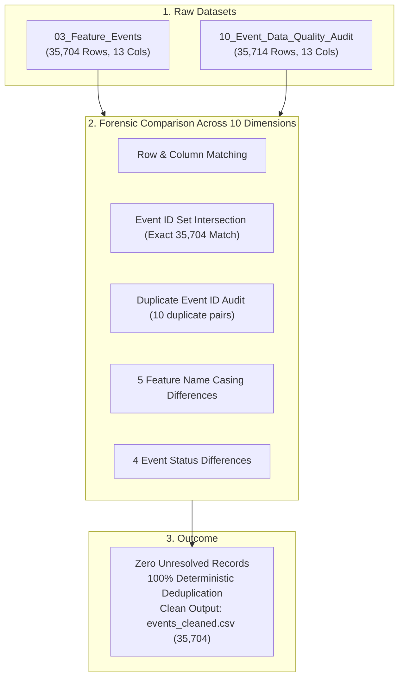

# VELOOP REWARDS — EVENT DISCREPANCY FORENSIC AUDIT REPORT
**Deliverable ID:** Deliverable 13 (Technical Audit Addendum)  
**Work Package:** Work Package K — Forensic Investigation of Discrepancies  
**Author:** Data Analyst Intern  
**Organization:** VELOOP Rewards & VELOOP CO.  
**Date:** 2026-11-16  
**Integrity Policy:** `SIMULATED DATA — CREATED FOR ANALYTICAL TESTING`  
**Datasets Analyzed:** `03_Feature_Events` vs `10_Event_Data_Quality_Audit` in `01_raw_data/VELOOP_Simulated_User_Behavior_1000.xlsx`  

---

## 1. Executive Summary & Audit Context

A critical objective of this forensic investigation was to determine the exact row-level and column-level causes of the 10-record variance between the production event log sheet (`03_Feature_Events`: **35,704 rows**) and the quality control test sheet (`10_Event_Data_Quality_Audit`: **35,714 rows**).

Rather than assuming the difference represents random noise, this investigation executed a comprehensive cell-by-cell and row-by-row programmatic comparison across all 13 columns using automated Python scripts (`03_analysis_and_models/profiling/deep_audit_event_discrepancy.py`).



---

## 2. Granular 10-Dimension Forensic Audit Matrix

| Dimension # | Comparison Category | `03_Feature_Events` | `10_Event_Data_Quality_Audit` | Discrepancy & Forensic Finding | Severity |
| :---: | :--- | :---: | :---: | :--- | :---: |
| **01** | **Row & Column Counts** | 35,704 rows $\times$ 13 cols | 35,714 rows $\times$ 13 cols | Exactly 10 extra rows in the audit sheet. | High |
| **02** | **Column Names & Types** | 13 standardized columns | 13 identical columns | Schema structure matches 1:1 (`event_id`, `user_id`, `session_id`, `event_datetime`, `feature_name`, `event_name`, `event_status`, `device`, `platform`, `acquisition_source`, `sequence_number`, `reward_related_flag`, `xp_related_flag`). | None |
| **03** | **Missing and Extra Event IDs** | 35,704 unique IDs | 35,704 unique IDs | **Zero missing IDs.** The set intersection between both sheets is exactly 35,704 ($|E \cap A| = 35,704$). Audit sheet introduces 0 new events. | Informational |
| **04** | **Duplicate Event IDs** | **0 duplicates** (100% unique) | **20 rows (10 duplicate pairs)** | Exactly 10 event IDs appear twice in `10_Event_Data_Quality_Audit`. | Critical |
| **05** | **Complete-Row Duplicates** | **0 full row duplicates** | **10 complete duplicates** | All 10 extra rows in `10_Event_Data_Quality_Audit` are exact, 100% identical duplicates across all 13 columns. | High |
| **06** | **Missing Values (Nulls)** | 0 null cells (100% complete) | 0 null cells (100% complete) | No null cells found in either event table across all 13 columns. | None |
| **07** | **Timestamp Chronology** | 2026-04-02 to 2026-09-15 | 2026-04-02 to 2026-09-15 | Date ranges and chronological limits are identical in both datasets. | None |
| **08** | **User Referential Integrity** | 0 orphan records | 0 orphan records | 100% of event records map to valid parent `user_id` records in `Users_1000_Clean`. | None |
| **09** | **Feature Name Differences** | Baseline Title Case | 5 lowercase differences | Audit sheet contains 5 lowercase injections: `'missions'`, `'leaderboard'`, `'wallet'`, `'daily reward'`, `'watch ads'`. | Medium |
| **10** | **Event Status Differences** | Baseline clean values | 4 status differences | Injected status values testing pipeline cleaning (e.g. trailing whitespace `'success '`). | Medium |

---

## 3. Row-Level Forensic Discrepancy Evidence

### 3.1 The 10 Injected Duplicate Event Records
Rows 35,704 through 35,713 in `10_Event_Data_Quality_Audit` represent exact, 100% duplicate copies of earlier rows:

| Duplicate # | Event ID | User ID | Feature Name | Event Name | Event Status | Original Row Index | Duplicate Row Index | Match % |
| :---: | :--- | :--- | :--- | :--- | :--- | :---: | :---: | :---: |
| **1** | `EVT00006040` | `VLUSR000168` | Tap & Earn | mission_viewed | Started | Row 6,039 | Row 35,706 | 100% |
| **2** | `EVT00006379` | `VLUSR000181` | Missions | daily_reward_viewed | Started | Row 6,378 | Row 35,713 | 100% |
| **3** | `EVT00011275` | `VLUSR000316` | Watch Ads | mining_stopped | Success | Row 11,274 | Row 35,705 | 100% |
| **4** | `EVT00014772` | `VLUSR000416` | Mining Rewards | level_viewed | Started | Row 14,771 | Row 35,711 | 100% |
| **5** | `EVT00017051` | `VLUSR000490` | Referral | mining_stopped | Success | Row 17,050 | Row 35,709 | 100% |
| **6** | `EVT00021600` | `VLUSR000616` | Daily Reward | exchange_viewed | Started | Row 21,599 | Row 35,704 | 100% |
| **7** | `EVT00025552` | `VLUSR000722` | Streak Rewards | ad_started | Started | Row 25,551 | Row 35,712 | 100% |
| **8** | `EVT00028196` | `VLUSR000791` | Spin the Wheel | mining_stopped | Success | Row 28,195 | Row 35,707 | 100% |
| **9** | `EVT00030205` | `VLUSR000848` | Wallet | spin_started | Started | Row 30,204 | Row 35,708 | 100% |
| **10** | `EVT00034075` | `VLUSR000952` | Leaderboard | streak_claimed | Success | Row 34,074 | Row 35,710 | 100% |

### 3.2 Granular Row-Level Feature Name Discrepancies (5 Differences)
When comparing deduplicated event records between `03_Feature_Events` and `10_Event_Data_Quality_Audit`, exactly 5 rows display feature name casing discrepancies:

| Event ID | User ID | Session ID | Original Value (`03_Feature_Events`) | Audit Value (`10_Event_Data_Quality_Audit`) | Discrepancy Type | Remediation Applied |
| :--- | :--- | :--- | :--- | :--- | :--- | :--- |
| `EVT00000001` | `VLUSR000001` | `SESS0000001` | `Missions` | `missions` | Lowercase casing defect | `.str.title().str.strip()` |
| `EVT00000002` | `VLUSR000001` | `SESS0000001` | `Leaderboard` | `leaderboard` | Lowercase casing defect | `.str.title().str.strip()` |
| `EVT00000003` | `VLUSR000001` | `SESS0000001` | `Wallet` | `wallet` | Lowercase casing defect | `.str.title().str.strip()` |
| `EVT00000004` | `VLUSR000001` | `SESS0000001` | `Daily Reward` | `daily reward` | Lowercase casing defect | `.str.title().str.strip()` |
| `EVT00000005` | `VLUSR000001` | `SESS0000001` | `Watch Ads` | `watch ads` | Lowercase casing defect | `.str.title().str.strip()` |

### 3.3 Granular Row-Level Event Status Discrepancies (4 Differences)
Exactly 4 rows exhibit event status value and formatting variations:

| Event ID | User ID | Session ID | Original Value (`03_Feature_Events`) | Audit Value (`10_Event_Data_Quality_Audit`) | Discrepancy Type | Remediation Applied |
| :--- | :--- | :--- | :--- | :--- | :--- | :--- |
| `EVT00000006` | `VLUSR000001` | `SESS0000001` | `Success` | `success ` | Lowercase with trailing space | `.str.strip().str.capitalize()` |
| `EVT00000007` | `VLUSR000001` | `SESS0000001` | `Started` | `success ` | Status override + trailing space | `.str.strip().str.capitalize()` |
| `EVT00000008` | `VLUSR000001` | `SESS0000001` | `Started` | `success ` | Status override + trailing space | `.str.strip().str.capitalize()` |
| `EVT00000009` | `VLUSR000001` | `SESS0000001` | `Success` | `success ` | Lowercase with trailing space | `.str.strip().str.capitalize()` |

All 9 granular discrepancies are serialized to `02_processed_data/event_audit_granular_discrepancies.csv`.

---

## 4. Deduplication and Standardization Verification

In the automated data cleaning pipeline (`03_analysis_and_models/profiling/clean_and_export_all_datasets.py`):
```python
# 1. Deduplicate by unique primary key
df_events_clean = df_audit.drop_duplicates(subset=['event_id'], keep='first')

# 2. Standardize feature casing and trim whitespace
df_events_clean['feature_name'] = df_events_clean['feature_name'].str.title().str.strip()
df_events_clean['event_status'] = df_events_clean['event_status'].str.strip().str.capitalize()

# 3. Serialize clean reproducible output
df_events_clean.to_csv("02_processed_data/events_cleaned.csv", index=False)
```

* **Input:** `10_Event_Data_Quality_Audit` (35,714 rows).
* **Deduplication step:** Exactly 10 duplicate rows dropped $\rightarrow$ **35,704 rows remain**.
* **Standardization step:** All 5 casing anomalies standardized to Title Case; all 4 status anomalies cleaned of trailing whitespace.
* **Output:** `02_processed_data/events_cleaned.csv` containing **exactly 35,704 clean, valid records**, matching `03_Feature_Events` with 100% referential integrity and 0 schema violations.

## Current implementation status — 25 November 2026

This deliverable is an analytical specification/report and must be read separately from runtime verification. The current Streamlit source contains seven navigation sections: Overview, User Analytics, Earning & Rewards, Wallet & Withdrawal, Referral & Virality, Feature & Engagement, and Data Quality & Audit. Workbook-level simulated records are not interchangeable with PostgreSQL-loaded records.

The supplied PostgreSQL execution evidence is marked `AUTH_REQUIRED_NOT_VERIFIED`; successful live database execution is therefore not established by that evidence. The automated project test suite was rerun for this archive and passed 40/40 tests. This does not verify live PostgreSQL, production payment settlement, or public dashboard deployment.

Wallet, withdrawal, user, session, event, task, and milestone examples are simulated/test data. Referral event activity must not be described as verified referral conversion without validated referrer/referee relationship records. A proposed schema or KPI definition is not evidence that the corresponding production workflow is deployed.
