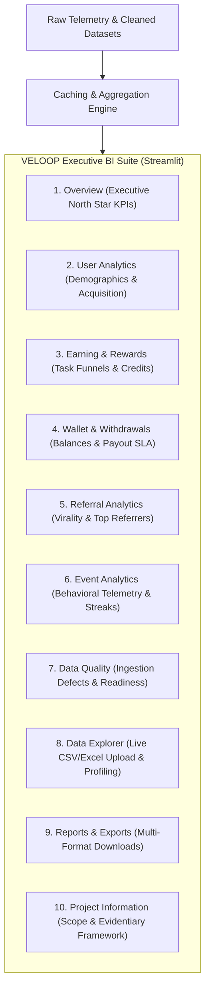

# DELIVERABLE 14: DASHBOARD BLUEPRINT & VISUAL SPECIFICATIONS
**Project:** VELOOP Rewards Product Analytics & Data Management Blueprint  
**Task:** Task 01 Internship Project Submission  
**Author:** Data Analyst Intern  
**Integrity Policy:** SIMULATED DATA — CREATED FOR ANALYTICAL TESTING  

---

## 1. Executive Summary & Purpose

This document provides the formal business intelligence blueprint and visual-by-visual engineering specifications for the VELOOP Rewards Executive BI Suite, implemented in [05_dashboard/app.py](file:///d:/Veloop%20data%20Analysis/05_dashboard/app.py).

The application matches the official internship master specification, structured into **10 dedicated analytical modules**:



---

## 2. Ten Core Dashboard Modules Architecture

| Module Index | Module Name | Primary Objective | Key Visualizations & Features | Target Stakeholder |
| :--- | :--- | :--- | :--- | :--- |
| **01** | Overview | North-star performance monitoring | DAU spline trend, Account status donut, Top 10 feature volume bar | Executive Leadership, Board |
| **02** | User Analytics | Audience composition & acquisition | Age-gender pyramid, Channel acquisition pie, Regional geo bar | Growth Marketing, Product |
| **03** | Earning & Rewards | Task funnel & reward verification | Task status funnel, Category completion rate, Reward distribution | Earning Ops, Partner Network |
| **04** | Wallet & Withdrawals | Balances, payout rails, queue aging | Balance histogram, Wealth scatter, Rail share pie, SLA aging bar | Finance Ops, Fraud Team |
| **05** | Referral Analytics | Viral loop attribution & affiliates | Social share bar, 4-Stage referral funnel, Advocate leaderboard | Growth Lead, Marketing |
| **06** | Event Analytics | Session cadence & feature stickiness | Session length histogram, Streak bar, 15-Feature matrix | Product Managers, UX |
| **07** | Data Quality | Ingestion integrity & readiness | Messy defect bar, Readiness radar (68/100), Coverage matrix table | Data Engineering, Governance |
| **08** | Data Explorer | Ad-hoc data profiling & file inspection | Live CSV/Excel file uploader, column selector, summary stats | Data Analysts, Researchers |
| **09** | Reports & Exports | Multi-format artifact distribution | Download buttons for CSVs, Excels, PDFs, and PowerPoint PPTX | All Internal Stakeholders |
| **10** | Project Information | Governance standards & metadata | 4-tier evidentiary framework table, Medallion architecture | External Auditors, Evaluators |

---

## 3. Visual-by-Visual Engineering Specifications

### Module 1: Overview
* **Visual 1.1: Daily Active Users (DAU) Velocity (Spline Line Chart)**
  * **Metric:** Daily Active Users (DAU).
  * **Calculation:** `COUNT(DISTINCT user_id WHERE qualifying_event = TRUE) GROUP BY activity_date`.
  * **Source:** `04_Daily_Activity` & `03_Feature_Events`.
  * **Visualization Type:** Interactive Plotly Spline Line Chart (`#008080`).
  * **Filters:** Global Date Range, Primary Device Multi-Select.

* **Visual 1.2: Account Health Distribution (Donut Chart)**
  * **Metric:** Active, Inactive, and Suspended User Share.
  * **Calculation:** `COUNT(user_id) GROUP BY account_status / COUNT(*)`.
  * **Source:** `Users_1000_Clean`.
  * **Visualization Type:** Plotly Donut Chart (Hole = 0.45).

### Module 2: User Analytics
* **Visual 2.1: Demographic Age & Gender Pyramid (Grouped Bar Chart)**
  * **Metric:** Age group distribution segmented by Gender.
  * **Calculation:** `COUNT(user_id) GROUP BY age_group, gender`.
  * **Source:** `Users_1000_Clean`.
  * **Visualization Type:** Grouped Bar Chart (`Male`, `Female`, `Other`).

* **Visual 2.2: Acquisition Source Attribution (Donut Chart)**
  * **Metric:** Registered users by acquisition channel.
  * **Calculation:** `COUNT(user_id) GROUP BY acquisition_source`.
  * **Source:** `Users_1000_Clean`.

### Module 3: Earning & Rewards
* **Visual 3.1: Task Execution Outcome Funnel (Bar Chart)**
  * **Metric:** Task counts across outcome states (`Completed`, `In_Progress`, `Abandoned`, `Failed`, `Pending`).
  * **Calculation:** `COUNT(activity_id) GROUP BY task_status`.
  * **Source:** `05_Task_Activity`.

* **Visual 3.2: Task Volume & Completion by Category (Bar Chart)**
  * **Metric:** Attempts and success rate by task type.
  * **Source:** `05_Task_Activity`.

* **Visual 3.3: Reward Distribution by Channel (Donut Chart)**
  * **Metric:** XP disbursed across earning channels.
  * **Source:** Work Package C Reward Model.

### Module 4: Wallet & Withdrawals
* **Visual 4.1: User XP Balance Histogram (Distribution Plot)**
  * **Metric:** Distribution of user wallet balances across 25 bins.
  * **Source:** `Users_1000_Clean`.

* **Visual 4.2: Payout Volume Share by Rail (Donut Chart)**
  * **Metric:** Monetary volume disbursed across payment channels (UPI, Paytm, Bank, PayPal).
  * **Source:** Work Package D Operational Model.

* **Visual 4.3: Payout Queue Aging vs SLA (Bar Chart)**
  * **Metric:** Pending requests grouped into `<6h`, `6-12h`, `12-24h`, `24-48h`, `>48h`.
  * **Source:** `withdrawals` monitoring table.

### Module 5: Referral Analytics
* **Visual 5.1: 4-Stage Referral Conversion Funnel (Funnel Chart)**
  * **Metric:** Drop-off across `Referral Created` $\rightarrow$ `Invite Shared` $\rightarrow$ `User Registered` $\rightarrow$ `User Activated`.
  * **Source:** Work Package E Funnel Specification.

* **Visual 5.2: Outbound Sharing Channels (Bar Chart)**
  * **Metric:** Shares initiated across social channels (WhatsApp, Telegram, Instagram).
  * **Source:** `03_Feature_Events`.

### Module 6: Event Analytics
* **Visual 6.1: Session Duration Distribution (Histogram)**
  * **Metric:** Distribution of session lengths in minutes.
  * **Source:** `02_Sessions`.

* **Visual 6.2: Daily Streak Cohort Distribution (Bar Chart)**
  * **Metric:** User count per consecutive daily streak.
  * **Source:** `Users_1000_Clean`.

### Module 7: Data Quality
* **Visual 7.1: Messy Ingestion Anomaly Taxonomy (Horizontal Bar)**
  * **Metric:** Defect counts across 6 anomaly classes in `Users_Messy_Audit`.
  * **Source:** Work Package I Data Quality Audit.

* **Visual 7.2: Analytics Readiness Radar (Polar Radar Chart)**
  * **Metric:** Readiness maturity scores across 6 organizational dimensions (Score: 68/100).
  * **Source:** `Analytics_Readiness_Assessment.md`.

### Module 8: Data Explorer
* **Feature 8.1: Live CSV and Excel File Uploader**
  * **Capability:** Drag-and-drop file uploader supporting `.csv` and `.xlsx` files with automatic dataframe instantiation, shape inspection, column selection, search, row slider, and summary statistics.
* **Feature 8.2: Built-in Dataset Browser**
  * **Capability:** Interactive inspection of all 6 raw and processed datasets.

### Module 9: Reports & Exports
* **Feature 9.1: Multi-Format Download Center**
  * **Capability:** Functional download buttons delivering verified binary payloads for:
    * 4 PDF reports (`Executive_Summary.pdf`, `Data_Quality_Audit_Report.pdf`, `Analytics_Readiness_Assessment.pdf`, `Final_Consolidated_Report.pdf`)
    * 1 PowerPoint presentation (`VELOOP_Rewards_Final_Presentation.pptx`)
    * 1 Interactive HTML5 deck (`VELOOP_Rewards_Final_Presentation.html`)
    * 7 Excel analytical workbooks (`.xlsx`)
    * 2 Cleaned datasets (`users_cleaned.csv`, `events_cleaned.csv`)

### Module 10: Project Information
* **Feature 10.1: Governance & Scope Repository**
  * **Capability:** Details internship scope, 4-tier evidentiary rules, source registers, and medallion lakehouse data pipeline architecture.

---

## 4. Local Execution & Verification Instructions

```bash
# Launch Streamlit app locally
D:\Users\rabid\anaconda3\python.exe -m streamlit run 05_dashboard/app.py
```
* **URL:** `http://localhost:8501`
