# VELOOP REWARDS — DATA PIPELINE & OPERATING MODEL PROPOSAL
**Deliverable ID:** Deliverable 16  
**Work Package:** Work Package O — Data Pipeline & Operating Model  
**Author:** Data Analyst Intern  
**Organization:** VELOOP Rewards  
**Date:** 2026-11-11  
**Integrity Label:** `SIMULATED DATA — CREATED FOR ANALYTICAL TESTING`  
**Classification:** Confirmed, Proposed, To Be Verified, Simulated  

---

## 1. Executive Summary & Design Principles

In strict adherence to **Section 21 of `Data_Analyst_01.pdf`**:
> *"Do not recommend expensive infrastructure merely because it sounds professional. The architecture must be practical for a developing product and scalable when justified."*

For an early-stage digital rewards ecosystem like VELOOP, deploying complex multi-cloud distributed infrastructure (e.g. multi-node Spark clusters, Snowflake enterprise tiers, or real-time Flink pipelines) incurs prohibitive infrastructure costs and unneeded operational overhead before telemetry volume warrants it.

This proposal establishes a **lean, pragmatic, cost-efficient, and maintainable pipeline architecture** utilizing modern lightweight open-source components (FastAPI / Ingestion Gateway $\rightarrow$ S3/MinIO Raw Parquet $\rightarrow$ PostgreSQL Analytical Replicas / DuckDB $\rightarrow$ dbt Core $\rightarrow$ Streamlit / Metabase BI).

---

## 2. End-to-End Pipeline Architecture Diagram

```mermaid
flowchart TD
    subgraph Sources["1. Event Producers & Sources"]
        A1["VELOOP Mobile App (Android/iOS SDK)"]
        A2["VELOOP Web Application (React/Next.js)"]
        A3["Ad & Offerwall Partners (S2S Postbacks)"]
        A4["Payment Gateway Webhooks (UPI/Razorpay)"]
    end

    subgraph Collection["2. Collection & Ingestion Layer"]
        B1["API Gateway (FastAPI / NGINX Ingestion Endpoint)"]
        B2["Redis Ingestion Buffer & Deduplication (1h TTL)"]
    end

    subgraph RawStorage["3. Raw Data Storage (Data Lake)"]
        C1["Object Storage (AWS S3 / Cloudflare R2 / MinIO)"]
        C2["Append-Only Raw JSON / Parquet Partitions"]
    end

    subgraph Validation["4. Automated Quality Gates"]
        D1["Schema Validator (Pydantic / Great Expectations)"]
        D2["Dead Letter Queue (DLQ) for Malformed Events"]
    end

    subgraph Transformation["5. Transformation Layer (dbt Core)"]
        E1["Hourly Micro-Batch ELT Cleaning Models"]
        E2["Entity Deduplication & Standardized Typing"]
        E3["Double-Entry Balance Reconciliation Assertions"]
    end

    subgraph Analytics["6. Analytical Data Layer (Data Marts)"]
        F1["PostgreSQL 15+ Analytical Read-Replica"]
        F2["Star-Schema Dimensional Marts (Facts & Dims)"]
    end

    subgraph Reporting["7. Business Intelligence & Reporting"]
        G1["Interactive Streamlit Dashboard (Local / Hosted)"]
        G2["Executive KPI Email Summaries (Daily Automated)"]
        G3["Finance Reconciliation Spreadsheets (OpenPyXL)"]
    end

    Sources --> Collection
    Collection --> RawStorage
    RawStorage --> Validation
    Validation --> Transformation
    Transformation --> Analytics
    Analytics --> Reporting
```

---

## 3. Layer-by-Layer Architectural Specifications

### 3.1 Source Systems & Event Producers
* **Client Applications:** Android and iOS apps embed a lightweight telemetry client SDK that batches events in local SQLite storage during offline periods and flushes them over HTTPS when connectivity is established.
* **Server Microservices:** Auth, Task, Wheel, and Wallet services emit transactional state events directly to internal ingestion endpoints.
* **External Partners:** Third-party offerwall networks (ironSource, Tapjoy) and payment gateways (Cashfree, Razorpay) deliver asynchronous HTTP postback webhooks.

### 3.2 Collection & Ingestion Layer
* **Ingestion Endpoint:** Stateless Python FastAPI service behind an NGINX load balancer handling `/api/v1/telemetry/events`.
* **Deduplication Buffer:** High-speed in-memory Redis cluster caching incoming `(event_id, sequence_number)` pairs for 1 hour. Repeated requests from client network retries are identified in $< 1\text{ms}$ and acknowledged with HTTP 200 without duplicate processing.

### 3.3 Raw Storage Layer (Bronze / Staging)
* **Storage Engine:** Cloudflare R2 or AWS S3 Standard-IA object storage storing events in append-only Parquet format partitioned by `year=YYYY/month=MM/day=DD/hour=HH`.
* **Cost Efficiency:** Parquet columnar compression reduces raw JSON storage footprint by $> 75\%$ with zero egress fees on modern object stores.

### 3.4 Quality Validation & Isolation (Silver Gate)
* **Schema Enforcement:** Pydantic models validate required fields, ISO-8601 UTC timestamps, and allowed enum values.
* **Dead Letter Queue (DLQ):** Payloads failing schema validation are diverted to an S3 quarantine prefix (`s3://veloop-data-dlq/`) with error diagnostic metadata, preventing downstream pipeline breakage.

### 3.5 Transformation Layer (Silver to Gold)
* **Tool:** `dbt Core` (open-source command-line tool, zero licensing cost) running scheduled hourly SQL transformations.
* **Models:**
  * `stg_users`: Trims whitespace, cleans emails, standardizes casing, handles null state/city.
  * `fct_task_activity`: Resolves task start-to-completion funnel duration.
  * `fct_wallet_ledger`: Reconstructs user balances from double-entry mutations.
  * `agg_daily_kpis`: Materializes pre-computed daily rollups for lightning-fast BI rendering.

### 3.6 Analytical Data Layer
* **Database Engine:** Dedicated PostgreSQL 15+ analytical read-replica (completely isolated from production transactional database CPU).
* **Dimensional Design:** Star-schema architecture consisting of central fact tables (`fct_events`, `fct_task_activity`, `fct_wallet_transactions`) surrounded by conformed dimensions (`dim_users`, `dim_tasks`, `dim_calendar`).

### 3.7 Business Intelligence & Dashboards
* **Operational Reporting:** Functional Streamlit application (`05_dashboard/app.py`) providing self-service drill-downs for product managers and operations.
* **Automated Python Reporting:** Daily automated Python scripts generating OpenPyXL workbooks and Slack executive alerts.

---

## 4. Pipeline Operating Model & Governance

| Operational Function | Technology / Mechanism | Execution Cadence | Responsible Team Owner | Failure Handling & Escalation Protocol |
| :--- | :--- | :---: | :--- | :--- |
| **Ingestion Health Monitoring** | Prometheus + Grafana alerts on HTTP 5xx rates | Continuous (Real-Time) | DevOps / Infrastructure | Auto-restart pods; route traffic to standby gateway if error rate $> 1\%$. |
| **Deduplication Rate Audit** | Redis deduplication counter metric | Hourly | Ingestion Engineering | Alert if deduplication rate spikes $> 15\%$ (indicates client retry loop bug). |
| **Data Lake Parquet Sync** | Streaming buffer flush worker | 5-minute intervals | Data Engineering | Fallback local disk spooling if S3 bucket upload fails. |
| **dbt Transformation Runs** | Scheduled cron job / GitHub Actions | Hourly | Analytics Engineering | On dbt test failure: abort downstream mart refresh; notify data team on Slack. |
| **Financial Balance Assertion** | SQL test: $\sum(\text{txns}) == \text{users.xp\_balance}$ | Daily at 01:00 UTC | Data Analyst & Finance | P1 incident if balance drift $> 0.00$; freeze automated payouts until resolved. |
| **Dashboard Cache Invalidation** | `@st.cache_data(ttl=3600)` | Hourly auto-refresh | BI Developer | Graceful fallback to cached data if analytical replica query times out. |

---

## 5. Architectural Scalability Roadmap

1. **Phase 1 (Current / Launch):** PostgreSQL Read-Replica + dbt Core + Streamlit. (Supports up to 50,000 DAU and 5,000,000 events/month at $<\$100/\text{month}$ total hosting cost).
2. **Phase 2 (Growth - 100k+ DAU):** Introduce Apache Kafka broker for streaming ingestion and DuckDB/ClickHouse for sub-second analytical query acceleration over billions of historical events.
3. **Phase 3 (Scale - 1M+ DAU):** Managed lakehouse (Databricks / BigQuery) with automated machine-learning fraud scoring pipelines.

