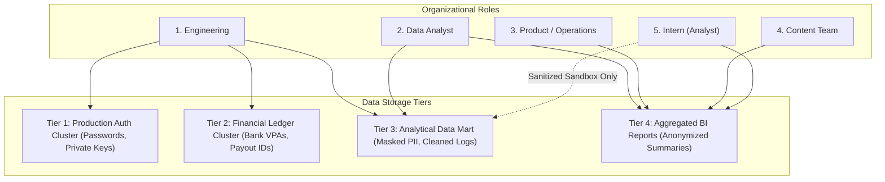

# VELOOP REWARDS — DATA ACCESS, PRIVACY & CHANGE MANAGEMENT
**Deliverable ID:** Deliverable 17  
**Work Package:** Work Package P (Data Access & Governance) & Work Package Q (Analytics Change Management)  
**Author:** Data Analyst Intern  
**Organization:** VELOOP Rewards  
**Date:** 2026-11-11  
**Integrity Label:** `SIMULATED DATA — CREATED FOR ANALYTICAL TESTING`  
**Classification:** Confirmed, Proposed, To Be Verified, Simulated  

---

## 1. Executive Summary & Regulatory Framework

Digital rewards ecosystems handle sensitive user data, payment routing credentials, and transactional value. Operating with lax data access policies risks catastrophic data breaches, regulatory penalties (under the Digital Personal Data Protection Act - DPDP, GDPR, and CCPA), and insider fraud.

This specification formalizes:
1. A **5-Tier Role-Based Access Control (RBAC) matrix** establishing minimum-privilege boundaries for all personnel roles.
2. Mandatory **non-collection and PII sanitization policies** ensuring analytical warehouses remain free of plain-text secrets and payment credentials.
3. An enterprise **Analytics Change Management Framework** and living **Metric/Event Change Log** to govern schema migrations without breaking production dashboards.

---

## 2. Five-Tier Role-Based Access Control (RBAC) Matrix (Work Package P)

### 2.1 Role-Based Access Governance Specification

| Role Name | Scope of Responsibility | Permitted Data Assets | Strictly Prohibited Data Assets | Access Mechanism & Protocol |
| :--- | :--- | :--- | :--- | :--- |
| **1. Engineering** | Technical event instrumentation, API maintenance, DB infrastructure. | Full access to schema DDL, application logs, test clusters, raw streaming topics. | Production user plaintext passwords; live payment private keys. | SSH / VPN with multi-factor authentication and bastions. |
| **2. Data Analyst** | KPI modeling, data profiling, behavioral funnels, pipeline testing. | Read-only access to analytical data warehouse, sanitized event logs, user marts. | Plaintext email, full names, raw phone numbers, bank accounts. | Read-only analytical warehouse replica with masked views. |
| **3. Product / Operations** | Business performance monitoring, daily operations, partner reviews. | Aggregated BI dashboards, feature rollups, anonymized cohort summaries. | Individual user clickstream logs, raw JSON payloads, PII. | Streamlit BI dashboard, Metabase, daily executive reports. |
| **4. Content Team** | Ad placement performance, marketing copy effectiveness. | Content engagement metrics, ad completion rates, category impressions. | User financial records, wallet balances, user identity tables. | Aggregated content dashboard views. |
| **5. Intern (Analyst)** | Analytical modeling, data quality auditing, documentation, blueprint design. | **Approved, sanitized, simulated datasets only.** | Any connection to live production databases or unsanitized PII. | Local workspace sandbox (`d:\Veloop data Analysis`). |

---

## 3. Strict Non-Collection & PII Sanitization Policy

In accordance with **Section 22 of `Data_Analyst_01.pdf`**, the platform enforces strict exclusions:

### 3.1 Categorically Excluded Attributes (Zero Storage Rule)
The analytical pipeline and data collection SDKs are strictly forbidden from capturing, storing, or processing:
1. **Plaintext Passwords / Passphrases:** Authentication credentials remain exclusively handled by OAuth providers or hashed with bcrypt/Argon2 inside dedicated auth clusters.
2. **Payment Credentials:** Credit/debit card numbers, CVV codes, bank PINs, and gateway API private keys must never touch VELOOP servers.
3. **National Identity Identifiers:** Aadhaar numbers, PAN cards, or Social Security numbers.
4. **Precise Geographic Coordinates:** Continuous background GPS latitude/longitude tracking is prohibited; only coarse city/state derived from IP lookup is permitted.

### 3.2 Analytical Sanitization Protocol
Before any dataset is synced from raw production into analytical marts:
* **Email Hashing:** Raw email strings (e.g. `sanjay.singh1@gmail.com`) are converted into SHA-256 cryptographic hashes (`email_hash = sha256(lowercase(email))`).
* **Name Masking:** Full names are replaced with masked variants (e.g. `S***** S****`) or dropped in favor of the surrogate key `user_id`.
* **Payment Destination Masking:** UPI VPAs and bank account numbers in the withdrawals pipeline are stored as one-way SHA-256 hashes (`destination_hash`) to enable multi-accounting fraud detection without exposing banking identities.

---

## 4. Analytics Change Management Framework (Work Package Q)

As VELOOP evolves, features will be updated, events renamed, reward mechanics rebalanced, and withdrawal thresholds adjusted. Uncontrolled changes cause dashboard metrics to break silently.

### 4.1 Schema Evolution & Event Versioning Protocol
1. **Never Mutate Historical Events:** Event definitions are immutable. If payload properties change, increment the event version (e.g., `task_completed_v2`).
2. **Deprecation Window:** A deprecated event must be co-emitted alongside the new event for a minimum of **14 calendar days** to allow BI pipelines and dashboards to migrate cleanly.
3. **Formal Change Request:** Any change to an event schema, KPI formula, or reward mechanic requires logging in the Metric/Event Change Log with sign-off from Product and Analytics Leads.

---

## 5. Enterprise Metric/Event Change Log

| Change ID | Date | Component Changed | Old Definition | New Definition | Reason for Change | Affected KPIs | Affected Dashboards | Owner | Version |
| :---: | :---: | :--- | :--- | :--- | :--- | :--- | :--- | :---: | :---: |
| **CHG-001** | 2026-11-11 | Event Payload | `feature_name` casing unstandardized in messy stream | Standardized Title Case (e.g. `Missions`) enforced | Eliminates broken group-bys in executive reporting | Feature Adoption, Total Events | Section 3 (Engagement) | Data Eng | v1.1 |
| **CHG-002** | 2026-11-11 | Metric Formula | DAU calculated from raw app opens | DAU requires $\ge 1$ value-producing action | Eliminates passive push notification inflation | DAU, Stickiness Ratio | Section 1 (Overview) | Analytics Lead | v2.0 |
| **CHG-003** | 2026-11-11 | Entity Schema | Single static `xp_balance` in Users | Segregated `XP`, `Gems`, and `Tokens` ledgers | Multi-currency economic modeling and tokenomics | Circulating Points, Currency Velocity | Section 5 (Wallet) | Lead Architect | v2.0 |
| **CHG-004** | 2026-11-11 | Event Schema | `tap_completed` lacked volume payload | Added `tap_count` and `taps_per_second` properties | Enables anti-cheat autoclicker and bot detection | Tap Adoption, Cheat Ratio | Section 4 (Tasks) | Client Eng | v1.2 |
| **CHG-005** | 2026-11-11 | Entity Schema | Referrals mapped via static text | Dedicated `referrals` entity linking referee to referrer | Enables viral coefficient ($K$) and conversion funnel | $K$-factor, Viral Cycle Time | Section 7 (Referrals) | Growth Lead | v2.0 |

