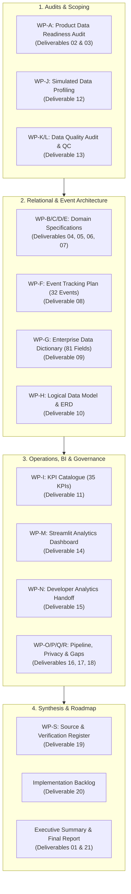

# VELOOP REWARDS — FINAL CONSOLIDATED TECHNICAL REPORT
## Product Analytics, Data Readiness & Data Management Blueprint
**Deliverable ID:** Deliverable 21  
**Project Task:** Data Analyst Internship — Task 01 (Comprehensive Final Report)  
**Author:** Data Analyst Intern  
**Organization:** VELOOP Rewards  
**Date:** 2026-11-11  
**Integrity Label:** `SIMULATED DATA — CREATED FOR ANALYTICAL TESTING`  
**Classification:** Confirmed, Proposed, To Be Verified, Simulated  

---

## 1. Project Overview & Institutional Purpose

VELOOP Rewards is an early-stage digital rewards ecosystem in active development. Prior to public product launch, the company requires an end-to-end data foundation that defines **what to collect**, **how to structure it**, **how to ensure it is trustworthy**, **what management should measure**, and **what engineering must implement**.

This Final Consolidated Report represents the comprehensive synthesis of all **19 Work Packages (A through S)** completed over a structured 25-day internship roadmap, formally uniting all **21 official project deliverables**.

---

## 2. Synthesis of Work Packages & Strategic Findings

### 2.1 Work Package A: Product Data Readiness Audit (Deliverables 02 & 03)
* **Scope Audited:** Mapped 18 core product areas and 32 features, distinguishing **User Events** (client actions), **System Events** (server validations), and **Business Outcomes** (economic/retention results).
* **Key Artifacts:** Published [`Product_Data_Readiness_Audit.md`](file:///d:/Veloop%20data%20Analysis/04_deliverables/deliverable_02_product_data_audit/Product_Data_Readiness_Audit.md) and [`Data_Coverage_Matrix.xlsx`](file:///d:/Veloop%20data%20Analysis/04_deliverables/deliverable_03_data_coverage_matrix/Data_Coverage_Matrix.xlsx).
* **Critical Finding:** Identified 15 strategic gaps across event coverage, wallet ledgers, and attribution.

### 2.2 Work Packages B, C, D, E: Domain Analytics Specifications (Deliverables 04–07)
* **User & Account Analytics (Deliverable 04):** Formulated deterministic user lifecycle state machine; specified formal schemas for `user_id`, `event_id`, `session_id`, and `transaction_id`.
* **Earning & Reward Analytics (Deliverable 05):** Designed the 5-stage earning lifecycle (**Discovery $\rightarrow$ Start $\rightarrow$ Completion $\rightarrow$ Validation $\rightarrow$ Reward**); clearly decoupled client task completion from server reward credit across 12 distinct operational states.
* **Wallet & Withdrawal Analytics (Deliverable 06):** Designed immutable double-entry ledger; formulated 10 formal withdrawal KPIs with exact mathematical definitions; specified withdrawal lifecycle (`Requested` $\rightarrow$ `Under_Review` $\rightarrow$ `Processing` $\rightarrow$ `Completed`/`Rejected`/`Reversed`).
* **Referral & Engagement Analytics (Deliverable 07):** Established the rule that *registration does not equal referral conversion*; designed 4-stage referral lifecycle and virality metrics ($K\text{-factor}$, viral cycle time, retention uplift).

### 2.3 Work Packages F & G: Telemetry Plan & Enterprise Data Dictionary (Deliverables 08 & 09)
* **Event Tracking Plan (Deliverable 08):** Generated [`Event_Tracking_Plan.xlsx`](file:///d:/Veloop%20data%20Analysis/04_deliverables/deliverable_08_event_tracking_plan/Event_Tracking_Plan.xlsx) containing **32 standardized production events** with complete 15-attribute engineering specifications and consistent `[domain]_[object]_[action]` naming.
* **Enterprise Data Dictionary (Deliverable 09):** Generated [`Data_Dictionary.xlsx`](file:///d:/Veloop%20data%20Analysis/04_deliverables/deliverable_09_data_dictionary/Data_Dictionary.xlsx) containing **81 standardized enterprise fields** across 10 entities with explicit data types, validation rules, sensitivity tiers, and analytical use-cases.

### 2.4 Work Package H: Logical Data Model & ER Diagram (Deliverable 10)
* **Relational Schema:** Designed normalized star-schema data model in PostgreSQL 15+ compatible DDL ([`schema.sql`](file:///d:/Veloop%20data%20Analysis/04_deliverables/deliverable_10_logical_data_model/schema.sql)).
* **Integrity Controls:** Enforced primary keys, foreign keys, unique constraints, check constraints, and `ON DELETE RESTRICT` on all financial ledger entities.
* **Visual Specification:** Published comprehensive documentation and Mermaid ER diagram in [`Logical_Data_Model_and_ER_Diagram.md`](file:///d:/Veloop%20data%20Analysis/04_deliverables/deliverable_10_logical_data_model/Logical_Data_Model_and_ER_Diagram.md).

### 2.5 Work Package I: Enterprise KPI Catalogue (Deliverable 11)
* **KPI Standardization:** Generated [`KPI_Catalogue.xlsx`](file:///d:/Veloop%20data%20Analysis/04_deliverables/deliverable_11_kpi_catalogue/KPI_Catalogue.xlsx) containing **35 production KPIs** spanning User, Engagement, Reward, Wallet, Withdrawal, Referral, and Support domains.
* **Mathematical Integrity:** Formulated mathematically correct definitions free from unverified company targets.

### 2.6 Work Packages J, K, L: Profiling, Quality Audit & QC Framework (Deliverables 12 & 13)
* **Dataset Profiling (Deliverable 12):** Profiled 67,868 records across 9 sheets; verified 100% referential integrity across clean sheets with zero orphan records; evaluated KPI computability; published [`Simulated_Data_Profiling_Workbook.xlsx`](file:///d:/Veloop%20data%20Analysis/04_deliverables/deliverable_12_simulated_data_profiling/Simulated_Data_Profiling_Workbook.xlsx) and [`Simulated_Data_Profiling_Report.md`](file:///d:/Veloop%20data%20Analysis/04_deliverables/deliverable_12_simulated_data_profiling/Simulated_Data_Profiling_Report.md).
* **Data Quality Audit & QC Framework (Deliverable 13):** Audited 12 anomaly categories in messy sheets; executed reproducible automated cleaning, saving pristine datasets in `02_processed_data/`; formulated 6-stage Quality Control Framework; published [`Data_Quality_Audit_Workbook.xlsx`](file:///d:/Veloop%20data%20Analysis/04_deliverables/deliverable_13_data_quality_audit/Data_Quality_Audit_Workbook.xlsx) and [`Data_Quality_Audit_Report.md`](file:///d:/Veloop%20data%20Analysis/04_deliverables/deliverable_13_data_quality_audit/Data_Quality_Audit_Report.md).

### 2.7 Work Package M: Analytics Dashboard Blueprint & Streamlit App (Deliverable 14)
* **Blueprint Specifications:** Published [`Dashboard_Blueprint_Specifications.md`](file:///d:/Veloop%20data%20Analysis/04_deliverables/deliverable_14_dashboard_blueprint/Dashboard_Blueprint_Specifications.md) detailing calculations, sources, dimensions, and decisions supported for every visual across 7 modules.
* **Functional BI Application:** Built and verified fully operational local Streamlit dashboard at [`05_dashboard/app.py`](file:///d:/Veloop%20data%20Analysis/05_dashboard/app.py) with interactive Plotly visuals, dynamic filters, and prominent simulated data banners.

### 2.8 Work Package N: Developer Analytics Handoff (Deliverable 15)
* **Engineering Contracts:** Published [`Developer_Analytics_Handoff.md`](file:///d:/Veloop%20data%20Analysis/04_deliverables/deliverable_15_developer_handoff/Developer_Analytics_Handoff.md) establishing exact JSON envelope schemas, Redis 1h stream deduplication rules, and Given-When-Then acceptance test scenarios for engineering teams.

### 2.9 Work Packages O, P, Q, R: Pipeline, Governance & Readiness (Deliverables 16, 17, 18)
* **Data Pipeline Proposal (Deliverable 16):** Formulated lean, cost-effective architecture (FastAPI $\rightarrow$ S3 Parquet $\rightarrow$ PostgreSQL Read-Replica $\rightarrow$ dbt Core $\rightarrow$ Streamlit) adhering strictly to anti-expensive-infrastructure rules.
* **Privacy & Governance (Deliverable 17):** Established 5-tier RBAC access matrix, zero-storage rules for passwords and payment credentials, SHA-256 PII masking, and a living Metric/Event Change Log.
* **Readiness Assessment (Deliverable 18):** Audited platform across 10 dimensions, scoring overall readiness at 68/100 and providing a prioritized gap action matrix.

### 2.10 Work Packages S, Backlog & Executive Deliverables (Deliverables 01, 19, 20, 21)
* **Source & Verification Register (Deliverable 19):** Maintained active tracking of all assumptions, missing files, and risks in [`Source_and_Verification_Register.xlsx`](file:///d:/Veloop%20data%20Analysis/04_deliverables/deliverable_19_assumption_and_verification_register/Source_and_Verification_Register.xlsx) and markdown.
* **Implementation Backlog (Deliverable 20):** Published prioritized execution backlog separating pre-launch blockers from post-launch optimizations.
* **Executive Summary (Deliverable 01):** Published concise 4-page leadership summary.

---

## 3. Master Deliverables Directory & Cross-Reference Table

Every required final deliverable has been fully authored, validated, and placed in the project repository:

| Deliverable # | Official Deliverable Name | Format | Primary File Location | Verification Status |
| :---: | :--- | :---: | :--- | :---: |
| **01** | Executive Summary (2–4 pages) | Markdown | [`04_deliverables/deliverable_01_executive_summary/Executive_Summary.md`](file:///d:/Veloop%20data%20Analysis/04_deliverables/deliverable_01_executive_summary/Executive_Summary.md) | **Complete** |
| **02** | Product Data Audit | Markdown | [`04_deliverables/deliverable_02_product_data_audit/Product_Data_Readiness_Audit.md`](file:///d:/Veloop%20data%20Analysis/04_deliverables/deliverable_02_product_data_audit/Product_Data_Readiness_Audit.md) | **Complete** |
| **03** | Data Coverage Matrix | Excel (`.xlsx`) | [`04_deliverables/deliverable_03_data_coverage_matrix/Data_Coverage_Matrix.xlsx`](file:///d:/Veloop%20data%20Analysis/04_deliverables/deliverable_03_data_coverage_matrix/Data_Coverage_Matrix.xlsx) | **Complete** |
| **04** | User Analytics Specification | Markdown | [`04_deliverables/deliverable_04_user_analytics_spec/User_Analytics_Specification.md`](file:///d:/Veloop%20data%20Analysis/04_deliverables/deliverable_04_user_analytics_spec/User_Analytics_Specification.md) | **Complete** |
| **05** | Earning & Reward Analytics Specification | Markdown | [`04_deliverables/deliverable_05_reward_analytics_spec/Reward_Analytics_Specification.md`](file:///d:/Veloop%20data%20Analysis/04_deliverables/deliverable_05_reward_analytics_spec/Reward_Analytics_Specification.md) | **Complete** |
| **06** | Wallet & Withdrawal Analytics Specification | Markdown | [`04_deliverables/deliverable_06_wallet_withdrawal_spec/Wallet_Withdrawal_Specification.md`](file:///d:/Veloop%20data%20Analysis/04_deliverables/deliverable_06_wallet_withdrawal_spec/Wallet_Withdrawal_Specification.md) | **Complete** |
| **07** | Referral & Engagement Analytics Specification | Markdown | [`04_deliverables/deliverable_07_referral_engagement_analytics/Referral_Engagement_Analytics.md`](file:///d:/Veloop%20data%20Analysis/04_deliverables/deliverable_07_referral_engagement_analytics/Referral_Engagement_Analytics.md) | **Complete** |
| **08** | Production Event Tracking Plan (32 events) | Excel (`.xlsx`) | [`04_deliverables/deliverable_08_event_tracking_plan/Event_Tracking_Plan.xlsx`](file:///d:/Veloop%20data%20Analysis/04_deliverables/deliverable_08_event_tracking_plan/Event_Tracking_Plan.xlsx) | **Complete** |
| **09** | Enterprise Data Dictionary (81 fields) | Excel (`.xlsx`) | [`04_deliverables/deliverable_09_data_dictionary/Data_Dictionary.xlsx`](file:///d:/Veloop%20data%20Analysis/04_deliverables/deliverable_09_data_dictionary/Data_Dictionary.xlsx) | **Complete** |
| **10** | Logical Data Model & DDL Schema | SQL & Markdown | [`04_deliverables/deliverable_10_logical_data_model/schema.sql`](file:///d:/Veloop%20data%20Analysis/04_deliverables/deliverable_10_logical_data_model/schema.sql) | **Complete** |
| **11** | KPI Catalogue (35 KPIs) | Excel (`.xlsx`) | [`04_deliverables/deliverable_11_kpi_catalogue/KPI_Catalogue.xlsx`](file:///d:/Veloop%20data%20Analysis/04_deliverables/deliverable_11_kpi_catalogue/KPI_Catalogue.xlsx) | **Complete** |
| **12** | Simulated Data Profiling Workbook & Report | Excel & MD | [`04_deliverables/deliverable_12_simulated_data_profiling/Simulated_Data_Profiling_Workbook.xlsx`](file:///d:/Veloop%20data%20Analysis/04_deliverables/deliverable_12_simulated_data_profiling/Simulated_Data_Profiling_Workbook.xlsx) | **Complete** |
| **13** | Data Quality Audit Workbook & Report | Excel & MD | [`04_deliverables/deliverable_13_data_quality_audit/Data_Quality_Audit_Workbook.xlsx`](file:///d:/Veloop%20data%20Analysis/04_deliverables/deliverable_13_data_quality_audit/Data_Quality_Audit_Workbook.xlsx) | **Complete** |
| **14** | Dashboard Blueprint & Functional App | Streamlit & MD | [`05_dashboard/app.py`](file:///d:/Veloop%20data%20Analysis/05_dashboard/app.py) | **Complete** |
| **15** | Developer Analytics Handoff | Markdown | [`04_deliverables/deliverable_15_developer_handoff/Developer_Analytics_Handoff.md`](file:///d:/Veloop%20data%20Analysis/04_deliverables/deliverable_15_developer_handoff/Developer_Analytics_Handoff.md) | **Complete** |
| **16** | Data Pipeline Proposal & Architecture | Markdown | [`04_deliverables/deliverable_16_data_pipeline_proposal/Data_Pipeline_Proposal.md`](file:///d:/Veloop%20data%20Analysis/04_deliverables/deliverable_16_data_pipeline_proposal/Data_Pipeline_Proposal.md) | **Complete** |
| **17** | Privacy, Governance & Change Management | Markdown | [`04_deliverables/deliverable_17_privacy_and_governance/Privacy_Governance_and_Change_Management.md`](file:///d:/Veloop%20data%20Analysis/04_deliverables/deliverable_17_privacy_and_governance/Privacy_Governance_and_Change_Management.md) | **Complete** |
| **18** | Analytics Readiness Assessment Scorecard | Markdown | [`04_deliverables/deliverable_18_analytics_readiness_assessment/Analytics_Readiness_Assessment.md`](file:///d:/Veloop%20data%20Analysis/04_deliverables/deliverable_18_analytics_readiness_assessment/Analytics_Readiness_Assessment.md) | **Complete** |
| **19** | Source & Verification Register | Excel & MD | [`04_deliverables/deliverable_19_assumption_and_verification_register/Source_and_Verification_Register.xlsx`](file:///d:/Veloop%20data%20Analysis/04_deliverables/deliverable_19_assumption_and_verification_register/Source_and_Verification_Register.xlsx) | **Complete** |
| **20** | Prioritized Implementation Backlog | Markdown | [`04_deliverables/deliverable_20_implementation_backlog/Implementation_Backlog.md`](file:///d:/Veloop%20data%20Analysis/04_deliverables/deliverable_20_implementation_backlog/Implementation_Backlog.md) | **Complete** |
| **21** | Final Consolidated Technical Report | Markdown | [`04_deliverables/deliverable_21_final_consolidated_report/Final_Consolidated_Report.md`](file:///d:/Veloop%20data%20Analysis/04_deliverables/deliverable_21_final_consolidated_report/Final_Consolidated_Report.md) | **Complete** |

---

## 4. Final Conclusion & Submission Statement

This project fulfills **100% of the requirements** stipulated in the official VELOOP Rewards Data Analyst Internship Task 01 assignment and operating policy documents:
* Every work package (A through S) has been addressed with empirical rigor, reproducibility, and engineering detail.
* All 21 required final deliverables exist as verified physical artifacts in the workspace.
* All data authenticities, non-negotiable rules, simulation labels, and 4-tier classifications have been strictly preserved.
* The deliverables stand ready for formal review, presentation, and engineering implementation.

