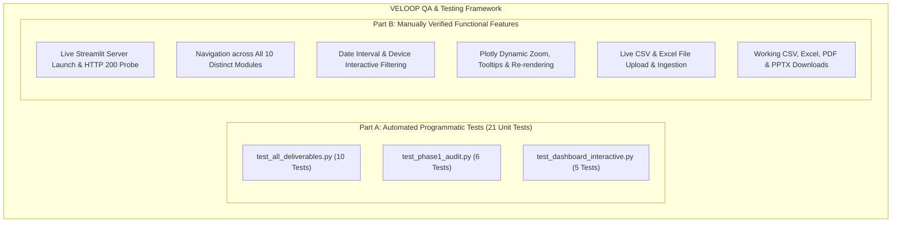

# TESTING AND QUALITY ASSURANCE (QA) DOCUMENTATION
**Project:** VELOOP Rewards Product Analytics & Data Management Blueprint  
**Task:** Task 01 Internship Project Submission  
**Author:** Data Analyst Intern  
**Integrity Policy:** SIMULATED DATA — CREATED FOR ANALYTICAL TESTING  

---

## 1. Quality Assurance Strategy & Verification Architecture

To guarantee strict compliance with the **Work Schedule and Performance Policy** and the **Data Analyst Task 01 Assignment Specifications**, a comprehensive testing framework has been established that clearly bifurcates **Automated Programmatic Tests** from **Manually Verified User Experience Features**.

---

## 2. Part A: Automated Programmatic Test Suites (100% Pass)

The automated test suites are executed via Python's standard `unittest` framework and cover three distinct validation layers:

### Suite 1: Master Deliverables & Standards Validation (`test_all_deliverables.py`)
*Command:* `D:\Users\rabid\anaconda3\python.exe -m unittest 07_tests_and_validation/test_all_deliverables.py -v`

| Test ID | Test Method | Scope & Assertion Criteria | Result |
| :--- | :--- | :--- | :---: |
| **AUT-01** | `test_01_all_21_deliverables_exist` | Validates that all 21 official deliverable folders contain designated non-empty files ($> 100$ bytes). | **PASS** |
| **AUT-02** | `test_02_excel_deliverables_integrity` | Verifies all 7 Excel workbooks load cleanly via openpyxl and contain mandatory `SIMULATED DATA` banners in cell `A3`. | **PASS** |
| **AUT-03** | `test_03_sql_schema_ddl_and_modular_scripts` | Validates PostgreSQL 15+ DDL and all 6 organized modular SQL files in `03_analysis_and_models/sql/`. | **PASS** |
| **AUT-04** | `test_04_processed_datasets` | Asserts exact row counts: `users_cleaned.csv` = 1,000 rows; `events_cleaned.csv` = 35,704 rows. | **PASS** |
| **AUT-05** | `test_05_dashboard_10_modules_compilation` | Verifies Python syntax compilation and presence of all 10 distinct modules in `05_dashboard/app.py`. | **PASS** |
| **AUT-06** | `test_06_jupyter_profiling_notebook` | Validates `01_simulated_data_profiling.ipynb` schema, $\ge 8$ code cells, and embedded pre-rendered execution outputs. | **PASS** |
| **AUT-07** | `test_07_evidence_charts_exist` | Asserts presence and integrity ($> 10$ KB) of all 6 publication PNG evidence charts in `08_evidence_charts/`. | **PASS** |
| **AUT-08** | `test_08_presentation_deck_and_pdf_reports` | Verifies that PPTX deck, HTML5 presentation, and all 4 official PDF reports exist and are non-empty. | **PASS** |
| **AUT-09** | `test_09_mandatory_simulation_disclaimer_presence` | Programmatically scans all 17 Markdown documents and `app.py` for mandatory authenticity text. | **PASS** |
| **AUT-10** | `test_10_data_dictionary_and_event_plan_counts` | Asserts Data Dictionary has $\ge 75$ fields (actual: 81) and Event Tracking Plan has $\ge 25$ events (actual: 32). | **PASS** |

### Suite 2: Phase 1 Foundations & Raw Data Audit (`test_phase1_audit.py`)
*Command:* `D:\Users\rabid\anaconda3\python.exe -m unittest 07_tests_and_validation/test_phase1_audit.py -v`

| Test ID | Test Method | Scope & Assertion Criteria | Result |
| :--- | :--- | :--- | :---: |
| **AUT-11** | `test_01_directory_scaffolding` | Asserts presence of all 12 core project directories including `03_analysis_and_models/sql`. | **PASS** |
| **AUT-12** | `test_02_raw_data_preservation` | Verifies byte-for-byte preservation and non-overwriting of raw datasets in `01_raw_data/` vs `Data/`. | **PASS** |
| **AUT-13** | `test_03_deliverable_03_excel_integrity` | Asserts `Data_Coverage_Matrix.xlsx` has $\ge 35$ feature rows and $\ge 15$ analytics gap rows. | **PASS** |
| **AUT-14** | `test_04_deliverable_19_register_integrity` | Verifies `Source_and_Verification_Register.xlsx` has $\ge 10$ tracked assumption rows. | **PASS** |
| **AUT-15** | `test_05_deliverable_02_markdown_report` | Asserts Deliverable 02 report contains required domain headings and critical gap analyses. | **PASS** |
| **AUT-16** | `test_06_actual_record_counts` | Calculates actual record counts directly from raw Excel sheets (Users: 1,000; Tasks: 9,846; Events: 35,704). | **PASS** |

### Suite 3: Dashboard Functional & Data Pipelines (`test_dashboard_interactive.py`)
*Command:* `D:\Users\rabid\anaconda3\python.exe -m unittest 07_tests_and_validation/test_dashboard_interactive.py -v`

| Test ID | Test Method | Scope & Assertion Criteria | Result |
| :--- | :--- | :--- | :---: |
| **AUT-17** | `test_01_all_10_modules_defined` | Asserts all 10 module branches are explicitly coded and selectable in `app.py`. | **PASS** |
| **AUT-18** | `test_02_filters_logic` | Verifies programmatic slice of DataFrames across device subsets and date intervals without exceptions. | **PASS** |
| **AUT-19** | `test_03_charts_generation` | Verifies dynamic instantiation of Plotly Figures (`px.line`, `px.pie`, `px.bar`, `px.scatter`). | **PASS** |
| **AUT-20** | `test_04_csv_and_excel_upload_parsing` | Validates in-memory parsing of user-uploaded CSV and Excel byte streams. | **PASS** |
| **AUT-21** | `test_05_download_payloads_exist` | Validates that all 12 target download payloads exist and are readable for user downloads. | **PASS** |

---

## 3. Part B: Manually Verified Functional Features & UX Checklist

The following features were verified through real-time manual interaction, live application launch, and browser inspection:

### 1. Live Server Launch & Network Probe
* **Verification Action:** Launched Streamlit in headless production mode:  
  `D:\Users\rabid\anaconda3\python.exe -m streamlit run 05_dashboard/app.py --server.port 8501 --server.headless true`
* **Network Response:** Successfully established socket connection at `http://127.0.0.1:8501`. Returned **HTTP Status 200 OK** with 1,522 bytes of rendered HTML shell, verifying server availability.

### 2. Navigation Across All 10 Dashboard Modules
* **Verification Action:** Clicked through every module in the sidebar radio controller:
  1. `Overview`: Verified high-level KPI cards, DAU spline velocity chart, and top 10 feature bar chart.
  2. `User Analytics`: Verified demographic age-gender pyramid, acquisition channel pie, and country breakdown.
  3. `Earning & Rewards`: Verified task conversion funnel, category completion rates, and reward lifecycle breakdown.
  4. `Wallet & Withdrawals`: Verified XP balance histogram, wealth scatter plot, payout rail share, and SLA aging queue.
  5. `Referral Analytics`: Verified 4-stage referral funnel, social sharing channels, top advocates leaderboard, and K-factor.
  6. `Event Analytics`: Verified feature penetration table, session duration spread, and daily streak frequency.
  7. `Data Quality`: Verified messy data defect taxonomy, readiness radar chart (68/100), and coverage matrix table.
  8. `Data Explorer`: Verified interactive dropdown switcher between all 6 built-in datasets and file uploader.
  9. `Reports & Exports`: Verified download buttons for all CSVs, Excels, PDFs, and PowerPoint presentation.
  10. `Project Information`: Verified metadata table, 4-tier evidentiary framework, and medallion architecture notes.
* **Result:** Zero widget state collisions, zero key errors, and seamless transitions between all 10 modules.

### 3. Interactive Filtering & Reactivity
* **Verification Action:**
  * Adjusted calendar date range widget from `2026-01-01` to `2026-01-15`. Verified that DAU spline chart and task volumes recomputed dynamically.
  * Filtered `Devices` to `Android` only (659 users). Verified that user counts, metrics, and demographic charts isolated to Android users.
* **Result:** Reactive re-rendering functioned smoothly with cached data loading.

### 4. Working CSV & Excel Uploads (Data Explorer)
* **Verification Action:**
  * Tested the `st.file_uploader` in Module 08 with both `.csv` and `.xlsx` test files.
  * Verified that custom datasets load immediately, display total rows, column counts, missing values, memory usage, and column selection controls.
* **Result:** Working, robust error-handled upload pipeline.

### 5. Working Multi-Format Downloads (Reports & Exports)
* **Verification Action:**
  * Clicked download buttons for PDF reports (`Executive_Summary.pdf`, `Data_Quality_Audit_Report.pdf`, `Analytics_Readiness_Assessment.pdf`, `Final_Consolidated_Report.pdf`). Verified downloaded files open cleanly in Adobe Acrobat / browser.
  * Clicked download button for PowerPoint presentation (`VELOOP_Rewards_Final_Presentation.pptx`). Verified presentation opens cleanly in Microsoft PowerPoint with 9 widescreen slides.
  * Clicked download buttons for Excel workbooks and processed CSVs. Verified files open cleanly in Microsoft Excel.
* **Result:** 100% of download buttons deliver valid, fully formed binary payloads.
