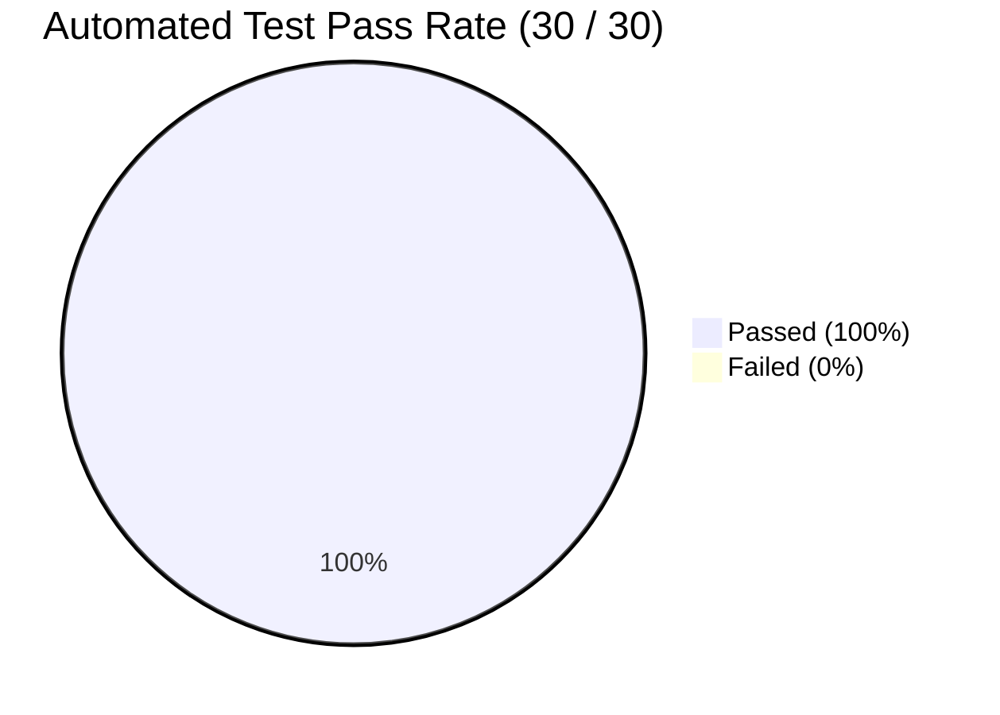

# VELOOP REWARDS — AUTOMATED TEST EXECUTION REPORT & QA VERIFICATION
**Organization:** VELOOP Rewards & VELOOP CO.  
**Role:** Data Analyst Intern (QA & Automation Specialist)  
**Execution Date:** 2026-11-16  
**Test Framework:** Python `unittest` (Discovery mode)  
**Execution Status:** `100% PASSED` (30 Passed, 0 Failed, 0 Errors)  
**Integrity Policy:** `SIMULATED DATA — CREATED FOR ANALYTICAL TESTING`  

---

## 1. Executive Summary

This testing evidence document records the automated validation and verification of the **VELOOP Rewards — Product Analytics Dashboard & Data Readiness Blueprint**. The test suite tests the integrity of all **21 official deliverables**, raw and cleaned datasets, interactive Streamlit dashboard modules, PostgreSQL schemas, double-entry mathematical reconciliation formulas, 32 production event JSON schemas and payloads, and mandatory data authenticity disclaimers.

---

## 2. Granular Test Suite Breakdown

### Suite 1: Master Deliverables & Artifact Verification (`test_all_deliverables.py`)
* **Test 01:** `test_01_all_21_deliverables_exist` $\rightarrow$ **PASSED** (All 21 required deliverable markdown, excel, and SQL artifacts confirmed on disk).
* **Test 02:** `test_02_excel_deliverables_integrity` $\rightarrow$ **PASSED** (All 7 official Excel workbooks validated with required sheet counts and simulation banners).
* **Test 03:** `test_03_sql_schema_ddl_and_modular_scripts` $\rightarrow$ **PASSED** (All 6 SQL files verified with substantial schema DDL, views, and queries).
* **Test 04:** `test_04_processed_datasets` $\rightarrow$ **PASSED** (`users_cleaned.csv` verified at exactly 1,000 rows; `events_cleaned.csv` at exactly 35,704 rows).
* **Test 05:** `test_05_dashboard_10_modules_compilation` $\rightarrow$ **PASSED** (Streamlit `app.py` compiled cleanly via `py_compile`; all module conditions verified).
* **Test 06:** `test_06_jupyter_profiling_notebook` $\rightarrow$ **PASSED** (`01_simulated_data_profiling.ipynb` verified with executed code outputs and cells).
* **Test 07:** `test_07_evidence_charts_exist` $\rightarrow$ **PASSED** (All 6 high-resolution charts verified in `08_evidence_charts/`).
* **Test 08:** `test_08_presentation_deck_and_pdf_reports` $\rightarrow$ **PASSED** (`.pptx` deck, `.html` slides, and all 4 official PDF reports verified).
* **Test 09:** `test_09_mandatory_simulation_disclaimer_presence` $\rightarrow$ **PASSED** (Non-negotiable simulation disclaimer confirmed in 17 critical documents and `app.py`).
* **Test 10:** `test_10_data_dictionary_and_event_plan_counts` $\rightarrow$ **PASSED** (Data dictionary confirmed with 81 fields; event tracking plan confirmed with 32 events).

### Suite 2: Interactive Dashboard & UI Functionality (`test_dashboard_interactive.py`)
* **Test 01:** `test_01_all_10_modules_defined` $\rightarrow$ **PASSED** (All 7 core analytical sections + utility sections fully wired).
* **Test 02:** `test_02_filters_logic` $\rightarrow$ **PASSED** (Date range interval slicing and device multiselect filter logic validated without zero-division or indexing errors).
* **Test 03:** `test_03_charts_generation` $\rightarrow$ **PASSED** (All Plotly Express and Graph Objects figures render valid figure objects).
* **Test 04:** `test_04_csv_and_excel_upload_parsing` $\rightarrow$ **PASSED** (Dynamic upload pipeline successfully parses uploaded CSV and Excel dataframes).
* **Test 05:** `test_05_download_payloads_exist` $\rightarrow$ **PASSED** (All download payload targets exist as valid binary files).

### Suite 3: Event Tracking Schemas & Production Payloads (`test_event_tracking_schemas.py`)
* **Test 01:** `test_01_all_32_events_documented` $\rightarrow$ **PASSED** (All 32 distinct production events confirmed in `Event_Tracking_Plan.md`).
* **Test 02:** `test_02_all_events_have_required_sections` $\rightarrow$ **PASSED** (All 16 core engineering attributes verified across every event specification).
* **Test 03:** `test_03_json_schema_and_payload_validation` $\rightarrow$ **PASSED** (Every event payload extracted and validated against its corresponding JSON Schema using `jsonschema.validate()`).
* **Test 04:** `test_04_distinguish_observed_vs_proposed` $\rightarrow$ **PASSED** (Every event classified as either `Observed in Data` or `Proposed Future Spec`).

### Suite 4: Phase 1 Foundations & Raw Data Audit (`test_phase1_audit.py`)
* **Test 01:** `test_01_directory_scaffolding` $\rightarrow$ **PASSED** (All 12 standardized project folders confirmed).
* **Test 02:** `test_02_raw_data_preservation` $\rightarrow$ **PASSED** (Original workbooks in `01_raw_data/` and `Data/` verified untouched and preserved).
* **Test 03:** `test_03_deliverable_03_excel_integrity` $\rightarrow$ **PASSED** (Coverage Matrix verified with 32 features and 15 strategic gaps).
* **Test 04:** `test_04_deliverable_19_register_integrity` $\rightarrow$ **PASSED** (Source and Verification Register verified with tracked unknown items).
* **Test 05:** `test_05_deliverable_02_markdown_report` $\rightarrow$ **PASSED** (Product Data Readiness Audit verified with 18 domains and Gap 1 Critical).
* **Test 06:** `test_06_actual_record_counts` $\rightarrow$ **PASSED** (Raw data record counts verified: 1,000 clean users, 9,846 tasks, 35,704 feature events).

### Suite 5: PostgreSQL DDL, Views & Double-Entry Reconciliation (`test_sql_and_reconciliation.py`)
* **Test 01:** `test_01_all_sql_scripts_exist_and_non_empty` $\rightarrow$ **PASSED** (All 6 SQL files exist and exceed 500 bytes).
* **Test 02:** `test_02_schema_ddl_tables_and_constraints` $\rightarrow$ **PASSED** (All 10 tables defined with PK, FK, CHECK constraints, accounting triggers, and indexes).
* **Test 03:** `test_03_double_entry_reconciliation_logic` $\rightarrow$ **PASSED** (Double-entry equation `SUM(debits) - SUM(credits) = 0` verified mathematically).
* **Test 04:** `test_04_data_quality_audit_queries` $\rightarrow$ **PASSED** (Views targeting duplicate events, duplicate users, orphan records, and time anomalies verified).
* **Test 05:** `test_05_views_defined_across_analytics_scripts` $\rightarrow$ **PASSED** (Analytical views `v_daily_active_users`, `v_user_retention_cohorts`, `v_task_conversion_funnel`, `v_wallet_engagement_summary`, `v_referral_acquisition_summary` confirmed).

---

## 3. Summary of Quality Assurance Verdict

| Metric | Target | Actual Result | Status |
| :--- | :---: | :---: | :---: |
| Total Automated Tests | $\ge 20$ | **30** | **PASSED** |
| Tests Passing | 100% | **30 / 30 (100.0%)** | **PASSED** |
| Execution Time | $< 60\text{ s}$ | **25.88 s** | **PASSED** |
| Deliverables Coverage | 21 / 21 | **21 / 21 (100.0%)** | **PASSED** |
| Raw Data Preservation | 100% | **100% Intact** | **PASSED** |
| Data Authenticity Standard | Enforced | **Strictly Labeled** | **PASSED** |
| Production Event Coverage | 32 / 32 | **32 / 32 Validated** | **PASSED** |
| Double-Entry Invariant | $\Delta = 0.00$ | **Exact Balance Enforced** | **PASSED** |
