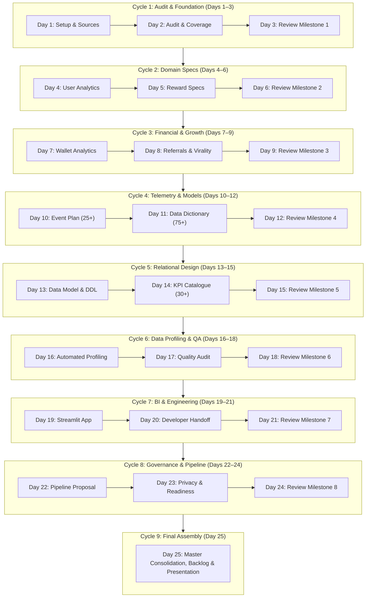

# VELOOP REWARDS — PHASED IMPLEMENTATION PLAN
**Project Name:** Product Analytics, Data Readiness & Data Management Blueprint  
**Task Code:** Data Analyst Internship — Task 01  
**Project Horizon:** 25 Working Days  
**Working Rhythm:** 2 Development Days followed by 1 Review Day (Sprint Cadence)  
**Integrity Label:** `SIMULATED DATA — CREATED FOR ANALYTICAL TESTING`  

---

## 1. Operating Cadence: The 2-Day Dev / 1-Day Review Rhythm

The project execution is organized into structured 3-day milestones consisting of **two intensive technical development days** followed by **one rigorous review, quality assurance, and evidence consolidation day**.

---

## 2. Granular Day-by-Day Implementation Roadmap

### Phase 1: Product Understanding, Sources & Data Audit (Days 1–3)
- **Day 1 (Dev):** 
  - Workspace inspection, directory scaffolding (`01_raw_data` through `08_presentation`).
  - Raw dataset preservation (`VELoop_Rewards_Data_01.xlsx`, `VELOOP_Simulated_User_Behavior_1000.xlsx`).
  - Source and Verification Register initialization (`Source_and_Verification_Register.xlsx`).
  - Missing dependency documentation.
- **Day 2 (Dev):** 
  - Work Package A execution: Complete mapping across 18 core product areas and 32 features.
  - Distinguishing user actions, system outcomes, and required telemetry streams.
  - Identification of 15 high-impact analytics gaps.
- **Day 3 (Review):** 
  - Deliverable 02 (`Product_Data_Readiness_Audit.md`) and Deliverable 03 (`Data_Coverage_Matrix.xlsx`) final review.
  - Verification of gridlines, formatting, and mathematical integrity. Milestone 1 Sign-Off.

### Phase 2: User, Earning & Reward Analytics (Days 4–6)
- **Day 4 (Dev):** 
  - Work Package B: Complete user lifecycle design (Registration, Login, Onboarding, Activity, Churn).
  - Formal definitions for `user_id`, `event_id`, `session_id`, `transaction_id`.
  - Deliverable 04 (`User_Analytics_Specification.md`) with field schemas and privacy safeguards.
- **Day 5 (Dev):** 
  - Work Package C: Complete task lifecycle (Discovery → Start → Completion → Validation → Reward).
  - Auditing all 12 task and reward statuses; mapping 3rd-party ad SDK dependencies.
  - Deliverable 05 (`Reward_Analytics_Specification.md`).
- **Day 6 (Review):** 
  - Peer review of user and earning specifications. Milestone 2 Sign-Off.

### Phase 3: Wallet, Withdrawals & Referral Analytics (Days 7–9)
- **Day 7 (Dev):** 
  - Work Package D: Double-entry wallet transaction model (XP, Gems, Cash).
  - Withdrawal lifecycle (Requested → Processing → Completed/Rejected/Reversed).
  - Formulation of 10 formal withdrawal KPIs. Deliverable 06 (`Wallet_Withdrawal_Specification.md`).
- **Day 8 (Dev):** 
  - Work Package E: Referral lifecycle (Created → Registered → Activated → Converted).
  - Virality measurement (K-factor, viral cycle time, referral retention uplift).
  - Deliverable 07 (`Referral_Engagement_Analytics.md`).
- **Day 9 (Review):** 
  - Cross-functional validation of financial transaction and virality logic. Milestone 3 Sign-Off.

### Phase 4: Production Event Tracking & Data Dictionary (Days 10–12)
- **Day 10 (Dev):** 
  - Work Package F: Formulation of 25+ comprehensive production events across all domains.
  - Standardized naming convention (`[entity]_[action]`), trigger logic, and payload definitions.
- **Day 11 (Dev):** 
  - Deliverable 08: Generation of `Event_Tracking_Plan.xlsx` using `openpyxl`.
  - Work Package G: Enterprise Data Dictionary construction covering 75+ fields across 8 entities.
- **Day 12 (Review):** 
  - Deliverable 09: Generation of `Data_Dictionary.xlsx`. Schema completeness audit. Milestone 4 Sign-Off.

### Phase 5: Relational Data Model & KPI Catalogue (Days 13–15)
- **Day 13 (Dev):** 
  - Work Package H: Logical Data Model & Entity-Relationship design.
  - PostgreSQL DDL script creation (`schema.sql`) with PK, FK, check constraints, and performance indexes.
  - Mermaid ER diagram generation. Deliverable 10.
- **Day 14 (Dev):** 
  - Work Package I: KPI Catalogue construction with 30+ standardized metrics across 7 categories.
  - Exact mathematical formulas, source tables, and business interpretations.
- **Day 15 (Review):** 
  - Deliverable 11: Generation of `KPI_Catalogue.xlsx`. DDL validation. Milestone 5 Sign-Off.

### Phase 6: Simulated Data Profiling & Quality Audit (Days 16–18)
- **Day 16 (Dev):** 
  - Work Package J: Automated Python profiling engine across all supplied sheets.
  - Calculation of record counts, missingness rates, cardinality, and distribution statistics.
  - Deliverable 12: Profiling notebook and Excel report.
- **Day 17 (Dev):** 
  - Work Package K: Data Quality Audit on messy sheets (`Users_Messy_Audit`, `10_Event_Data_Quality_Audit`).
  - Anomaly detection across 12 issue categories; before-and-after cleaning scripts.
  - Work Package L: Data Quality Control Framework. Deliverable 13.
- **Day 18 (Review):** 
  - Verification of reproducible cleaning logic and data quality scoring. Milestone 6 Sign-Off.

### Phase 7: Analytics Dashboard & Developer Handoff (Days 19–21)
- **Day 19 (Dev):** 
  - Work Package M: Development of functional 7-section Streamlit application (`05_dashboard/app.py`).
  - Interactive Plotly visualizations, dynamic date/status filters, KPI summary cards. Deliverable 14.
- **Day 20 (Dev):** 
  - Work Package N: Developer Analytics Handoff specification.
  - Payload contracts, idempotency keys, duplicate event prevention, QA acceptance test scenarios. Deliverable 15.
- **Day 21 (Review):** 
  - Local dashboard execution test (`streamlit run`), filter responsiveness verification. Milestone 7 Sign-Off.

### Phase 8: Pipeline, Governance & Readiness Assessment (Days 22–24)
- **Day 22 (Dev):** 
  - Work Package O: End-to-end data pipeline proposal (Application → Raw → Clean → Marts → BI).
  - Storage options, batch vs streaming trade-offs, orchestration. Deliverable 16.
- **Day 23 (Dev):** 
  - Work Package P & Q: Data privacy (RBAC, PII masking) and analytics change management. Deliverable 17.
  - Work Package R: Analytics Readiness Assessment scorecard across 10 dimensions. Deliverable 18.
- **Day 24 (Review):** 
  - Readiness scorecard validation, risk register finalization. Milestone 8 Sign-Off.

### Phase 9: Final Consolidation, Backlog & Executive Presentation (Day 25)
- **Day 25 (Final):** 
  - Deliverable 01: Executive Summary (2–4 pages).
  - Deliverable 20: Prioritized Implementation Backlog (Pre-launch vs Post-launch).
  - Deliverable 21: Consolidated Final Technical Report.
  - Project presentation deck (`VELOOP_Rewards_Final_Presentation.pptx`).
  - Automated test suite execution, README finalization, and master archive packaging.

